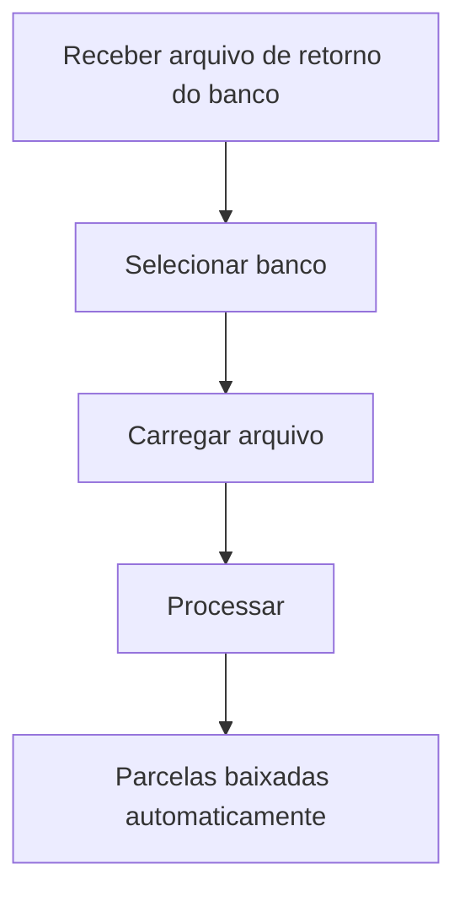

# Baixa Automática

## Objetivo

Dar **baixa automática** nas mensalidades a partir do **arquivo de retorno** do banco — o arquivo
que o banco envia informando quais boletos foram pagos. O sistema processa o retorno e quita as
parcelas correspondentes, sem lançamento manual.

---

## Como acessar

```
Financeiro
→ Bancário
→ Baixa Automática
```

---

## Quando utilizar

- Ao receber o **arquivo de retorno** do banco com os boletos pagos.

---

## Como utilizar

1. Abra **Baixa Automática**.
2. Selecione o **Banco**.
3. Carregue o **arquivo de retorno** do banco.
4. Informe a **Disponível em** (data de disponibilidade do crédito), quando aplicável.
5. Clique em **Processar**.
6. Confira as parcelas baixadas.

---

## Campos

| Campo | Descrição | Obrigatório |
|-------|-----------|-------------|
| Banco | Banco do arquivo de retorno | Sim |
| Arquivo de retorno | Arquivo enviado pelo banco | Sim |
| Disponível em | Data de disponibilidade do crédito | Não |

---

## Botões

| Botão | O que faz |
|-------|-----------|
| **Processar** | Processa o arquivo e dá baixa nas parcelas pagas |

---

## Resultados

- As parcelas pagas via banco são **quitadas automaticamente**, com lançamento no diário.

---

## Regras importantes

- O **banco** selecionado deve corresponder ao arquivo de retorno.
- O arquivo precisa estar no **layout** correto (CNAB do banco).
- Parcelas em datas com caixa encerrado podem exigir atenção.

---

## Fluxo da funcionalidade



---

## Exemplos práticos

**Exemplo:** processar o retorno diário do banco para quitar automaticamente todos os boletos pagos.

---

## Dicas

- Processe o retorno diariamente para manter as mensalidades atualizadas sem baixa manual.

---

## FAQ

**Qual a relação com o Arquivo de Remessa?**
A [Remessa](arquivo-remessa.md) envia os boletos ao banco; a **Baixa Automática** processa o
**retorno** com os que foram pagos.

---

## Prints

- [ ] Seleção do banco e do arquivo.
- [ ] Resultado do processamento.

---

## Histórico

| Data | Alteração |
|------|-----------|
| 30/07/2026 | Página criada. |
