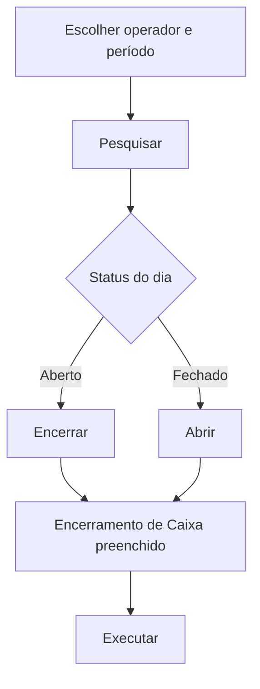

# Consulta de Caixas

## Objetivo

**Consultar a situação dos caixas** (aberto ou fechado) dos operadores em um período: quem
encerrou, quando encerrou e qual o valor. Também é o caminho mais rápido para **encerrar** um
caixa que ficou aberto ou **reabrir** um caixa encerrado — o botão da linha leva direto ao
[Encerramento de Caixa](encerramento-caixa.md), já preenchido.

---

## Como acessar

```
Financeiro
→ Consulta de Caixas
```

*(O nome exato do item de menu depende da configuração de menus da sua escola; o título da tela é
**Consulta de Caixas**.)*

---

## Quando utilizar

- Para descobrir **qual dia ficou com o caixa aberto** depois de ver o aviso amarelo nas telas financeiras.
- Para conferir quem encerrou o caixa e o valor apurado.
- Para reabrir um caixa encerrado por engano.

---

## Como utilizar

1. Abra **Consulta de Caixas**.
2. Escolha o **Operador** (usuários comuns só enxergam o próprio nome; o **Operador de Caixa Master** pode deixar em branco para ver **Todos**).
3. Informe o período em **Data** (obrigatório).
4. Se quiser, filtre por **Status**: **Aberto** ou **Fechado**.
5. Clique em **Pesquisar**.
6. Na linha desejada, clique em **Encerrar** (caixa aberto) ou **Abrir** (caixa fechado). O sistema abre o Encerramento de Caixa com ação, operador e data já escolhidos e já pesquisados — basta conferir e clicar em **Executar**.

*(Print sugerido: filtros preenchidos e lista de caixas com linhas verdes e vermelhas.)*

> **Como usar o campo de período (calendário):** clique no campo, escolha a **data inicial** e depois a
> **data final** (para um único dia, clique duas vezes no mesmo dia). Os botões do calendário são
> **Limpar** (apaga o período), **Hoje** (seleciona o dia de hoje) e **Confirmar** (aplica o período).

---

## Campos

| Campo | Descrição | Obrigatório | Observações |
|-------|-----------|-------------|-------------|
| Operador | Usuário dono do caixa | Sim (usuário comum) | Usuário comum: fixo no próprio nome. Operador de Caixa Master: pode limpar para ver **Todos** |
| Data | Período consultado | Sim | Campo de período (ver acima) |
| Status | Aberto ou Fechado | Não | Em branco = todos |

---

## Botões

| Botão | O que faz |
|-------|-----------|
| **Pesquisar** | Lista os caixas do período |
| **Encerrar** | Aparece nas linhas **abertas**; leva ao Encerramento de Caixa para encerrar aquele dia |
| **Abrir** | Aparece nas linhas **fechadas**; leva ao Encerramento de Caixa para reabrir aquele dia |

---

## Filtros e colunas

Colunas: **Data Caixa**, **Operador**, **Status** (etiqueta vermelha *Aberto* / verde *Fechado*),
**Encerramento Operador**, **Encerramento Data** (com a hora) e **Valor**. A lista mostra 10
linhas por página e fica ordenada do dia mais recente para o mais antigo.

- Linha com fundo **verde claro** = caixa aberto; fundo **vermelho claro** = caixa fechado.
- Quando o valor de um caixa **já fechado** é diferente do que o sistema recalcula hoje (por exemplo, houve lançamento posterior), aparece um **triângulo de alerta laranja** ao lado do valor; passe o mouse para ver *"Valor recalculado hoje: R$ ..."*.
- Um dia só aparece se tiver **movimentação** do operador ou registro de caixa. Dia sem movimento não tem caixa.

---

## Resultados

- Lista dos caixas do período com situação e valor.
- Nada é gravado nesta tela; as ações são feitas no [Encerramento de Caixa](encerramento-caixa.md).

---

## Regras importantes

- **Usuário comum só consulta o próprio caixa.** Apenas o **Operador de Caixa Master** (marcação no cadastro do usuário) consulta outros operadores.
- Caixa **aberto** = tem movimentação e ainda não foi encerrado. Caixa **fechado** = encerrado.
- Valor de caixa **aberto** = total calculado agora; valor de caixa **fechado** = valor gravado no encerramento.

---

## Mensagens do sistema

- *"Selecione o Operador!"*
- *"Você só pode consultar o seu próprio caixa!"*
- *"Selecione o período!"*
- *"Operador não encontrado!"*
- *"Erro ao consultar os caixas!"*
- *"Nenhum caixa encontrado."* (lista vazia)

---

## Fluxo da funcionalidade



---

## Exemplos práticos

**Exemplo:** apareceu o aviso *"Existe caixa aberto de data(s) anterior(es) (05/10/2026)"*. Abra a Consulta de Caixas, pesquise o período, clique em **Encerrar** na linha do dia 05/10 e depois em **Executar**.

---

## Dicas

- Faça a consulta no início do dia: evita ser bloqueado na hora de receber.
- O triângulo laranja indica que vale conferir o que foi lançado depois do encerramento.

---

## Erros comuns

- **Não aparece o operador que procuro** → só o Operador de Caixa Master vê outros operadores.
- **Dia não aparece na lista** → não houve movimentação financeira daquele operador naquele dia.

---

## FAQ

**Qual a diferença para o Encerramento de Caixa?**
A consulta só **mostra**; o [Encerramento de Caixa](encerramento-caixa.md) é quem **encerra ou reabre**.

**Quem é Operador de Caixa Master?**
Usuário marcado com essa opção no cadastro em [Usuários](../gerenciador/usuarios.md).

---

## Prints

- [ ] Filtros e lista de caixas (linhas aberta/fechada).
- [ ] Calendário de período com Limpar / Hoje / Confirmar.
- [ ] Triângulo de alerta de valor divergente.

---

## Histórico

| Data | Alteração |
|------|-----------|
| 07/10/2026 | Página criada (nova tela Consulta de Caixas). |
