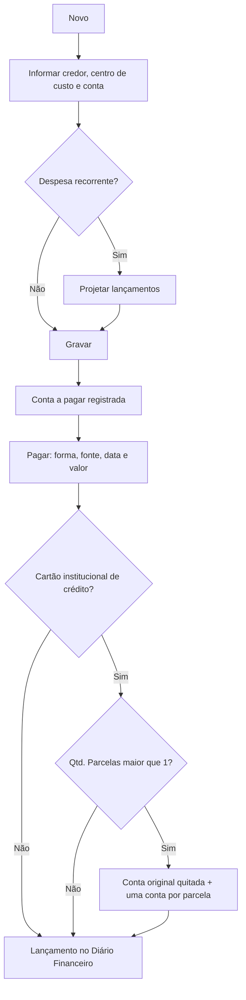
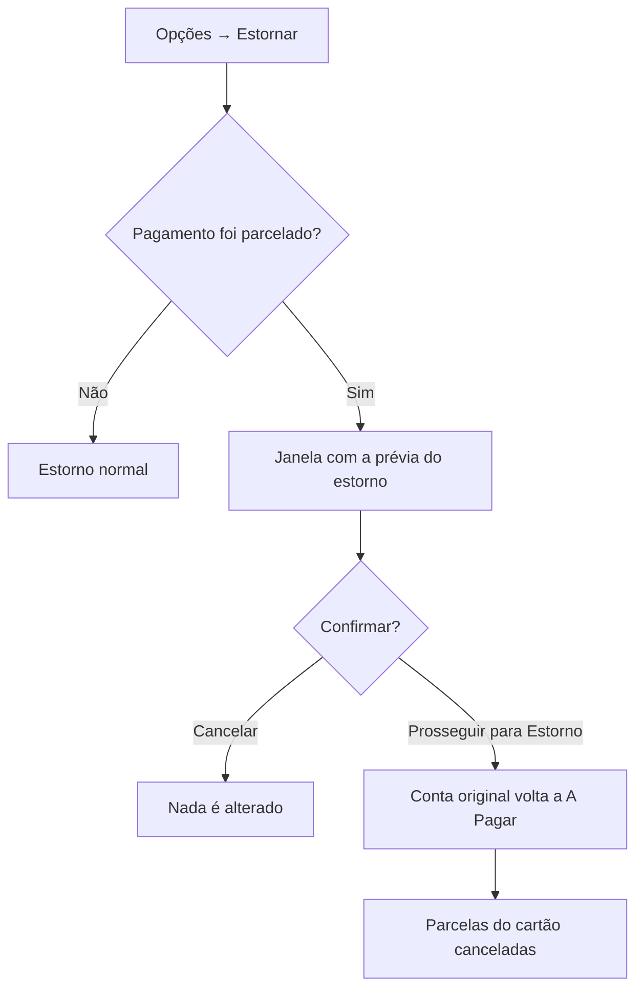

# Contas a Pagar

## Objetivo

Registrar e controlar as **despesas da escola** — o que a instituição tem a pagar a
fornecedores, prestadores e credores. Permite lançar contas, projetar lançamentos recorrentes,
efetuar o pagamento, trocar o credor e emitir o relatório de contas a pagar.

---

## Como acessar

```
Financeiro
→ Contas a Pagar
```

O relatório correspondente fica em:

```
Relatórios
→ Financeiro
→ Contas a Pagar
```

---

## Quando utilizar

- Ao receber uma conta/fatura de fornecedor.
- Para programar despesas recorrentes (aluguel, salários, serviços).
- No momento de **pagar** uma despesa já registrada.

---

## Como utilizar

1. Abra **Contas a Pagar**.
2. Clique em **Novo** para registrar uma despesa.
3. Informe o **Credor**, o **Referente**, o **Centro de Custo** e a **Conta**.
4. Informe o **Valor a Pagar**, a **Data** e o **Vencimento**.
5. Para despesas recorrentes, use **Projetar Lançamentos** e informe a **Qtd. Lançamentos**.
6. Clique em **Gravar**.
7. Para **pagar**, abra a conta, informe **Forma de Pagamento**, **Fonte/Conta**, **Data do
   Pagamento**, eventuais **Juros/Multa/Desconto** e o **Valor Pago**, e grave.

### Pagar parcelado no cartão institucional de crédito

Quando o pagamento é feito com um **cartão institucional de crédito**, é possível dividir a
despesa em parcelas:

1. Em **Forma de Pagamento**, escolha o cartão institucional de crédito.
2. O campo **Qtd. Parcelas** é habilitado, já com o valor **1**.
3. Informe em quantas vezes a despesa foi parcelada.
4. Grave o pagamento.

O sistema então **quita a conta original** e gera **uma conta a pagar para cada parcela** do
cartão, com os vencimentos correspondentes. As parcelas ficam ligadas à conta original, o que
permite estorná-las todas de uma vez.

*(Print sugerido: campo Qtd. Parcelas habilitado após escolher o cartão institucional.)*

:::note Limite de parcelas
O limite de parcelas vem do cadastro do [Cartão Institucional](../tabelas-financeiras/cartao-institucional.md).
Se o cartão não tiver um limite configurado, o sistema aceita até 99 parcelas.
:::

### Estornar um pagamento parcelado

Ao estornar uma conta paga de forma parcelada, o sistema exibe antes a janela
**"⚠️ Informações do Estorno de Pagamento Parcelado"**, mostrando exatamente o que vai acontecer:

| Coluna | O que mostra |
|--------|--------------|
| Documento | Identificação da conta ou da parcela |
| Papel | **Conta Original** ou **Parcela X/Y (Cartão)** |
| Vencimento | Data de vencimento |
| Valor | Valor do lançamento |
| O que vai acontecer? | 🟢 *Será Reativada como A Pagar* (conta original) ou 🔴 *Será Cancelada (Estorno Financeiro)* (parcelas) |

Confira a lista e clique em **Prosseguir para Estorno** para continuar, ou em **Cancelar** para
desistir.

*(Print sugerido: janela de prévia do estorno parcelado.)*

:::tip Conta sugerida pelo credor
Ao **selecionar o credor**, o sistema preenche automaticamente a **Conta** com a **última conta
utilizada** naquele credor, agilizando o lançamento. Você pode trocar a conta normalmente se
necessário — a nova escolha passa a ser a sugerida no próximo lançamento do mesmo credor.
:::

> Durante a gravação, o pagamento, o estorno ou a exclusão, o sistema exibe um **indicador de
> carregamento** e desabilita os botões para evitar cliques duplicados.

*(Print sugerido: formulário de Contas a Pagar.)*

---

## Campos

| Campo | Descrição | Obrigatório | Exemplo | Observações |
|-------|-----------|-------------|---------|-------------|
| Credor | Quem receberá o pagamento | Sim | Papelaria Central | |
| Referente | Descrição da despesa | Sim | Material de escritório | |
| Centro de Custo | Centro de custo da despesa | Sim | Administrativo | Há um centro de custo padrão |
| Conta | Plano de contas da despesa | Sim | Despesas — Materiais | Sugerida automaticamente com a **última conta usada** no credor selecionado |
| Nº Documento | Nº da nota/documento | Não | NF 1234 | |
| Nº da Fatura | Nº da fatura vinculada | Não | 987 | |
| Valor a Pagar | Valor devido | Sim | 500,00 | |
| Data | Data do lançamento | Sim | 30/07/2026 | |
| Vencimento | Data de vencimento | Sim | 10/08/2026 | |
| Projetar Lançamentos | Repete a despesa em vários meses | Não | Sim | |
| Qtd. Lançamentos | Quantas projeções gerar | Condicional | 12 | Quando projeta |
| Forma de Pagamento | Como será pago | No pagamento | Transferência | |
| Fonte / Conta | Origem do valor | No pagamento | Banco X | |
| Data do Pagamento | Data em que foi pago | No pagamento | 10/08/2026 | Não pode ser futura |
| Hora do Pagamento | Hora do pagamento | Não | 14:30 | |
| Juros / Multa / Desconto | Ajustes no pagamento | Não | 0,00 | |
| Desconto Extra | Desconto adicional concedido (antes chamado *Desconto Concedido*) | Não | 0,00 | |
| Data Programada / Valor Programado | Data e valor previstos para o pagamento | No pagamento | 10/08/2026 | Obrigatórios ao registrar o pagamento |
| Valor Pago | Valor efetivamente pago | No pagamento | 500,00 | |
| Cartão Institucional | Vincula a um cartão institucional | Não | — | |
| Qtd. Parcelas | Em quantas vezes a despesa foi parcelada no cartão | Condicional | 6 | Só é habilitado para **cartão institucional de crédito**. Começa em 1; o limite vem do cadastro do cartão (ou 99, se não houver limite) |
| Pagamento efetuado por | Responsável pelo pagamento | Não | Tesouraria | |

---

## Botões

| Botão | O que faz |
|-------|-----------|
| **Novo** | Inicia uma nova conta a pagar |
| **Pesquisar** | Busca contas lançadas |
| **Gravar** | Salva a conta / o pagamento |
| **Salvar** (Alterar Credor) | Confirma a troca de credor |
| **Opções** | Ações do registro (pagar, estornar, excluir, alterar credor) |
| **Mostrar Taxas** | Exibe as taxas relacionadas |
| **Prosseguir para Estorno** | Confirma a prévia do estorno parcelado e abre o estorno |
| **Cancelar** | Fecha sem gravar |

---

## Filtros e colunas (lista)

Colunas: **Credor**, **Referente**, **Nº Documento**, **Fatura**, **Valor** (valor **líquido**: já com os descontos; se há programação, o valor programado com multa e juros), **Vencimento**,
**Data Pagto**, **Valor Pago**, **Ações**.

Há também a opção **Cartão Institucional** e **Alterar Credor** (troca o credor de um lançamento).

Na coluna **Fatura**, quando a conta está vinculada a um **cartão institucional**, um ícone
identifica o tipo:

| Ícone | Significado |
|-------|-------------|
| **C** (verde) | Cartão de **Crédito** institucional (fatura) **já paga/liquidada** |
| **C** (vermelho) | Cartão de **Crédito** institucional (fatura) **em aberto** |
| **D** (azul) | Cartão de **Débito** institucional (débito em conta) |

---

## Resultados

- A despesa fica registrada e, ao ser paga, gera lançamento no **Diário Financeiro**.
- Ao usar **Projetar Lançamentos**, o sistema cria automaticamente as parcelas futuras.

---

## Regras importantes

- **Credor**, **Referente**, **Centro de Custo**, **Conta** e **Valor** são obrigatórios.
- **A Data de Pagamento não pode ser futura** e, quando a escola limita lançamentos retroativos, deve estar dentro do limite de dias.
- **Valor líquido:** a coluna **Valor** e a prévia do estorno parcelado mostram o valor líquido, e o parcelamento no cartão divide o **valor líquido** entre as parcelas (as parcelas não repetem multa, juros nem desconto).
- **Número do documento:** se ficar em branco, o sistema gera um automaticamente.
- Com **caixa aberto de data anterior** ou **caixa de hoje encerrado**, o botão **Novo** e o lápis de edição ficam desabilitados.
- Para trocar o credor é preciso **selecionar um novo credor**.
- Se o **caixa estiver encerrado** para a data do pagamento (ou o **caixa de hoje**, no caso de estorno e pagamento), a operação é bloqueada.
- Registros com pagamento não podem ser excluídos sem **estorno**.
- O **parcelamento** só está disponível para **cartão institucional de crédito**. Nas demais
  formas de pagamento, o campo **Qtd. Parcelas** permanece desabilitado.
- Ao pagar parcelado, o sistema gera **uma conta a pagar por parcela**, vinculada à conta
  original. Não altere essas parcelas manualmente — elas são controladas pelo vínculo.
- No **estorno de um pagamento parcelado**, a conta original volta a ficar **A Pagar** e **todas
  as parcelas geradas são canceladas**. O sistema mostra essa prévia antes de confirmar.

---

## Mensagens do sistema

**Sucesso**
- *"Credor alterado com sucesso!"*
- *"Estorno realizado com sucesso!"*

**Erro**
- *"Selecione um novo credor."* / *"Erro ao alterar o credor."*
- *"Data de Pagamento não pode ser futura."*
- *"Erro ao salvar o registro no Contas a Pagar"*
- *"Erro ao salvar o registro no Diário Financeiro"*
- *"O Caixa está encerrado para a data dd/MM/aaaa para o funcionário X! Não é permitido estorno de pagamento."* (o final muda conforme a ação)
- *"O caixa de hoje (dd/MM/aaaa) está encerrado! Não é permitido lançar valores."*
- *"Conta é obrigatório"* / *"Valor é obrigatório"* / *"Referente é obrigatório."*
- *"Data Programada é obrigatória."* / *"Valor Programado é obrigatório e deve ser maior que zero."*
- *"A data de pagamento excede o limite de N dia(s) para lançamento retroativo no período."* / *"Retroativo permitido até N dia(s)."*

**Confirmação**
- Confirmação de **estorno** e de **exclusão**.
- Estorno parcelado concluído: *"Estornado"* — *"Estorno parcelado realizado com sucesso!"*
- Janela **"⚠️ Informações do Estorno de Pagamento Parcelado"**, com o resumo: *"Ao confirmar, a
  conta original (líquido: R$ ...) para o credor será reativada no Contas a Pagar e as N parcelas do
  cartão serão canceladas."*

---

:::caution Aviso de caixa pendente
Ao abrir esta tela, o sistema confere o **seu caixa**. Se houver **caixa aberto de data anterior**
e/ou o **caixa de hoje já estiver encerrado**, aparece um **aviso amarelo** logo abaixo do título
(fecha no **X**), por exemplo: *"Existe caixa aberto de data(s) anterior(es) (dd/mm/aaaa). Verifique
as pendências no Encerramento de Caixa."* ou *"O caixa de hoje já está encerrado. Verifique o
Encerramento de Caixa antes de continuar."* Enquanto o aviso estiver ativo, o botão de gravar
(Novo) fica **desabilitado**. Resolva a pendência em [Encerramento de Caixa](encerramento-caixa.md)
(a situação de cada dia pode ser consultada em [Consulta de Caixas](consulta-de-caixas.md)).
:::

---

## Fluxo da funcionalidade



### Fluxo do estorno parcelado



---

## Exemplos práticos

**Exemplo 1 — aluguel projetado:** Registrar o aluguel de R$ 3.000,00, com **Projetar
Lançamentos** e **Qtd. Lançamentos** = 12. O sistema cria uma conta por mês. A cada mês,
abra a parcela e efetue o pagamento.

**Exemplo 2 — compra parcelada no cartão da escola:** a escola compra 20 carteiras por
R$ 6.000,00, parceladas em 6 vezes no cartão institucional de crédito. No pagamento, escolha o
cartão, informe **Qtd. Parcelas = 6** e grave. A conta original é quitada e o sistema cria as 6
parcelas de R$ 1.000,00, cada uma com o seu vencimento — o fluxo de caixa dos próximos meses já
fica correto.

---

## Dicas

- Use o **Centro de Custo** correto — ele alimenta os relatórios gerenciais.
- Para despesas fixas, **projete os lançamentos** em vez de digitar mês a mês.
- Não confunda **Projetar Lançamentos** com **Qtd. Parcelas**: o primeiro repete uma despesa
  recorrente antes do pagamento; o segundo divide **um pagamento já feito** no cartão da escola.
- Leia a **prévia do estorno parcelado** antes de confirmar — ela mostra exatamente quais
  lançamentos serão reativados e quais serão cancelados.

---

## Erros comuns

- **"Selecione um novo credor."** → ao alterar o credor, escolha o novo antes de salvar.
- **Pagamento com data futura** → ajuste a data do pagamento.
- **O campo Qtd. Parcelas está desabilitado** → a forma de pagamento escolhida não é um cartão
  institucional **de crédito**. Só nele o parcelamento é permitido.
- **Apareceram várias contas a pagar depois de um único pagamento** → é o comportamento esperado
  do pagamento parcelado: uma conta por parcela do cartão.

---

## FAQ

**Posso mudar o credor depois de lançar?**
Sim, use **Alterar Credor**, selecione o novo credor e clique em **Salvar**.

**Como cancelo um pagamento?**
Use **Opções → Estornar**.

**Posso estornar só uma das parcelas do cartão?**
Não. O estorno trata o conjunto: a conta original volta a ficar **A Pagar** e **todas** as
parcelas são canceladas.

**Qual o limite de parcelas?**
O que estiver configurado no cadastro do cartão institucional. Sem limite configurado, o sistema
aceita até 99.

---

## Prints

- [ ] Aviso amarelo de caixa pendente.
- [ ] Campo Desconto Extra no formulário.
- [ ] Lista de Contas a Pagar.
- [ ] Formulário com Projetar Lançamentos.
- [ ] Janela **Alterar Credor**.
- [ ] Campo **Qtd. Parcelas** habilitado com cartão institucional de crédito.
- [ ] Janela **Informações do Estorno de Pagamento Parcelado**.

---

## Histórico

| Data | Alteração |
|------|-----------|
| 30/07/2026 | Página criada. Inclui centro de custo padrão, alterar credor, projeção de lançamentos e correções de estorno/alteração. |
| 31/07/2026 | **Conta sugerida** pela última conta usada no credor. **Ícones C/D** na coluna Fatura para diferenciar cartão institucional de crédito e débito. **Indicador de carregamento** ao gravar/pagar/estornar/excluir. |
| 07/08/2026 | Correção na **exclusão** de contas pagas com **cartão institucional**: a taxa do cartão vinculada passa a ser removida junto com o lançamento. |
| 21/08/2026 | Novo **pagamento parcelado no cartão institucional de crédito**: campo **Qtd. Parcelas**, geração de uma conta a pagar por parcela e nova janela de **prévia do estorno parcelado** ("Informações do Estorno de Pagamento Parcelado"), com o detalhamento do que será reativado e do que será cancelado. |
| 07/10/2026 | Coluna **Valor** líquida, **Desconto Extra**, campos de programação obrigatórios, limite retroativo, estorno com motivo e valor líquido, aviso/bloqueio por caixa pendente. |
