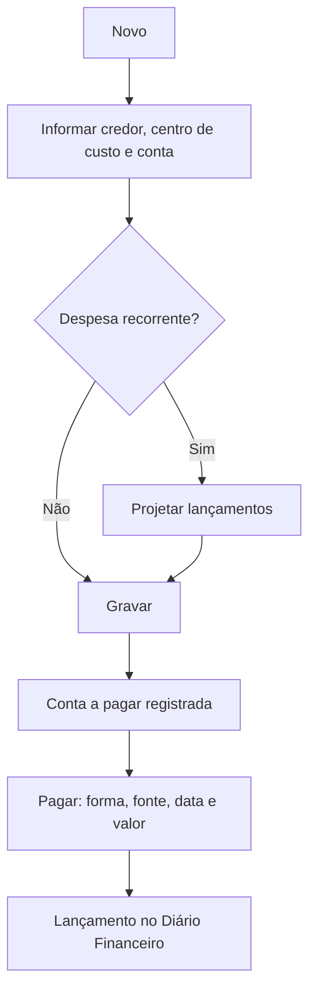

# Contas a Pagar

## Objetivo

Registrar e controlar as **despesas da escola** — o que a instituição tem a pagar a
fornecedores, prestadores e credores. Permite lançar contas, projetar lançamentos recorrentes,
efetuar o pagamento, trocar o credor e emitir o relatório de contas a pagar.

---

## Como acessar

```
Financeiro
→ Contas a Pagar
```

O relatório correspondente fica em:

```
Relatórios
→ Financeiro
→ Contas a Pagar
```

---

## Quando utilizar

- Ao receber uma conta/fatura de fornecedor.
- Para programar despesas recorrentes (aluguel, salários, serviços).
- No momento de **pagar** uma despesa já registrada.

---

## Como utilizar

1. Abra **Contas a Pagar**.
2. Clique em **Novo** para registrar uma despesa.
3. Informe o **Credor**, o **Referente**, o **Centro de Custo** e a **Conta**.
4. Informe o **Valor a Pagar**, a **Data** e o **Vencimento**.
5. Para despesas recorrentes, use **Projetar Lançamentos** e informe a **Qtd. Lançamentos**.
6. Clique em **Gravar**.
7. Para **pagar**, abra a conta, informe **Forma de Pagamento**, **Fonte/Conta**, **Data do
   Pagamento**, eventuais **Juros/Multa/Desconto** e o **Valor Pago**, e grave.

:::tip Conta sugerida pelo credor
Ao **selecionar o credor**, o sistema preenche automaticamente a **Conta** com a **última conta
utilizada** naquele credor, agilizando o lançamento. Você pode trocar a conta normalmente se
necessário — a nova escolha passa a ser a sugerida no próximo lançamento do mesmo credor.
:::

> Durante a gravação, o pagamento, o estorno ou a exclusão, o sistema exibe um **indicador de
> carregamento** e desabilita os botões para evitar cliques duplicados.

*(Print sugerido: formulário de Contas a Pagar.)*

---

## Campos

| Campo | Descrição | Obrigatório | Exemplo | Observações |
|-------|-----------|-------------|---------|-------------|
| Credor | Quem receberá o pagamento | Sim | Papelaria Central | |
| Referente | Descrição da despesa | Sim | Material de escritório | |
| Centro de Custo | Centro de custo da despesa | Sim | Administrativo | Há um centro de custo padrão |
| Conta | Plano de contas da despesa | Sim | Despesas — Materiais | Sugerida automaticamente com a **última conta usada** no credor selecionado |
| Nº Documento | Nº da nota/documento | Não | NF 1234 | |
| Nº da Fatura | Nº da fatura vinculada | Não | 987 | |
| Valor a Pagar | Valor devido | Sim | 500,00 | |
| Data | Data do lançamento | Sim | 30/07/2026 | |
| Vencimento | Data de vencimento | Sim | 10/08/2026 | |
| Projetar Lançamentos | Repete a despesa em vários meses | Não | Sim | |
| Qtd. Lançamentos | Quantas projeções gerar | Condicional | 12 | Quando projeta |
| Forma de Pagamento | Como será pago | No pagamento | Transferência | |
| Fonte / Conta | Origem do valor | No pagamento | Banco X | |
| Data do Pagamento | Data em que foi pago | No pagamento | 10/08/2026 | Não pode ser futura |
| Hora do Pagamento | Hora do pagamento | Não | 14:30 | |
| Juros / Multa / Desconto | Ajustes no pagamento | Não | 0,00 | |
| Valor Pago | Valor efetivamente pago | No pagamento | 500,00 | |
| Cartão Institucional | Vincula a um cartão institucional | Não | — | |
| Pagamento efetuado por | Responsável pelo pagamento | Não | Tesouraria | |

---

## Botões

| Botão | O que faz |
|-------|-----------|
| **Novo** | Inicia uma nova conta a pagar |
| **Pesquisar** | Busca contas lançadas |
| **Gravar** | Salva a conta / o pagamento |
| **Salvar** (Alterar Credor) | Confirma a troca de credor |
| **Opções** | Ações do registro (pagar, estornar, excluir, alterar credor) |
| **Mostrar Taxas** | Exibe as taxas relacionadas |
| **Cancelar** | Fecha sem gravar |

---

## Filtros e colunas (lista)

Colunas: **Credor**, **Referente**, **Nº Documento**, **Fatura**, **Valor**, **Vencimento**,
**Data Pagto**, **Valor Pago**, **Ações**.

Há também a opção **Cartão Institucional** e **Alterar Credor** (troca o credor de um lançamento).

Na coluna **Fatura**, quando a conta está vinculada a um **cartão institucional**, um ícone
identifica o tipo:

| Ícone | Significado |
|-------|-------------|
| **C** (verde) | Cartão de **Crédito** institucional (fatura) **já paga/liquidada** |
| **C** (vermelho) | Cartão de **Crédito** institucional (fatura) **em aberto** |
| **D** (azul) | Cartão de **Débito** institucional (débito em conta) |

---

## Resultados

- A despesa fica registrada e, ao ser paga, gera lançamento no **Diário Financeiro**.
- Ao usar **Projetar Lançamentos**, o sistema cria automaticamente as parcelas futuras.

---

## Regras importantes

- **Credor**, **Referente**, **Centro de Custo**, **Conta** e **Valor** são obrigatórios.
- **A Data de Pagamento não pode ser futura.**
- Para trocar o credor é preciso **selecionar um novo credor**.
- Se o **caixa estiver encerrado** para a data do pagamento, a operação é bloqueada.
- Registros com pagamento não podem ser excluídos sem **estorno**.

---

## Mensagens do sistema

**Sucesso**
- *"Credor alterado com sucesso!"*
- *"Estorno realizado com sucesso!"*

**Erro**
- *"Selecione um novo credor."* / *"Erro ao alterar o credor."*
- *"Data de Pagamento não pode ser futura."*
- *"Erro ao salvar o registro no Contas a Pagar"*
- *"Erro ao salvar o registro no Diário Financeiro"*
- *"O Caixa está encerrado para a data: ..."*

**Confirmação**
- Confirmação de **estorno** e de **exclusão**.

---

## Fluxo da funcionalidade



---

## Exemplos práticos

**Exemplo — aluguel projetado:** Registrar o aluguel de R$ 3.000,00, com **Projetar
Lançamentos** e **Qtd. Lançamentos** = 12. O sistema cria uma conta por mês. A cada mês,
abra a parcela e efetue o pagamento.

---

## Dicas

- Use o **Centro de Custo** correto — ele alimenta os relatórios gerenciais.
- Para despesas fixas, **projete os lançamentos** em vez de digitar mês a mês.

---

## Erros comuns

- **"Selecione um novo credor."** → ao alterar o credor, escolha o novo antes de salvar.
- **Pagamento com data futura** → ajuste a data do pagamento.

---

## FAQ

**Posso mudar o credor depois de lançar?**
Sim, use **Alterar Credor**, selecione o novo credor e clique em **Salvar**.

**Como cancelo um pagamento?**
Use **Opções → Estornar**.

---

## Prints

- [ ] Lista de Contas a Pagar.
- [ ] Formulário com Projetar Lançamentos.
- [ ] Janela **Alterar Credor**.

---

## Histórico

| Data | Alteração |
|------|-----------|
| 30/07/2026 | Página criada. Inclui centro de custo padrão, alterar credor, projeção de lançamentos e correções de estorno/alteração. |
| 31/07/2026 | **Conta sugerida** pela última conta usada no credor. **Ícones C/D** na coluna Fatura para diferenciar cartão institucional de crédito e débito. **Indicador de carregamento** ao gravar/pagar/estornar/excluir. |
| 07/08/2026 | Correção na **exclusão** de contas pagas com **cartão institucional**: a taxa do cartão vinculada passa a ser removida junto com o lançamento. |
