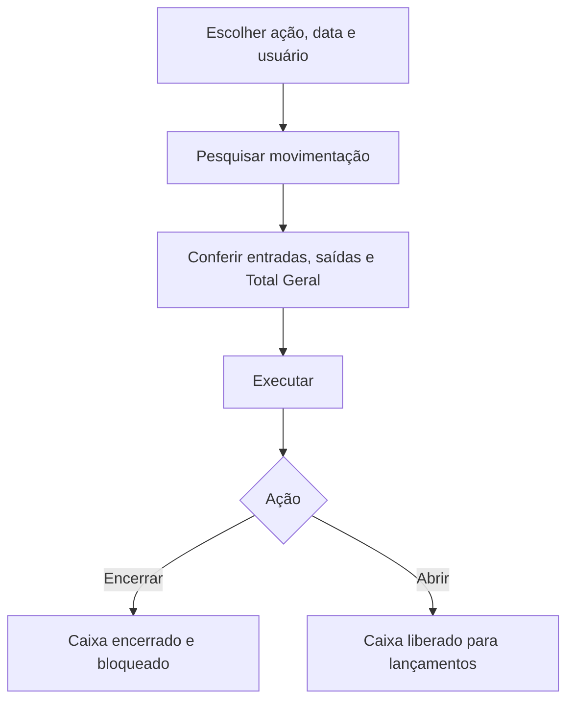

# Encerramento de Caixa

## Objetivo

**Encerrar (fechar) o caixa** de um operador em um dia (ou, para o Operador de Caixa Master, em um
período). Após o encerramento, **nenhuma movimentação financeira pode ser registrada na data
encerrada** — é o fechamento oficial do dia. A tela também permite a ação inversa (**abrir** um
caixa encerrado). **É a única tela que grava o fechamento do caixa**: recebimentos, sangrias,
abastecimentos e pagamentos só movimentam o dia; quem fecha é esta tela.

---

## Como acessar

```
Financeiro
→ Encerramento de Caixa
```

O título da tela é **Encerramento do MeuCaixa - Lançamentos Diários**. Para ver a situação dos
caixas antes de agir, use [Consulta de Caixas](consulta-de-caixas.md).

---

## Quando utilizar

- Ao fechar o caixa do dia, depois de conferir recebimentos, sangrias e saldos.
- Quando o sistema avisa que há **caixa aberto de data anterior**.
- Para **abrir** novamente um caixa encerrado por engano (a quem tiver permissão).

---

## Como utilizar

1. Abra **Encerramento de Caixa**.
2. Em **Ações**, escolha **Encerrar o Caixa** (padrão) ou **Abrir o Caixa**.
3. Informe a **Data** (usuário comum) ou o período **Data Inicial / Data Final** (Operador de Caixa Master) e o **Usuário**.
4. Clique em **Pesquisar** para conferir a movimentação. Para um único dia, o quadro **Status** mostra se o caixa está **Aberto**, **Fechado** ou **inexistente**.
5. Confira **Entradas**, **Saídas**, o **Resumo** e o **Total Geral**.
6. Clique em **Executar**.

Ao escolher **Encerrar o Caixa**, aparece o aviso: *"Após encerrar o caixa, NENHUMA movimentação
financeira poderá ser registrada nesta data."*

*(Print sugerido: tela com Ações, Movimentação de Caixa e Status; depois da pesquisa, com entradas/saídas.)*

> **Como usar o campo de período (calendário):** clique no campo, escolha a **data inicial** e depois a
> **data final** (para um único dia, clique duas vezes no mesmo dia). Os botões do calendário são
> **Limpar** (apaga o período), **Hoje** (seleciona o dia de hoje) e **Confirmar** (aplica o período).

---

## Campos

| Campo | Descrição | Obrigatório | Observações |
|-------|-----------|-------------|-------------|
| Ações | **Abrir o Caixa** ou **Encerrar o Caixa** | Sim | Padrão: Encerrar |
| Data | Dia do caixa | Sim | Para usuário comum (um único dia) |
| Data Inicial / Data Final | Período | Sim | Só para o **Operador de Caixa Master**; encerra um registro por dia |
| Usuário | Operador do caixa | Sim | Usuário comum só vê o próprio nome; Master vê todos |
| Status | Situação do dia pesquisado | — | *Caixa Aberto* (vermelho), *Caixa Fechado* (verde) ou *Caixa inexistente para esse dia* (azul). Só aparece pesquisando **um único dia** |

---

## Botões

| Botão | O que faz |
|-------|-----------|
| **Pesquisar** | Calcula e mostra a movimentação do período |
| **Executar** | Aplica a ação (encerrar/abrir). Fica desabilitado quando a ação é Encerrar e o caixa do dia já está **Fechado** |

---

## Resultados

- **Entradas:** abastecimento, recebimentos em dinheiro e em cartão (Meu Caixa e Outras Fontes).
- **Saídas:** sangrias, estornos e contas pagas.
- **Resumo:** pagamento de mensalidade, baixa, outros recebimentos, estornos e contas a pagar.
- **Total Geral** do dia. Ao encerrar, o valor é gravado por dia.
- O caixa do período fica **encerrado** e bloqueado para novos lançamentos.

---

## Regras importantes

- **Depois de encerrado, nenhuma movimentação pode ser registrada na data.** Nas telas de recebimento/pagamento aparece *"Caixa Encerrado para a ..."* ou *"O caixa de hoje (dd/MM/aaaa) está encerrado! Não é permitido lançar valores."* — veja a [regra no módulo](README.md#regras-gerais-do-módulo).
- O caixa de um dia **existe** quando o operador teve **movimentação** nele (recebimento, pagamento, abastecimento ou sangria). Dia sem movimentação é *"inexistente"* e não é gravado.
- **Transferência de Fonte** e **taxas de cartão** não contam no caixa.
- Só entram nos totais as formas **Dinheiro** e **Cartão**.
- Encerrar um caixa com total zerado, mas com movimentação, **também fecha** o dia (senão ele continuaria pendente).
- **Operador de Caixa Master** (marcação no cadastro de [Usuários](../gerenciador/usuarios.md)) pode escolher um período e qualquer operador; os demais, um dia e só o próprio caixa.
- Reabrir apaga a marca de encerramento do período; reabra com critério.

---

## Mensagens do sistema

**Atenção / erro**
- *"Selecione a Ação"* / *"Selecione a ação!"*
- *"Selecione um período!"*
- *"Selecione um Usuário!"* / *"Selecione o Usuário"*
- *"Este caixa já está encerrado. Para lançar nova movimentação, abra o caixa primeiro."*
- *"Não foi possível identificar o operador selecionado!"*
- *"Erro ao pesquisar a movimentação do caixa!"*
- *"Erro ao salvar!"*
- *"O caixa já estava encerrado para o período selecionado."*

**Sucesso / informação**
- *"Caixa encerrado com sucesso!"* (pode somar: *"N dia(s) já estava(m) encerrado(s)."* e *"N dia(s) sem movimentação não foram gravados."*)
- *"Caixa aberto com sucesso!"*
- *"Não houve movimentação financeira no período. Nada a encerrar."*
- *"Nenhum caixa encerrado foi encontrado para abrir no período."*
- *"Após encerrar o caixa, NENHUMA movimentação financeira poderá ser registrada nesta data."*

---

## Fluxo da funcionalidade



---

## Exemplos práticos

**Exemplo:** ao fim do dia, a recepcionista pesquisa a data de hoje, confere o **Total Geral** com o dinheiro físico e clica em **Executar** com a ação *Encerrar o Caixa*.

**Exemplo (Master):** o financeiro escolhe um período de 5 dias de um operador que esqueceu de fechar e encerra todos de uma vez.

---

## Dicas

- Só encerre depois de **conferir o saldo**.
- Use a [Consulta de Caixas](consulta-de-caixas.md) para achar rapidamente os dias pendentes.

---

## Erros comuns

- **Lançamento bloqueado em outras telas** → o caixa daquela data (ou o de hoje) está encerrado; abra o caixa aqui (com permissão).
- **Botão Executar desabilitado** → o caixa do dia já está fechado.
- **Aviso amarelo em várias telas** → há caixa aberto de data anterior; encerre-o.

---

## FAQ

**Qual a diferença para Encerramento de Movimentação?**
O de caixa fecha o **caixa** por data/usuário; o de [Movimentação](encerramento-movimentacao.md)
consolida a movimentação financeira do período de forma mais ampla.

**A opção "Consulta" sumiu?**
Sim. A consulta agora é a tela [Consulta de Caixas](consulta-de-caixas.md).

---

## Prints

- [ ] Ações, data/usuário e Status.
- [ ] Entradas, saídas, resumo e Total Geral.
- [ ] Campo de período do Operador de Caixa Master.

---

## Histórico


| Data | Alteração |
|------|-----------|
| 30/07/2026 | Página criada. |
| 07/10/2026 | Ações **Abrir/Encerrar** (a opção Consulta saiu), quadro **Status**, **Total Geral**, período para Operador de Caixa Master, encerramento por dia, e passou a ser a **única tela que grava o caixa**. Nova [Consulta de Caixas](consulta-de-caixas.md). |
