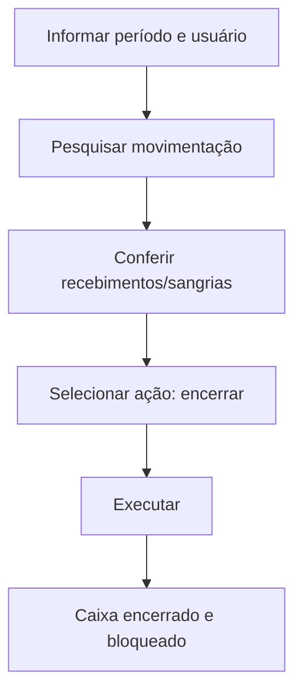

# Encerramento de Caixa

## Objetivo

**Encerrar (fechar) o caixa** de um período/usuário. Após o encerramento, **nenhuma movimentação
financeira pode ser registrada na data encerrada** — é o fechamento oficial do dia. A tela também
permite a ação inversa quando necessário (reabertura), conforme a permissão.

---

## Como acessar

```
Financeiro
→ Encerramento de Caixa
```

---

## Quando utilizar

- Ao fechar o caixa do dia/período, depois de conferir recebimentos, sangrias e saldos.

---

## Como utilizar

1. Abra **Encerramento de Caixa**.
2. Informe **Data Inicial** e **Data Final** e selecione o **Usuário**.
3. Clique em **Pesquisar** para conferir a movimentação.
4. Em **Selecione a ação desejada**, escolha a ação (encerrar/reabrir).
5. Clique em **Executar**.
6. Confirme, ciente de que *"Após encerrar o caixa, NENHUMA movimentação financeira poderá ser
   registrada nesta data."*.

---

## Campos

| Campo | Descrição | Obrigatório |
|-------|-----------|-------------|
| Data Inicial / Data Final | Período a encerrar | Sim |
| Usuário | Operador do caixa | Sim |
| Ação desejada | Encerrar ou reabrir | Sim |

---

## Botões

| Botão | O que faz |
|-------|-----------|
| **Pesquisar** | Lista a movimentação do período |
| **Executar** | Aplica a ação (encerrar/reabrir) |

---

## Resultados

- O caixa do período fica **encerrado** e bloqueado para novos lançamentos.

---

## Regras importantes

- **Depois de encerrado, nenhuma movimentação pode ser registrada na data.** Tentativas mostram
  *"O Caixa está encerrado para a data..."* nas telas de recebimento/pagamento.
- A reabertura, quando permitida, deve ser feita com critério.

---

## Mensagens do sistema

- *"Após encerrar o caixa, NENHUMA movimentação financeira poderá ser registrada nesta data."*

---

## Fluxo da funcionalidade



---

## Exemplos práticos

**Exemplo:** ao fim do dia, encerrar o caixa da recepção após conferir que o saldo bate com o físico.

---

## Dicas

- Só encerre depois de **conferir o saldo** — reabrir depois pode exigir permissão especial.

---

## Erros comuns

- Lançamento bloqueado em outras telas → a data foi encerrada aqui; reabra (com permissão) ou use outra data.

---

## FAQ

**Qual a diferença para Encerramento de Movimentação?**
O de caixa fecha o **caixa** por data/usuário; o de [Movimentação](encerramento-movimentacao.md)
consolida a movimentação financeira do período de forma mais ampla.

---

## Prints

- [ ] Seleção de período e usuário.
- [ ] Confirmação do encerramento.

---

## Histórico

| Data | Alteração |
|------|-----------|
| 30/07/2026 | Página criada. |
