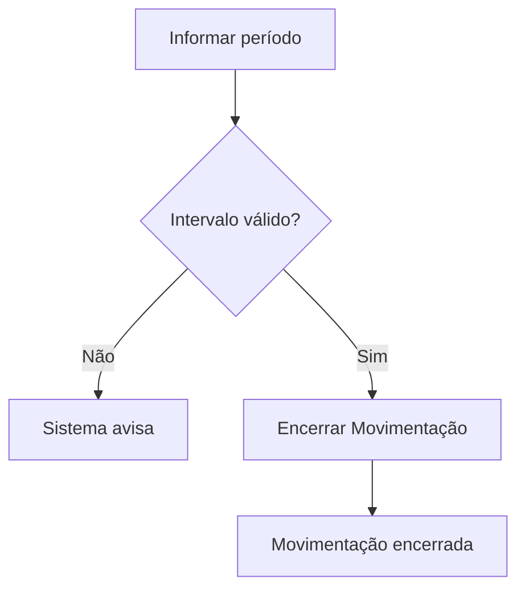

# Encerramento de Movimentação

## Objetivo

**Encerrar a movimentação financeira** de um período — consolidar o intervalo de datas para
fechamento, impedindo novos lançamentos na faixa encerrada. É um fechamento mais amplo que o de
caixa, usado no controle financeiro do período.

---

## Como acessar

```
Financeiro
→ Encerramento de Movimentação
```

---

## Quando utilizar

- Ao fechar a movimentação de um período (ex.: mês) no controle financeiro.

---

## Como utilizar

1. Abra **Encerramento de Movimentação**.
2. Informe **Data Inicial** e **Data Final** do período.
3. Clique em **Encerrar Movimentação**.
4. Aguarde a confirmação *"Movimentação encerrada com sucesso!"*.

---

## Campos

| Campo | Descrição | Obrigatório |
|-------|-----------|-------------|
| Data Inicial | Início do período | Sim |
| Data Final | Fim do período | Sim |

---

## Botões

| Botão | O que faz |
|-------|-----------|
| **Encerrar Movimentação** | Encerra a movimentação do período informado |

---

## Resultados

- A movimentação do período fica encerrada, protegendo os dados já consolidados.

---

## Regras importantes

- O intervalo tem um limite máximo — o sistema avisa se ele for excedido (*"O intervalo não pode ser maior que ..."*).
- Datas inválidas são bloqueadas.

---

## Mensagens do sistema

- *"Movimentação encerrada com sucesso!"*
- *"O intervalo não pode ser maior que ..."*
- *"Data Inválida!"*

---

## Fluxo da funcionalidade



---

## Exemplos práticos

**Exemplo:** encerrar a movimentação do mês de julho após concluir a conciliação.

---

## Dicas

- Faça o encerramento após conferir recebimentos, pagamentos e o diário do período.

---

## Erros comuns

- **"O intervalo não pode ser maior que ..."** → reduza a faixa de datas.

---

## FAQ

**Encerrar movimentação também encerra o caixa?**
São controles distintos; o caixa é fechado no [Encerramento de Caixa](encerramento-caixa.md).

---

## Prints

- [ ] Seleção do período.
- [ ] Mensagem de sucesso.

---

## Histórico

| Data | Alteração |
|------|-----------|
| 30/07/2026 | Página criada. |
