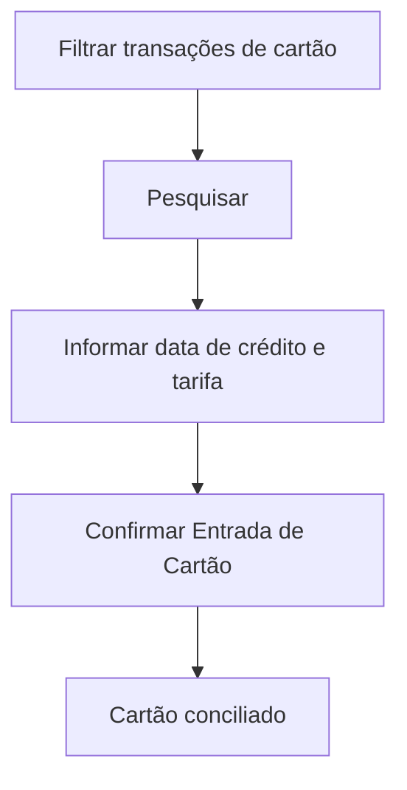

# Entrada de Cartão

## Objetivo

Confirmar a **entrada (crédito) dos pagamentos em cartão** — quando a operadora efetiva o
crédito dos valores recebidos em cartão, registrando a data de crédito e a tarifa cobrada. É a
conciliação das vendas em cartão com o que a operadora deposita.

---

## Como acessar

```
Financeiro
→ Entrada de Cartão
```

---

## Quando utilizar

- Quando a operadora credita os valores das transações de cartão.

---

## Como utilizar

1. Abra **Entrada de Cartão**.
2. Filtre pelos períodos (**Data Lançamento**, **Data Disponível**) e pela **Forma de Pagamento** (cartão).
3. Clique em **Pesquisar** para listar as transações pendentes de crédito.
4. Informe a **Data do Crédito** e o **Valor Tarifa** de cada transação.
5. Clique em **Confirmar Entrada de Cartão**.

---

## Campos

| Campo | Descrição | Obrigatório |
|-------|-----------|-------------|
| Forma de Pagamento | Cartão a conciliar | Sim |
| Data Lançamento (Inicial/Final) | Período de lançamento | Não |
| Data Disponível (Inicial/Final) | Período de disponibilidade | Não |
| Data do Crédito | Data em que a operadora creditou | Sim |
| Valor Tarifa | Tarifa cobrada pela operadora | Não |
| Valor Pagamento | Valor recebido na transação (em R$) | — |
| Nº Documento | Documento da transação | Não |
| Matrícula / Nome | Aluno da transação | — |

---

## Botões

| Botão | O que faz |
|-------|-----------|
| **Pesquisar** | Lista as transações de cartão |
| **Confirmar Entrada de Cartão** | Registra o crédito e a tarifa |

---

## Resultados

- As transações ficam **creditadas**, com a tarifa registrada, conciliando o cartão.

---

## Regras importantes

- Informe a **Data do Crédito** para confirmar a entrada.
- Com **caixa aberto de data anterior** ou **caixa de hoje encerrado**, o botão **Confirmar Entrada de Cartão** fica desabilitado (veja o aviso abaixo).
- Se a escola ativou a **confirmação automática de entrada do cartão** em Parâmetros Financeiros, a baixa é feita pelo sistema; a tela de quitação manual de fatura em [Fatura de Cartão](fatura-cartao.md) fica indisponível.
- A **tarifa** reduz o valor líquido creditado.

---

:::caution Aviso de caixa pendente
Ao abrir esta tela, o sistema confere o **seu caixa**. Se houver **caixa aberto de data anterior**
e/ou o **caixa de hoje já estiver encerrado**, aparece um **aviso amarelo** logo abaixo do título
(fecha no **X**), por exemplo: *"Existe caixa aberto de data(s) anterior(es) (dd/mm/aaaa). Verifique
as pendências no Encerramento de Caixa."* ou *"O caixa de hoje já está encerrado. Verifique o
Encerramento de Caixa antes de continuar."* Enquanto o aviso estiver ativo, o botão de gravar
(Confirmar Entrada de Cartão) fica **desabilitado**. Resolva a pendência em [Encerramento de Caixa](encerramento-caixa.md)
(a situação de cada dia pode ser consultada em [Consulta de Caixas](consulta-de-caixas.md)).
:::

---

## Fluxo da funcionalidade



---

## Exemplos práticos

**Exemplo:** confirmar o crédito das vendas de cartão da semana, informando a data em que caíram
na conta e a tarifa da operadora.

---

## Dicas

- Concilie regularmente para o saldo bancário refletir o líquido do cartão.

---

## FAQ

**Onde recebo o pagamento em cartão inicialmente?**
No [Recebimento de Mensalidade](recebimento-mensalidade.md)/[Outros Recebimentos](outros-recebimentos.md);
aqui você confirma o **crédito** posterior.

---

## Prints

- [ ] Filtros e lista de transações.
- [ ] Confirmação de entrada.
- [ ] Aviso amarelo de caixa pendente.

---

## Histórico

| Data | Alteração |
|------|-----------|
| 30/07/2026 | Página criada. Ajustes nas telas de Cartão/Entrada de Cartão (jul/2026). |
| 07/10/2026 | Nova coluna **Valor Pagamento**; aviso e bloqueio do botão quando há caixa pendente. |
