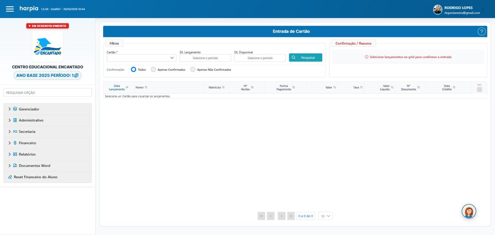
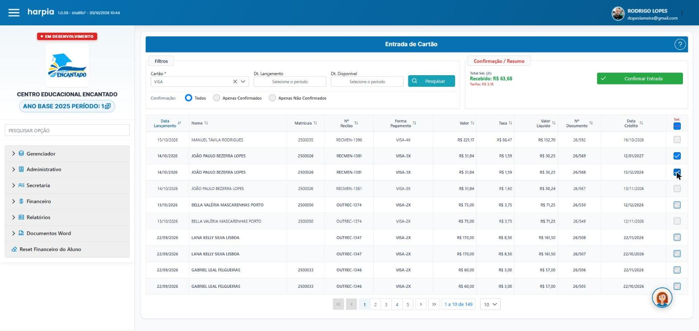
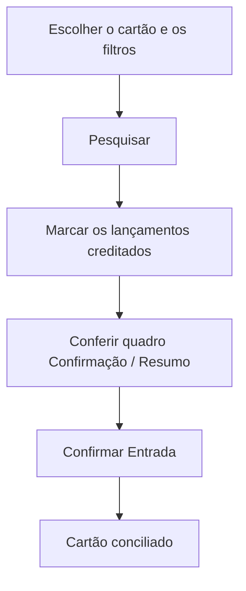

# Entrada de Cartão

## Objetivo

Confirmar a **entrada (crédito) dos pagamentos em cartão** — quando a operadora credita os valores
recebidos em cartão (mensalidades e outros recebimentos). Ao confirmar, o sistema lança a **taxa do
cartão** e baixa os lançamentos, conciliando as vendas em cartão com o que a operadora deposita.

---

## Como acessar

```
Financeiro
→ Entrada de Cartão
```

---

## Quando utilizar

- Quando a operadora credita os valores das transações de cartão.

---

## Como utilizar

1. Abra **Entrada de Cartão**.
2. Selecione o **Cartão** (obrigatório, marcado com asterisco). Se quiser, filtre também por **Dt. Lançamento** e **Dt. Disponível** (campos de período).
3. Escolha a situação em **Confirmação**: **Todos**, **Apenas Confirmados** ou **Apenas Não Confirmados**.
4. Clique em **Pesquisar** para listar os recebimentos em cartão (mensalidades e outros recebimentos).
5. Marque, na coluna de seleção, os lançamentos que a operadora já creditou. A caixa do cabeçalho seleciona ou desmarca todos os pendentes.
6. No quadro **Confirmação / Resumo** (à direita) confira **Total Sel. (N)**, o valor **Recebido** e as **Tarifas**.
7. Clique em **Confirmar Entrada**. O sistema grava a baixa de cada lançamento selecionado usando a **data programada de crédito** do próprio lançamento.





---

## Campos

| Campo/Coluna | Descrição | Obrigatório | Observações |
|--------------|-----------|-------------|-------------|
| Cartão | Cartão/bandeira a conciliar | Sim | Sem cartão: *"Selecione um Cartão para pesquisar."* |
| Dt. Lançamento | Período em que o recebimento foi lançado | Não | Campo de período |
| Dt. Disponível | Período em que o valor fica disponível | Não | Campo de período |
| Confirmação | Todos / Apenas Confirmados / Apenas Não Confirmados | Não | Padrão: Todos |
| Data Lançamento | Dia do recebimento | — | Coluna |
| Nome / Matrícula | Aluno (ou pagador) do recebimento | — | Colunas |
| Nº Recibo | Recibo do recebimento | — | Coluna |
| Forma Pagamento | Cartão e parcelas (ex.: *VISA-3X*) | — | Coluna |
| Valor | Valor recebido | — | Coluna |
| Taxa | Tarifa cobrada pela operadora | — | Coluna |
| Valor Líquido | Valor menos a taxa | — | Coluna |
| Nº Documento | Documento da transação | — | Coluna |
| Data Crédito | Data em que a operadora credita | — | Coluna |

---

## Botões

| Botão | O que faz |
|-------|-----------|
| **Pesquisar** | Lista os recebimentos em cartão conforme os filtros |
| **Confirmar Entrada** | Registra a entrada dos lançamentos selecionados |
| Caixa do cabeçalho (seleção) | Seleciona ou desmarca todos os lançamentos pendentes |

---

## Resultados

- As transações ficam **creditadas**, com a tarifa registrada, conciliando o cartão.

---

## Regras importantes

- A **Data do Crédito** é a data programada do próprio lançamento; não é digitada na confirmação.
- Lançamentos já confirmados aparecem marcados e **não podem ser desmarcados**.
- Com **caixa pendente**, a seleção na lista fica **bloqueada** (dica ao passar o mouse: *"Seleção bloqueada por caixa aberto"*).
- Com **caixa aberto de data anterior** ou **caixa de hoje encerrado**, o botão **Confirmar Entrada** fica desabilitado (veja o aviso abaixo).
- Se a escola ativou a **confirmação automática de entrada do cartão** em Parâmetros Financeiros, a baixa é feita pelo sistema; a tela de quitação manual de fatura em [Fatura de Cartão](fatura-cartao.md) fica indisponível.
- A **tarifa** reduz o valor líquido creditado.

---

:::caution Aviso de caixa pendente
Ao abrir esta tela, o sistema confere o **seu caixa**. Se houver **caixa aberto de data anterior**
e/ou o **caixa de hoje já estiver encerrado**, aparece um **aviso amarelo** logo abaixo do título
(fecha no **X**), por exemplo: *"Existe caixa aberto de data(s) anterior(es) (dd/mm/aaaa). Verifique
as pendências no Encerramento de Caixa."* ou *"O caixa de hoje já está encerrado. Verifique o
Encerramento de Caixa antes de continuar."* Enquanto o aviso estiver ativo, o botão de gravar
(Confirmar Entrada) fica **desabilitado**. Resolva a pendência em [Encerramento de Caixa](encerramento-caixa.md)
(a situação de cada dia pode ser consultada em [Consulta de Caixas](consulta-de-caixas.md)).
:::

---

## Fluxo da funcionalidade



---

## Exemplos práticos

**Exemplo:** na segunda-feira, escolher o cartão "VISA", filtrar a **Dt. Disponível** da semana, marcar os
lançamentos que já caíram na conta e clicar em **Confirmar Entrada**; o quadro mostra quanto foi
recebido e quanto ficou de tarifa.

---

## Dicas

- Concilie regularmente para o saldo bancário refletir o líquido do cartão.

---

## FAQ

**Onde recebo o pagamento em cartão inicialmente?**
No [Recebimento de Mensalidade](recebimento-mensalidade.md)/[Outros Recebimentos](outros-recebimentos.md);
aqui você confirma o **crédito** posterior.

---

## Prints

- [x] **Recapturar:** tela nova (filtros com Confirmação, quadro Confirmação / Resumo e lista com seleção).
- [ ] Confirmação de entrada.
- [ ] Aviso amarelo de caixa pendente.

---

## Histórico

| Data | Alteração |
|------|-----------|
| 30/07/2026 | Página criada. Ajustes nas telas de Cartão/Entrada de Cartão (jul/2026). |
| 07/10/2026 | Nova coluna **Valor Pagamento**; aviso e bloqueio do botão quando há caixa pendente. |
| 30/10/2026 | Tela redesenhada: filtro **Cartão** obrigatório, filtro **Confirmação** (Todos/Confirmados/Não Confirmados), seleção por linha e no cabeçalho, quadro **Confirmação / Resumo** e botão **Confirmar Entrada**. Passa a listar também **recebimentos de mensalidade em cartão**. A data de crédito vem do lançamento. |
