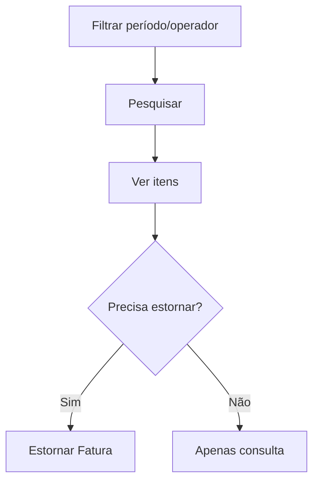

# Fatura de Cartão Quitada

## Objetivo

Consultar as **faturas de cartão institucional já quitadas**, ver seus itens e, quando
necessário, **estornar** uma fatura (desfazer a quitação). É o histórico das faturas pagas.

---

## Como acessar

```
Financeiro
→ Fatura de Cartão - Quitadas
```

---

## Quando utilizar

- Para consultar faturas pagas ou estornar uma quitação feita por engano.

---

## Como utilizar

1. Abra **Fatura de Cartão - Quitadas**.
2. Filtre por **Cartão Institucional**, período de **Dt. Liquidação** (campo de período) e **Operador**.
3. Clique em **Pesquisar** (as faturas mais recentes aparecem primeiro).
4. Use **Ver Itens** para detalhar a fatura (os valores são os líquidos).
5. Para desfazer, marque a fatura em **Sel.**; no quadro **Estorno da Fatura** confira **Total Selecionado** e clique em **Estornar Fatura**.

*(Print sugerido: filtros e quadro Estorno da Fatura.)*

> **Como usar o campo de período (calendário):** clique no campo, escolha a **data inicial** e depois a
> **data final** (para um único dia, clique duas vezes no mesmo dia). Os botões do calendário são
> **Limpar** (apaga o período), **Hoje** (seleciona o dia de hoje) e **Confirmar** (aplica o período).


---

## Campos e colunas

| Campo/Coluna | Descrição |
|--------------|-----------|
| Fatura | Identificação da fatura |
| Cartão Institucional | Cartão da fatura |
| Fonte | Fonte usada na quitação |
| Sel. | Marca a fatura para estorno |
| Valor | Valor liquidado (líquido) |
| Data / Hora Liquidação | Quando foi quitada |
| Operador da Liquidação | Quem quitou |

---

## Botões

| Botão | O que faz |
|-------|-----------|
| **Pesquisar** | Lista as faturas quitadas |
| **Ver Itens** | Detalha os itens da fatura |
| **Estornar Fatura** | Desfaz a quitação da fatura |

---

## Resultados

- Exibe o histórico das faturas quitadas; o estorno devolve a fatura à condição de aberta.

---

## Regras importantes

- O **estorno** reabre a fatura e desfaz os lançamentos da quitação — use com cautela.
- Com **caixa aberto de data anterior** ou **caixa de hoje encerrado**, o botão **Estornar Fatura** fica desabilitado.
- Sem seleção, o quadro mostra *"Selecione uma fatura no grid para estornar"*.

---

:::caution Aviso de caixa pendente
Ao abrir esta tela, o sistema confere o **seu caixa**. Se houver **caixa aberto de data anterior**
e/ou o **caixa de hoje já estiver encerrado**, aparece um **aviso amarelo** logo abaixo do título
(fecha no **X**), por exemplo: *"Existe caixa aberto de data(s) anterior(es) (dd/mm/aaaa). Verifique
as pendências no Encerramento de Caixa."* ou *"O caixa de hoje já está encerrado. Verifique o
Encerramento de Caixa antes de continuar."* Enquanto o aviso estiver ativo, o botão de gravar
(Estornar Fatura) fica **desabilitado**. Resolva a pendência em [Encerramento de Caixa](encerramento-caixa.md)
(a situação de cada dia pode ser consultada em [Consulta de Caixas](consulta-de-caixas.md)).
:::

---

## Fluxo da funcionalidade



---

## Exemplos práticos

**Exemplo:** conferir os itens de uma fatura paga no mês anterior.

---

## Dicas

- Antes de estornar, confirme que a quitação foi realmente indevida.

---

## FAQ

**Como pago uma fatura em aberto?**
Em [Fatura de Cartão](fatura-cartao.md).

---

## Prints

- [ ] Lista de faturas quitadas.
- [ ] Itens da fatura.
- [ ] Quadro Estorno da Fatura com seleção.

---

## Histórico

| Data | Alteração |
|------|-----------|
| 30/07/2026 | Página criada. |
| 07/10/2026 | Layout novo (filtros e quadro **Estorno da Fatura**), filtro **Cartão Institucional**, colunas Cartão e Fonte, valores líquidos, aviso/bloqueio por caixa pendente. |
