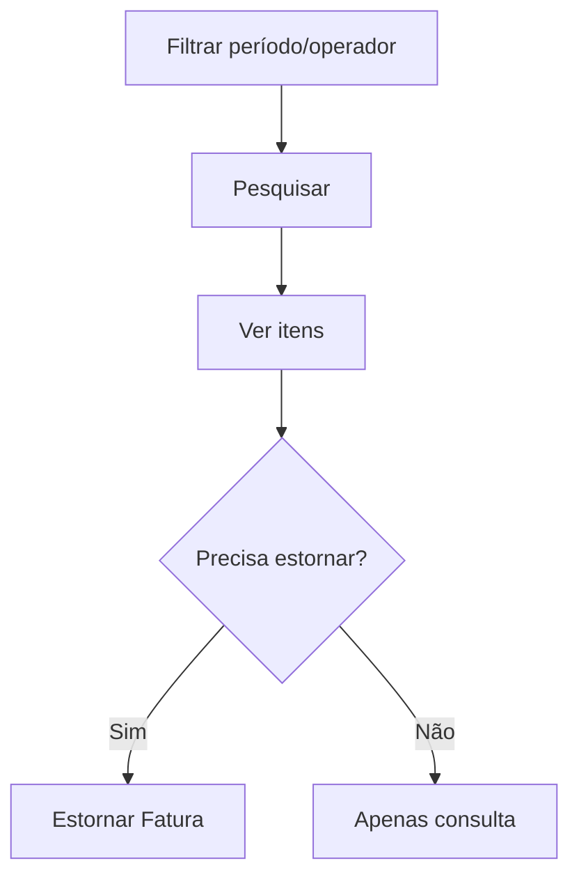

# Fatura de Cartão Quitada

## Objetivo

Consultar as **faturas de cartão institucional já quitadas**, ver seus itens e, quando
necessário, **estornar** uma fatura (desfazer a quitação). É o histórico das faturas pagas.

---

## Como acessar

```
Financeiro
→ Fatura de Cartão Quitada
```

---

## Quando utilizar

- Para consultar faturas pagas ou estornar uma quitação feita por engano.

---

## Como utilizar

1. Abra **Fatura de Cartão Quitada**.
2. Filtre por período (**Data**, **Data Liquidação**) e **Operador**.
3. Clique em **Pesquisar**.
4. Use **Ver Itens** para detalhar a fatura.
5. Se necessário, use **Estornar Fatura** para desfazer a quitação.

---

## Campos e colunas

| Campo/Coluna | Descrição |
|--------------|-----------|
| Fatura | Identificação da fatura |
| Nº Documento | Documento |
| Valor | Valor liquidado |
| Data / Hora Liquidação | Quando foi quitada |
| Operador da Liquidação | Quem quitou |

---

## Botões

| Botão | O que faz |
|-------|-----------|
| **Pesquisar** | Lista as faturas quitadas |
| **Ver Itens** | Detalha os itens da fatura |
| **Estornar Fatura** | Desfaz a quitação da fatura |

---

## Resultados

- Exibe o histórico das faturas quitadas; o estorno devolve a fatura à condição de aberta.

---

## Regras importantes

- O **estorno** reabre a fatura e desfaz os lançamentos da quitação — use com cautela.

---

## Fluxo da funcionalidade



---

## Exemplos práticos

**Exemplo:** conferir os itens de uma fatura paga no mês anterior.

---

## Dicas

- Antes de estornar, confirme que a quitação foi realmente indevida.

---

## FAQ

**Como pago uma fatura em aberto?**
Em [Fatura de Cartão](fatura-cartao.md).

---

## Prints

- [ ] Lista de faturas quitadas.
- [ ] Itens da fatura.

---

## Histórico

| Data | Alteração |
|------|-----------|
| 30/07/2026 | Página criada. |
