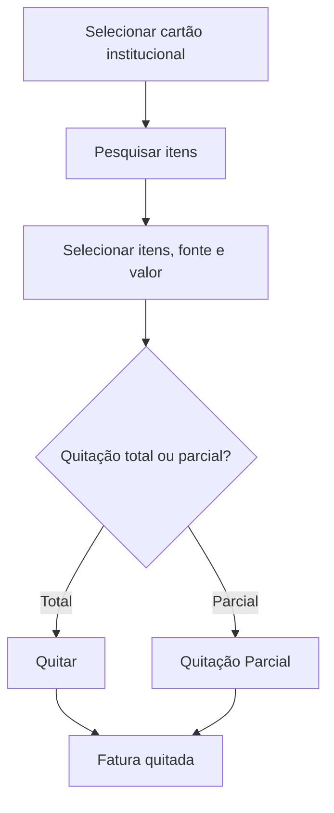

# Fatura de Cartão

## Objetivo

Gerenciar as **faturas de cartão institucional** — as despesas pagas com o cartão da escola,
agrupadas em faturas, permitindo a **quitação** (total ou parcial) da fatura. Complementa
[Contas a Pagar](contas-a-pagar.md).

---

## Como acessar

```
Financeiro
→ Fatura de Cartão - Abertas
```

Faturas já pagas ficam em [Fatura de Cartão Quitada](fatura-cartao-quitada.md).

---

## Quando utilizar

- Para quitar a fatura do cartão institucional no vencimento.

---

## Como utilizar

1. Abra **Fatura de Cartão - Abertas**.
2. Selecione o **Cartão Institucional** (obrigatório) e, se quiser, os períodos **Dt. Vencimento** e **Dt. Pagamento** (campos de período).
3. Clique em **Pesquisar**. Os itens aparecem ordenados por **Nº Documento**.
4. Marque os lançamentos da fatura na coluna **Sel.** (a caixa do cabeçalho seleciona/desmarca todos).
5. No quadro **Quitação da Fatura** (à direita) confira **Total Sel. (N)**, ajuste o **Valor a Pagar** se for pagar menos e escolha a **Fonte**.
6. Clique em **Quitar** e confirme.
7. Se o **Valor a Pagar** for menor que o total, o sistema pergunta se é **Desconto** ou **Quitação Parcial**.
8. Depois de quitar, o quadro continua mostrando o resumo da última quitação até você fazer uma nova pesquisa.

*(Print sugerido: filtros e quadro Quitação da Fatura com itens selecionados.)*
*(Print sugerido: janela de confirmação "Atenção!".)*

> **Como usar o campo de período (calendário):** clique no campo, escolha a **data inicial** e depois a
> **data final** (para um único dia, clique duas vezes no mesmo dia). Os botões do calendário são
> **Limpar** (apaga o período), **Hoje** (seleciona o dia de hoje) e **Confirmar** (aplica o período).

---

## Campos e colunas

| Campo/Coluna | Descrição |
|--------------|-----------|
| Cartão Institucional | Cartão da escola | 
| Credor | Fornecedor do item |
| Referente | Descrição |
| Nº Documento | Documento |
| Dt. Vencimento / Dt. Pagamento | Datas (filtros de período e colunas) |
| Valor | **Valor líquido** do lançamento (o que de fato foi pago/vai na fatura, já com taxas e descontos) |
| Total Sel. (N) | Soma líquida dos N itens marcados |
| Valor a Pagar | Quanto será pago na quitação |
| Fonte | Fonte de pagamento |
| Sel. | Marca o item para a quitação |

---

## Botões

| Botão | O que faz |
|-------|-----------|
| **Pesquisar** | Lista os itens/faturas do cartão |
| **Quitar** | Quita os itens selecionados (pergunta *Desconto* ou *Quitação Parcial* quando o valor é menor) |

---

## Resultados

- A fatura é quitada e passa para [Fatura de Cartão Quitada](fatura-cartao-quitada.md).

---

## Regras importantes

- **Selecione o cartão institucional** antes de operar.
- **A fatura é calculada pelo valor líquido** dos lançamentos (valor pago/líquido, não o valor bruto).
- **Quitação manual bloqueada com confirmação automática:** se em **Parâmetros Financeiros** estiver ativada a *confirmação automática de entrada do cartão*, a tela mostra um cadeado com **"Quitação manual indisponível"** — *"A confirmação automática de entrada do cartão está ativada em Parâmetros Financeiros. As faturas são processadas automaticamente."* e os filtros ficam desabilitados.
- Com **caixa aberto de data anterior** ou **caixa de hoje encerrado**, o botão **Quitar** fica desabilitado.
- É obrigatório escolher a **Fonte**.
- **Valores de quitação maiores que a fatura não são permitidos.**
- Para pagamento de fatura, é preciso ter as **contas de crédito/débito** configuradas em Parâmetros.

---

## Mensagens do sistema

- *"Selecione o cartão institucional"*
- *"Selecione a fonte para quitação da fatura."*
- Confirmação **Atenção!**: *"Confirme se selecionou todos os lançamentos da fatura do cartão. DESEJA PROSSEGUIR COM A QUITAÇÃO?"* (**Sim** / **Não**)
- Janela **Tipo de Desconto** (**Desconto** ou **Quitação Parcial**; **Confirmar** / **Cancelar**)
- *"Registro gravado com sucesso"* (a lista é atualizada sem recarregar a página)
- *"Valores de quitação maiores que de fatura, não são permitidos."*
- *"Para quitação de pagamento de fatura, não pode ser valor menor."*
- *"Informe a conta para CRÉDITO/DÉBITO (Pagamento de Fatura) em Parâmetros"*

---

:::caution Aviso de caixa pendente
Ao abrir esta tela, o sistema confere o **seu caixa**. Se houver **caixa aberto de data anterior**
e/ou o **caixa de hoje já estiver encerrado**, aparece um **aviso amarelo** logo abaixo do título
(fecha no **X**), por exemplo: *"Existe caixa aberto de data(s) anterior(es) (dd/mm/aaaa). Verifique
as pendências no Encerramento de Caixa."* ou *"O caixa de hoje já está encerrado. Verifique o
Encerramento de Caixa antes de continuar."* Enquanto o aviso estiver ativo, o botão de gravar
(Quitar) fica **desabilitado**. Resolva a pendência em [Encerramento de Caixa](encerramento-caixa.md)
(a situação de cada dia pode ser consultada em [Consulta de Caixas](consulta-de-caixas.md)).
:::

---

## Fluxo da funcionalidade



---

## Exemplos práticos

**Exemplo:** quitar a fatura do cartão institucional no vencimento, pela fonte "Banco X".

---

## Dicas

- Configure antes as contas de **crédito/débito** de fatura em Parâmetros, ou a quitação falha.

---

## Erros comuns

- **"Informe a conta para CRÉDITO/DÉBITO..."** → complete os parâmetros de pagamento de fatura.

---

## FAQ

**Onde vejo faturas já pagas?**
Em [Fatura de Cartão Quitada](fatura-cartao-quitada.md).

---

## Prints

- [ ] Lista de itens da fatura.
- [ ] Quitação (total/parcial).
- [ ] Quitação manual indisponível (confirmação automática ativada).

---

## Histórico

| Data | Alteração |
|------|-----------|
| 30/07/2026 | Página criada. |
| 07/10/2026 | Layout novo (quadro **Quitação da Fatura**, filtros de período, botão **Quitar**), **valor líquido**, quitação manual bloqueada com confirmação automática, aviso/bloqueio por caixa pendente. |
