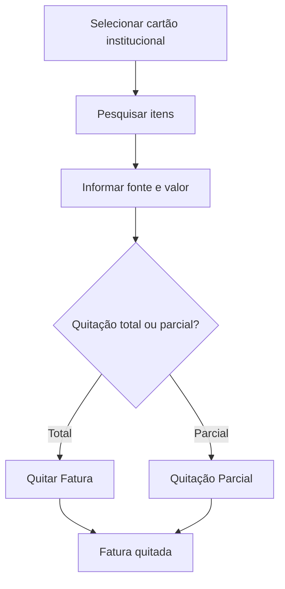

# Fatura de Cartão

## Objetivo

Gerenciar as **faturas de cartão institucional** — as despesas pagas com o cartão da escola,
agrupadas em faturas, permitindo a **quitação** (total ou parcial) da fatura. Complementa
[Contas a Pagar](contas-a-pagar.md).

---

## Quem pode utilizar

Financeiro e Administrador.

---

## Como acessar

```
Financeiro
→ Fatura de Cartão
```

Faturas já pagas ficam em [Fatura de Cartão Quitada](fatura-cartao-quitada.md).

---

## Quando utilizar

- Para quitar a fatura do cartão institucional no vencimento.

---

## Como utilizar

1. Abra **Fatura de Cartão**.
2. Selecione o **Cartão Institucional** e filtre pelo período.
3. Clique em **Pesquisar** para ver os itens/faturas.
4. Informe a **Fonte**, o **Desconto** (se houver) e o **Valor A Pagar**.
5. Clique em **Quitar Fatura** (ou use **Quitação Parcial** para pagar parte).

---

## Campos e colunas

| Campo/Coluna | Descrição |
|--------------|-----------|
| Cartão Institucional | Cartão da escola | 
| Credor | Fornecedor do item |
| Referente | Descrição |
| Nº Documento | Documento |
| Dt. Vencimento / Dt. Pagamento | Datas |
| Valor / Valor A Pagar | Valores |
| Fonte | Fonte de pagamento |
| Desconto | Desconto na quitação |

---

## Botões

| Botão | O que faz |
|-------|-----------|
| **Pesquisar** | Lista os itens/faturas do cartão |
| **Quitar Fatura** | Quita a fatura integralmente |
| **Quitação Parcial** | Quita parte da fatura |

---

## Resultados

- A fatura é quitada e passa para [Fatura de Cartão Quitada](fatura-cartao-quitada.md).

---

## Regras importantes

- **Selecione o cartão institucional** antes de operar.
- **Valores de quitação maiores que a fatura não são permitidos.**
- Para pagamento de fatura, é preciso ter as **contas de crédito/débito** configuradas em Parâmetros.

---

## Mensagens do sistema

- *"Selecione o cartão institucional"*
- *"Valores de quitação maiores que de fatura, não são permitidos."*
- *"Para quitação de pagamento de fatura, não pode ser valor menor."*
- *"Informe a conta para CRÉDITO/DÉBITO (Pagamento de Fatura) em Parâmetros"*

---

## Fluxo da funcionalidade



---

## Exemplos práticos

**Exemplo:** quitar a fatura do cartão institucional no vencimento, pela fonte "Banco X".

---

## Dicas

- Configure antes as contas de **crédito/débito** de fatura em Parâmetros, ou a quitação falha.

---

## Erros comuns

- **"Informe a conta para CRÉDITO/DÉBITO..."** → complete os parâmetros de pagamento de fatura.

---

## FAQ

**Onde vejo faturas já pagas?**
Em [Fatura de Cartão Quitada](fatura-cartao-quitada.md).

---

## Prints

- [ ] Lista de itens da fatura.
- [ ] Quitação (total/parcial).

---

## Histórico

| Data | Alteração |
|------|-----------|
| 30/07/2026 | Página criada. |
