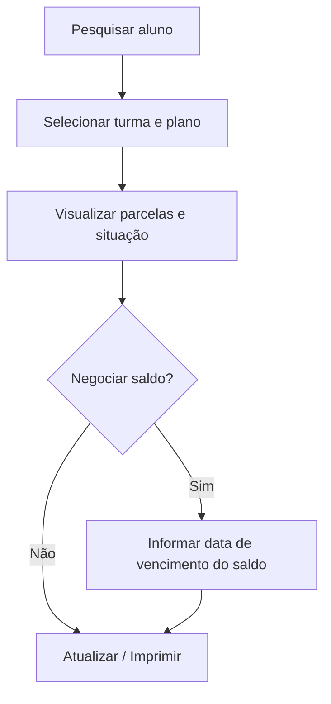

# Ficha Financeira

## Objetivo

Consultar, em um só lugar, **toda a situação financeira de um aluno**: parcelas, vencimentos,
valores de mensalidade, acréscimos, deduções, descontos, valor corrigido, o que já foi pago e o
que está em aberto. Também permite ações sobre as parcelas e a impressão da ficha.

---

## Como acessar

```
Financeiro
→ Ficha Financeira
```

---

## Quando utilizar

- Para conferir a situação de um aluno antes de negociar ou receber.
- Para verificar parcelas em aberto, valores corrigidos e histórico de pagamentos.
- Para gerar a data de vencimento de um saldo em negociação.

---

## Como utilizar

1. Abra **Ficha Financeira**.
2. **Pesquise o aluno**.
3. Selecione a **Turma** e o **Plano de Pagamento**, se houver mais de um.
4. Confira a tabela de parcelas: **Parcela**, **Banco**, **Vencto**, **Mensal.**, **Desc.**,
   **Dedução**, **Acrésc.**, **Total**, **Data**, **Pago**, **Corrigido**, **Sit.**. As colunas do
   grupo **Pagamento** (à direita) detalham o que foi efetivamente recebido.
5. Use **Atualizar** para recalcular os valores após alguma alteração.
6. Se estiver negociando um saldo, informe a **Data de Vencimento do Saldo**.
7. Na coluna de **ações** de cada parcela, é possível **pagar**, **imprimir o recibo** de um
   pagamento e **estornar** um pagamento (ver seção **Ações por parcela**).
8. Use **Imprimir** para emitir a ficha.

*(Print sugerido: ficha financeira do aluno com a tabela de parcelas.)*

---

## Ações por parcela

Cada linha da tabela de parcelas traz botões próprios, que aparecem conforme a situação:

| Botão | O que faz |
|-------|-----------|
| **Pagar mensalidade** (ícone $) | Abre o recebimento da parcela diretamente pela ficha. Fica indisponível para parcela de aluno remanejado |
| **Imprimir recibo** (ícone impressora) | Reimprime o [recibo](recibo.md) de um pagamento já realizado. Um botão por pagamento existente na parcela |
| **Estornar pagamento** (ícone lixeira) | Estorna um pagamento realizado naquela parcela |

Ao expandir a parcela, o **detalhe** exibe os **dados do banco** e a composição dos valores
do pagamento.

> Ao **receber** ou **estornar** a **parcela de matrícula** (selo **M**), a consulta do aluno é
> **atualizada automaticamente** na tela, refletindo a nova situação sem precisar recarregar.

---

## Campos e colunas

| Coluna | Descrição |
|--------|-----------|
| Parcela | Número da parcela e descrição. A **parcela de matrícula** recebe o selo **M** |
| Banco | Banco vinculado à parcela/boleto (código do banco; o nome aparece ao passar o mouse) |
| Vencto | Data de vencimento (vencidas em aberto aparecem em vermelho) |
| Mensal. | Valor da mensalidade |
| Desc. | Desconto |
| Dedução | Valor deduzido |
| Acrésc. | Acréscimos |
| Total | Total da parcela |
| Data | Data e hora do último pagamento |
| Pago | Valor já pago |
| Corrigido | Valor corrigido a pagar (com juros/multa/correção), para parcelas em aberto |
| Sit. | Situação da parcela (em aberto, paga, etc.) |

### Grupo de colunas "Pagamento"

À direita da tabela, um bloco identificado como **Pagamento** detalha o que foi recebido em cada
parcela:

| Coluna | Descrição |
|--------|-----------|
| Desc.+Ext. | Desconto somado ao desconto extra concedido no recebimento |
| M + J | Multa somada aos juros cobrados |
| Déb.Cor. | Débito corrigido considerado no pagamento |
| Dat. Pagto. | Data do último pagamento (permite ordenação) |
| Pago | Valor efetivamente recebido |
| Nº Recibo | Número do recibo emitido para o pagamento |

| Campo | Descrição | Obrigatório | Observações |
|-------|-----------|-------------|-------------|
| Aluno | Aluno consultado | Sim | Pesquisa por nome/matrícula |
| Turma | Turma do aluno | Condicional | Quando há mais de uma |
| Plano de Pagamento | Plano vinculado | Condicional | Quando há mais de um |
| Situação | Situação a considerar | Não | Filtro |
| Data de Vencimento do Saldo | Vencimento do saldo em negociação | Condicional | Obrigatório ao gerar saldo |

---

## Botões

| Botão | O que faz |
|-------|-----------|
| **Atualizar** | Recalcula os valores da ficha |
| **Imprimir** | Emite a ficha financeira |
| **Gravar** | Salva alterações realizadas na ficha |
| **Cancelar** | Fecha sem salvar |

---

## Resultados

- Visão consolidada da situação financeira do aluno.
- Ficha impressa para atendimento/negociação.

---

## Regras importantes

- Para gerar/negociar um saldo, **é preciso informar a Data de Vencimento do Saldo**.
- Os valores exibidos (corrigido, total) são **calculados pelo sistema**; use **Atualizar** após mudanças.
- **Pagamento com data retroativa:** quando a escola ativa o parâmetro *Permitir Pagto./Transf.
  Fonte p/ Data retroativa*, o recebimento pela ficha só aceita datas **dentro do limite de dias**
  configurado. Fora do limite, a operação é bloqueada. Com o parâmetro **desativado**, não há
  limite de dias. Ver [Configurações do Financeiro](../configuracoes/financeiro.md).
- **Parcelamento no cartão:** o campo **Parcelas** só é oferecido para cartões do tipo
  **Parcelado**. Cartões marcados como **RPU** são sempre recebidos em parcela única. Ver
  [Cartão](../tabelas-financeiras/cartao.md).

---

## Mensagens do sistema

**Sucesso**
- *"Estorno realizado com sucesso!"* (ao estornar um pagamento pela ficha)

**Atenção / Erro**
- *"Informe a data de vencimento do saldo para continuar."*
- *"Retroativo permitido até N dia(s)."*
- *"A data de pagamento excede o limite de N dia(s) para lançamento retroativo."*
- *"Erro ao carregar os dados"* / *"Erro na consulta"*

---

## Fluxo da funcionalidade



---

## Exemplos práticos

**Exemplo — conferência antes do recebimento:** Antes de receber, abra a Ficha Financeira do
aluno para ver quais parcelas estão em aberto e o valor corrigido de cada uma.

---

## Dicas

- Sempre clique em **Atualizar** depois de qualquer alteração para ver os valores corretos.

---

## Erros comuns

- **"Informe a data de vencimento do saldo..."** → preencha a data antes de continuar a negociação.
- **"A data de pagamento excede o limite de N dia(s) para lançamento retroativo."** → a data
  informada é anterior ao limite permitido. Use uma data dentro do prazo ou peça ao
  administrador para revisar o parâmetro em
  [Configurações do Financeiro](../configuracoes/financeiro.md).

---

## FAQ

**A ficha mostra o que já foi pago?**
Sim, nas colunas **Pago** e **Data**, junto da situação de cada parcela.

**Onde vejo o número do recibo de um pagamento?**
Na coluna **Nº Recibo**, dentro do grupo **Pagamento**.

**Por que não consigo lançar um pagamento de duas semanas atrás?**
A escola configurou um **limite de dias para lançamento retroativo**. O sistema informa o limite
na própria mensagem.

---

## Prints

- [ ] Ficha financeira com tabela de parcelas — **recapturar** com o grupo de colunas **Pagamento** (Desc.+Ext., M + J, Déb.Cor., Dat. Pagto., Pago, Nº Recibo).
- [ ] Coluna de **ações por parcela** (pagar / imprimir recibo / estornar).
- [ ] Detalhe da parcela com **dados do banco**.
- [ ] Mensagem de bloqueio de pagamento retroativo.

---

## Histórico

| Data | Alteração |
|------|-----------|
| 30/07/2026 | Página criada. Inclui recálculos da ficha e data de vencimento do saldo. |
| 31/07/2026 | **Ações por parcela** (pagar, imprimir recibo e estornar) na própria tabela, com tooltips. Detalhe da parcela passa a exibir **dados do banco**. Ajustes de layout das colunas. |
| 07/08/2026 | Nova coluna **Banco** na tabela de parcelas e selo **M** na **parcela de matrícula**. Ao receber/estornar a parcela de matrícula, a consulta do aluno é **atualizada automaticamente**. |
| 21/08/2026 | Novo grupo de colunas **Pagamento** (Desc.+Ext., M + J, Déb.Cor., Dat. Pagto., Pago e **Nº Recibo**), com ordenação por data de pagamento. Passou a valer o **bloqueio de pagamento retroativo** conforme o limite de dias configurado nas Configurações do Financeiro. Cartões marcados como **RPU** não permitem parcelamento no recebimento. |
