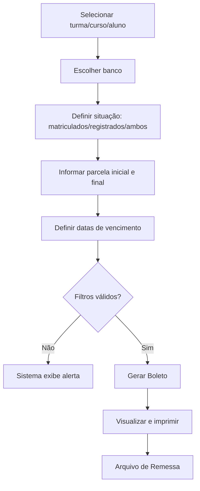

# Geração de Boletos

## Objetivo

Gerar os **boletos das mensalidades** dos alunos, definindo o banco, o intervalo de parcelas e
as datas de vencimento. É a tela usada para produzir os boletos que serão entregues aos
responsáveis ou enviados ao banco.

---

## Como acessar

```
Financeiro
→ Geração de Boletos
```

---

## Quando utilizar

- No início do período/mês, para gerar os boletos das mensalidades.
- Para (re)gerar boletos de uma turma, curso ou aluno específico.

---

## Como utilizar

1. Abra **Geração de Boletos**.
2. Selecione o alcance: **Turma**, **Curso** ou **Aluno**.
3. Escolha o **Banco** que emitirá os boletos, ou use **Considerando o banco do cadastro da
   TURMA** para respeitar o banco definido em cada turma.
4. Defina o público pela situação: **Matriculados**, **Registrados** ou **Ambos**.
5. Informe a **Parcela Inicial** e a **Parcela Final** a gerar.
6. Ajuste as datas de vencimento:
   - **Dia**, **Mês** e **Ano do vencimento**;
   - **Fixar a Data de Vencimento para todas as parcelas**, se quiser a mesma data;
   - **Gerar data de vencimento com o último dia do mês**, se preferir vencer no fim do mês.
7. Se necessário, ajuste **Valor da Parcela** e **Valor do Desconto**.
8. Escolha o **Layout de impressão**: **1 boleto p/ página** ou **3 boletos p/ página**.
9. Clique em **Gerar Boleto**.
10. Visualize o resultado em **Visualização do Boleto** e imprima.

:::note Layout do boleto por banco
A **visualização/impressão** usa o **layout correspondente ao banco selecionado**. Para os bancos
que utilizam o layout **60**, o boleto é apresentado no **modelo de carnê** ("Carnê de Boletos"),
com composição própria do **Nosso Número**. Os demais bancos seguem o layout padrão. A escolha é
**automática**, conforme o cadastro do banco.
:::

:::note Layout de impressão (nº de boletos por página)
O campo **Layout de impressão** define quantos boletos saem em cada página impressa:

- **1 boleto p/ página** — um boleto por folha.
- **3 boletos p/ página** — três boletos por folha, economizando papel.

A seleção é **obrigatória** antes de gerar/imprimir. Ao selecionar o banco, o sistema exibe os
dados bancários (**Agência**, **Carteira**) apenas para conferência — esses campos não são editáveis.
:::

*(Print sugerido: tela de geração com filtros e opções de vencimento.)*

---

## Campos

| Campo | Descrição | Obrigatório | Exemplo | Observações |
|-------|-----------|-------------|---------|-------------|
| Turma / Curso / Aluno | Alcance da geração | Sim | Turma 3ºA | Escolha um dos filtros |
| Banco | Banco emissor dos boletos | Sim | Banco X | Ver opção "banco da turma" |
| Considerando o banco do cadastro da TURMA | Usa o banco definido na turma | Não | — | Alternativa ao banco fixo |
| Para TODOS com o banco informado | Aplica o banco informado a todos | Não | — | |
| Matriculados / Registrados / Ambos | Situação dos alunos incluídos | Sim | Matriculados | |
| Parcela Inicial | Primeira parcela a gerar | Sim | 1 | Não pode ser 0 |
| Parcela Final | Última parcela a gerar | Sim | 12 | Não pode ser 0; ≥ inicial |
| Dia do vencimento | Dia base do vencimento | Sim | 10 | Não pode passar de 31 |
| Mês do vencimento | Mês base | Sim | 08 | |
| Ano do vencimento | Ano base | Sim | 2026 | |
| Fixar a Data de Vencimento para todas as parcelas | Mesma data para todas | Não | — | |
| Gerar data de vencimento com o último dia do mês | Vence no último dia | Não | — | |
| Valor da Parcela | Valor a cobrar | Não | 450,00 | |
| Valor do Desconto | Desconto aplicado | Não | 0,00 | |
| Layout de impressão | Nº de boletos por página | Sim | 1 boleto p/ página | Opções: 1 ou 3 boletos por página |

:::info Valor com dedução
Quando a parcela possui **dedução**, o valor do boleto é calculado já com o abatimento
(**valor da mensalidade − dedução − desconto**), refletindo o valor líquido a cobrar.
:::

---

## Botões

| Botão | O que faz |
|-------|-----------|
| **Gerar Boleto** | Gera os boletos conforme os filtros e datas |
| **Visualização do Boleto** | Mostra os boletos gerados para conferência/impressão |

---

## Resultados

- Os boletos são gerados para as parcelas e alunos selecionados.
- Os boletos ficam prontos para impressão e para inclusão no [Arquivo de Remessa](arquivo-remessa.md).

---

## Regras importantes

- É obrigatório **selecionar ao menos um filtro**: Curso, Turma ou Aluno.
- **Parcela Inicial e Parcela Final não podem ser 0** e a **inicial não pode ser maior que a final**.
- **O dia do vencimento não pode ser superior a 31**; se o dia não existir no mês, o sistema avisa.
- É obrigatório **selecionar um banco** (ou usar o banco do cadastro da turma).
- É obrigatório **selecionar o Layout de impressão** (1 ou 3 boletos por página).
- Alunos configurados para **não imprimir boleto** são ignorados (mensagem *"O aluno não imprime boleto."*).

---

## Mensagens do sistema

**Erro / Atenção**
- *"Selecione ao menos um filtro: Curso, Turma ou Aluno."*
- *"Nenhum banco selecionado."* / *"Seleção do banco é obrigatório."*
- *"Seleção do número de páginas para impressão é obrigatória."*
- *"Parcela Inicial não pode ser 0."* / *"Parcela Final não pode ser 0."*
- *"Parcela Inicial não pode ser maior que a Final."*
- *"Dia do vencimento não pode ser superior a 31."*
- *"O dia ... não existe em [mês]..."*
- *"Nenhum boleto foi gerado"*
- *"O aluno não imprime boleto."*

---

## Fluxo da funcionalidade



---

## Exemplos práticos

**Exemplo — mensalidades do ano:** Gerar as parcelas 1 a 12 da turma 3ºA, banco X, vencimento
todo dia 10. Selecione a turma, o banco, **Parcela Inicial** = 1, **Parcela Final** = 12,
**Dia** = 10 e **Gerar Boleto**.

---

## Dicas

- Use **"Considerando o banco do cadastro da TURMA"** quando cada turma tem seu próprio banco.
- Para vencimentos no fim do mês, prefira **"último dia do mês"** em vez de digitar 30/31.

---

## Erros comuns

- **"Nenhum banco selecionado."** → escolha o banco ou marque a opção de banco da turma.
- **"O dia ... não existe em [mês]..."** → use um dia válido ou a opção de último dia do mês.

---

## FAQ

**Posso gerar só algumas parcelas?**
Sim. Defina **Parcela Inicial** e **Parcela Final**.

**Como enviar os boletos ao banco?**
Depois de gerar, produza o [Arquivo de Remessa](arquivo-remessa.md).

---

## Prints

- [ ] Tela de geração com filtros e o campo **Layout de impressão** — **recapturar**.
- [ ] Visualização do boleto (**novo modelo**, com logo atualizado) — **recapturar**.
- [ ] Visualização em **3 boletos por página**.
- [ ] Visualização do boleto em **modelo de carnê** (bancos com layout 60).

> **Prints a substituir:** as capturas do boleto no modelo anterior estão desatualizadas — o
> layout e o logo mudaram em 08/2026.

---

## Histórico

| Data | Alteração |
|------|-----------|
| 30/07/2026 | Página criada. Inclui geração pelo banco do cadastro da turma, opções de vencimento e ajustes de valores/estilo do boleto. |
| 31/07/2026 | Novo **modelo de carnê** para bancos com layout 60 (seleção automática do layout conforme o banco). |
| 07/08/2026 | **Novo modelo de boleto** (layout e logo atualizados). Novo campo **Layout de impressão** (1 ou 3 boletos por página), de seleção obrigatória. Exibição dos dados bancários (Agência/Carteira) para conferência. Valor do boleto passa a considerar a **dedução** no cálculo do valor líquido. Nova validação de **filtro obrigatório** (Curso/Turma/Aluno). |
