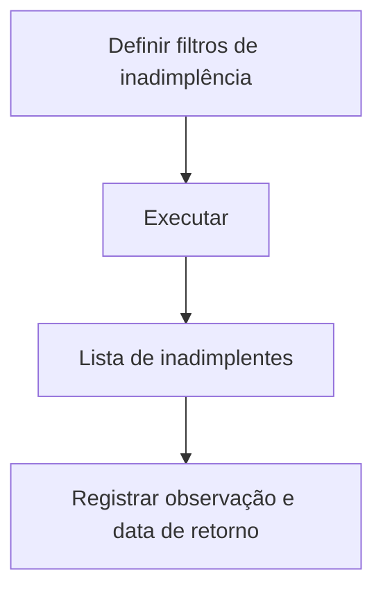

# Inadimplentes — Observações

## Objetivo

Acompanhar os **alunos inadimplentes** e registrar **observações de cobrança** (tratativas,
acordos, data de retorno prometida). É a ferramenta de gestão da inadimplência e do relacionamento
de cobrança.

---

## Quem pode utilizar

Financeiro e Administrador.

---

## Como acessar

```
Financeiro
→ Inadimplentes — Observações
```

---

## Quando utilizar

- Para trabalhar a régua de cobrança e registrar o contato com os responsáveis.

---

## Como utilizar

1. Abra **Inadimplentes — Observações**.
2. Filtre por período de vencimento, **Parcela Inicial/Final** e datas de retorno.
3. Ajuste as opções: **Não considerar débitos referente ao acréscimo** e **Exibir somente os
   alunos com observações registradas**.
4. Clique em **Executar** para listar os inadimplentes.
5. Para cada aluno, registre a **Observação** e a **Data Retorno** (data prometida de pagamento).

---

## Campos e colunas

| Campo/Coluna | Descrição |
|--------------|-----------|
| Parcela Inicial / Final | Faixa de parcelas |
| Data Inicial / Final | Período de vencimento |
| Data de Retorno (Inicial/Final) | Filtro por data de retorno |
| Não considerar débitos referente ao acréscimo | Ignora acréscimos no cálculo do débito |
| Exibir somente alunos com observações | Filtra quem já tem observação |
| Matrícula / Nome / Turma | Identificação do aluno |
| Parcelas Débito / Débito Nor. | Parcelas e valor em aberto |
| Sit / Dia | Situação e dia de vencimento |
| Observação | Anotação da cobrança |
| Data Retorno | Data prometida de pagamento |

---

## Botões

| Botão | O que faz |
|-------|-----------|
| **Executar** | Lista os inadimplentes conforme os filtros |

---

## Resultados

- Lista de inadimplentes com o débito e o registro das tratativas de cobrança.

---

## Regras importantes

- **A data de retorno deve ser futura** (o sistema avisa se for inválida).

---

## Mensagens do sistema

- *"Data de retorno inválida para o aluno [nome]. Deve ser futura."*

---

## Fluxo da funcionalidade



---

## Exemplos práticos

**Exemplo:** listar os inadimplentes com parcelas vencidas no mês, registrar o contato feito e a
data de retorno prometida por cada responsável.

---

## Dicas

- Use **"somente alunos com observações"** para acompanhar as tratativas já iniciadas.

---

## Erros comuns

- **"Data de retorno inválida... Deve ser futura."** → informe uma data futura.

---

## FAQ

**De onde vem o valor do débito?**
Das parcelas em aberto do aluno; a opção de acréscimo permite considerar ou não os acréscimos.

---

## Prints

- [ ] Filtros de inadimplência.
- [ ] Lista com observações e data de retorno.

---

## Histórico

| Data | Alteração |
|------|-----------|
| 30/07/2026 | Página criada. |
