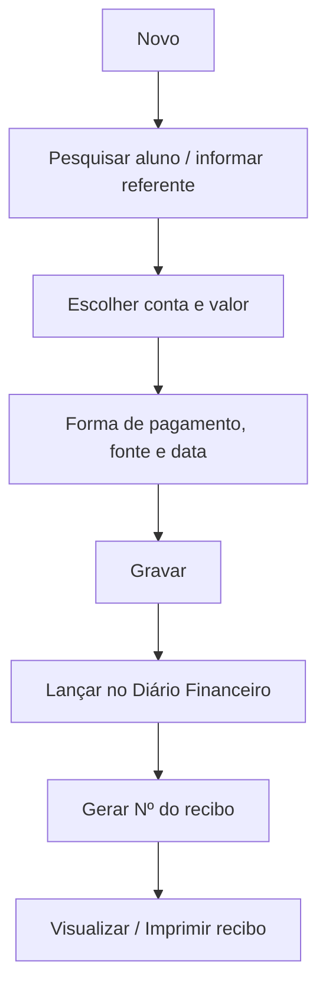

# Outros Recebimentos

## Objetivo

Registrar recebimentos que **não são mensalidade** — por exemplo taxas, materiais, uniformes,
segunda via de documentos, eventos e demais cobranças avulsas. A tela permite lançar o valor,
escolher a forma de pagamento e emitir o **recibo** correspondente.

---

## Quem pode utilizar

Perfis com permissão financeira (Financeiro, Administrador e, em algumas escolas, Secretaria).

---

## Como acessar

```
Financeiro
→ Outros Recebimentos
```

---

## Quando utilizar

- Cobrar valores avulsos ligados (ou não) a um aluno.
- Registrar entradas que precisam de recibo mas não estão vinculadas à mensalidade.

---

## Como utilizar

1. Abra **Outros Recebimentos**.
2. Para um novo lançamento, clique em **Novo**.
3. **Pesquise o aluno** (quando o recebimento for vinculado a um aluno).
4. Informe o **Referente** (descrição do que está sendo cobrado).
5. Escolha o **Plano de Pagamento** / **Conta** e o número de **Qtd. Parcelas**, se aplicável.
6. Informe **Valor**, e **Juros**, **Multa** e **Desconto** quando houver.
7. Escolha a **Forma de Pagamento**, a **Fonte** e a **Data**.
8. Confira o **Total** e o **Valor Pago**.
9. Clique em **Gravar**.
10. Use **Visualizar Recibo** / **Imprimir** para emitir o comprovante.

*(Print sugerido: formulário de Outros Recebimentos preenchido.)*

---

## Campos

| Campo | Descrição | Obrigatório | Exemplo | Observações |
|-------|-----------|-------------|---------|-------------|
| Aluno / Nome | Aluno vinculado ao recebimento | Condicional | Maria Souza | Pesquisa padronizada por aluno |
| Referente | Descrição do que está sendo cobrado | Sim | Taxa de 2ª via | |
| Plano de Pagamento | Plano/condição usada na cobrança | Condicional | Avulso | |
| Conta | Conta/plano de contas do recebimento | Sim | Receitas — Taxas | Mensagem de erro se vazio |
| Qtd. Parcelas | Número de parcelas | Não | 1 | Deve ser maior que 1 quando parcelado |
| Valor | Valor da cobrança | Sim | 30,00 | Mensagem de erro se vazio |
| Juros | Juros aplicados | Não | 0,00 | |
| Multa | Multa aplicada | Não | 0,00 | |
| Desconto | Desconto concedido | Não | 0,00 | |
| Forma de Pagamento | Como o valor foi pago | Sim | Dinheiro | |
| Fonte | Origem/destino do valor | Sim | Caixa | |
| Data | Data do recebimento | Sim | 30/07/2026 | Não pode ser futura |
| Nº Documento | Nº do comprovante | Não | 4567 | |
| Bom Para / Disponível Em | Disponibilidade (cheque/cartão) | Não | 05/08/2026 | |
| Nº Recibo | Número do recibo gerado | — | 000912 | Gerado pelo sistema |
| Pagamento sem valor recebido | Marca como cortesia | Não | — | |

---

## Botões

| Botão | O que faz |
|-------|-----------|
| **Novo** | Inicia um novo recebimento |
| **Pesquisar** | Busca recebimentos já lançados |
| **Gravar** | Registra o recebimento e gera o recibo |
| **Visualizar Recibo** | Mostra o recibo na tela |
| **Imprimir** | Imprime o recibo |
| **Opções** | Abre ações do registro (visualizar recibo, estornar, excluir) |
| **Configurar Impressão do Recibo** | Ajusta o layout/opções do recibo |
| **Cancelar** | Fecha sem gravar |

---

## Filtros (tela de consulta)

| Filtro | O que faz |
|--------|-----------|
| Nome | Filtra pelo nome do aluno/recebedor |
| Situação | Filtra pela situação do recebimento |
| Pesquisar | Aplica os filtros e lista os resultados |

Colunas da lista: **Seq**, **Nº Recibo**, **Nome**, **Referente**, **Parc.**, **Valor**,
**Vencimento**, **Data Disp.**, **Data Pagto**, **Ações**.

---

## Resultados

- O recebimento é registrado e lançado no **Diário Financeiro**.
- É gerado um **recibo numerado** (campo **Nº Recibo**).

---

## Regras importantes

- **Conta** e **Valor** são obrigatórios.
- Para parcelar, a **quantidade de parcelas deve ser maior que 1**.
- **A Data de Pagamento não pode ser futura.**
- Se o **caixa estiver encerrado** para a data, o lançamento é bloqueado.
- Registros com pagamento não podem ser excluídos — é preciso **estornar**.

---

## Mensagens do sistema

**Sucesso**
- *"Sucesso"* ao gravar; *"Estornado"* ao estornar; *"Excluído"* ao excluir.

**Erro**
- *"Conta é obrigatório"*
- *"Valor é obrigatório"*
- *"Digite um valor válido para Parcelas (Maior que 1)!"*
- *"Data de Pagamento não pode ser futura."*
- *"Erro ao gerar recibo!"* / *"Recibo não encontrado!"* / *"Erro ao buscar dados do recibo"*
- *"O Caixa está encerrado para a data: ..."*

**Confirmação**
- Confirmação de **estorno** e de **exclusão** antes de concluir a ação.

---

## Fluxo da funcionalidade



---

## Exemplos práticos

**Exemplo — taxa de segunda via:** A escola cobra R$ 30,00 pela 2ª via de um documento.
Clique em **Novo**, pesquise o aluno, **Referente** = "Taxa de 2ª via", **Conta** = Receitas—Taxas,
**Valor** = 30,00, **Forma** = Dinheiro, **Gravar** e **Imprimir**.

---

## Dicas

- Use um **Referente** claro: ele aparece na lista e no recibo.
- Antes de excluir, verifique se não é caso de **estorno**.

---

## Erros comuns

- **"Conta é obrigatório" / "Valor é obrigatório"** → preencha esses campos antes de gravar.
- **"Digite um valor válido para Parcelas..."** → informe uma quantidade de parcelas maior que 1.

---

## FAQ

**Preciso vincular a um aluno?**
Nem sempre. Recebimentos que não são de um aluno específico podem ser lançados conforme a
política da escola; quando forem de um aluno, pesquise-o para vincular o recibo.

**Como reimprimo um recibo antigo?**
Pesquise o recebimento na lista e use **Visualizar Recibo** / **Opções**.

---

## Prints

- [ ] Lista de Outros Recebimentos com filtros.
- [ ] Formulário preenchido.
- [ ] Recibo gerado.

---

## Histórico

| Data | Alteração |
|------|-----------|
| 30/07/2026 | Página criada. Recibo padronizado, numeração de recibo e input de pesquisa de aluno padronizado. |
