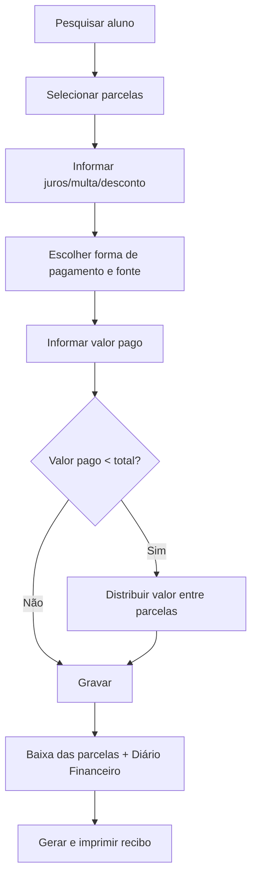

# Recebimento de Mensalidade

## Objetivo

Registrar o **pagamento (baixa) das parcelas de mensalidade** de um aluno. É a tela usada no
balcão para receber a mensalidade, informando a forma de pagamento, eventuais juros, multas e
descontos, e gerar o recibo.

---

## Como acessar

```
Financeiro
→ Recebimento de Mensalidade
```

---

## Quando utilizar

- Quando o responsável vem pagar uma ou mais parcelas da mensalidade.
- Quando é preciso registrar um pagamento com **juros/multa** por atraso ou com **desconto**.
- Para registrar uma **cortesia** (isenção), usando a opção de pagamento sem valor recebido.

---

## Como utilizar

1. Abra a tela **Recebimento de Mensalidade**.
2. **Pesquise o aluno** pelo nome ou matrícula no campo de busca de aluno.
3. O sistema lista as **parcelas do aluno**. Selecione a(s) parcela(s) que serão recebidas.
4. Confira o **Valor da Mensalidade** e o **Valor a Pagar**.
5. Informe **Juros** e **Multa**, se houver atraso, e **Desconto**, se aplicável.
6. Escolha a **Forma de Pagamento** (dinheiro, cartão, boleto, etc.) e a **Fonte**.
7. Preencha os campos complementares conforme a forma escolhida (ver seção **Campos**).
8. Confira o **Valor Pago**.
9. Clique em **Gravar** para registrar o recebimento.
10. O sistema gera o **[recibo](recibo.md)**; use a opção de impressão para entregá-lo ao responsável.

> **Recebimento com valor a menor:** quando o valor pago é menor que o total das parcelas
> selecionadas, o sistema abre a **distribuição de valores**, permitindo indicar como o valor
> recebido será distribuído entre as parcelas. É preciso informar ao menos um valor e o total
> distribuído não pode ultrapassar o saldo.

:::note Quantidade de parcelas no cartão
O campo **Qtd. Parcelas** só fica habilitado quando a forma de pagamento é um **cartão
parcelado**. Para **dinheiro/PIX** e cartões não parcelados, o valor fica fixo em **1**.
Ao escolher o cartão, o sistema já ajusta o campo para **1** e não permite informar um número
**acima do limite de parcelas** configurado naquele cartão.

Cartões marcados como **RPU (Recebimento de Parcelamento Único)** também mantêm o campo
desabilitado em **1**, mesmo sendo do tipo parcelado. Esses cartões aparecem no dropdown com a
marcação **- RPU** ao final da descrição — por exemplo:
*Crédito à Vista - 2% - 12 Parcela(s) - 30 dia(s) - RPU*.
Ver [Cartão](../tabelas-financeiras/cartao.md).
:::

*(Print sugerido: tela de recebimento com o aluno e as parcelas selecionadas.)*

---

## Campos

| Campo | Descrição | Obrigatório | Exemplo | Observações |
|-------|-----------|-------------|---------|-------------|
| Aluno | Aluno cujo pagamento será registrado | Sim | João da Silva | Pesquise por nome ou matrícula |
| Parcela | Parcela(s) a receber | Sim | Parcela 03/12 | Pode selecionar mais de uma |
| Valor Mensalidade | Valor original da parcela | — | 450,00 | Preenchido pelo sistema |
| Valor a Pagar | Valor devido no momento | — | 465,00 | Calculado com juros/multa/desconto |
| Juros | Juros por atraso | Não | 5,00 | |
| Multa | Multa por atraso | Não | 10,00 | |
| Desconto | Desconto concedido | Não | 0,00 | |
| Valor Pago | Valor efetivamente recebido | Sim | 465,00 | Se menor, abre a distribuição |
| Forma de Pagamento | Como o valor foi pago | Sim | Dinheiro | |
| Fonte | Origem/destino do valor | Sim | Caixa | |
| Número do Documento | Nº do comprovante/cheque/transação | Não | 001234 | |
| Data | Data do pagamento | Sim | 30/07/2026 | Não pode ser data futura |
| Bom Para / Disponível Em | Data de disponibilidade (cheque/cartão) | Não | 05/08/2026 | Usado em cheque/cartão |
| Cartão | Dados do cartão | Condicional | — | Quando a forma é cartão |
| Qtd. Parcelas | Nº de parcelas do cartão | Condicional | 3 | Habilitado apenas para **cartão parcelado** que **não** seja RPU. Mínimo 1 e no máximo o limite de parcelas do cartão selecionado |
| Pagamento sem valor recebido (Cortesia) | Marca o recebimento como cortesia | Não | — | Isenção, sem entrada de dinheiro |

---

## Botões

| Botão | O que faz |
|-------|-----------|
| **Gravar** | Registra o recebimento, dá baixa na parcela e gera o recibo |
| **Imprimir** | Emite o recibo do recebimento |
| **Cancelar** | Fecha a operação sem gravar |

---

## Resultados

- As parcelas selecionadas ficam **quitadas**.
- É gerado um **lançamento no Diário Financeiro**.
- É gerado um **[recibo](recibo.md) numerado** para impressão.

O **[recibo](recibo.md)** traz, além dos dados do aluno e da parcela:

- **Forma de Pagto.** com o número de parcelas do cartão entre parênteses quando parcelado
  (ex.: *Cartão de Crédito (3x)*).
- **N° Doc.** — exibido quando há número de documento/comprovante informado no pagamento.
- Detalhamento de valores no canhoto: **Val. Mens.**, **Desconto**, **Desconto Extra**,
  **Dedução**, **Acréscimos**, **Juros**, o **Total** apurado e o **valor Pago** em destaque.
- Em pagamentos por **cartão**, a **Forma de Pagto.** mostra o tipo da máquina (Crédito/Débito/
  Parcelado/PIX). Ver [Recibo](recibo.md).

---

## Regras importantes

- **A Data de Pagamento não pode ser futura.**
- **O Valor Pago não pode ser menor que a soma de Juros e Multa.**
- Se o **caixa estiver encerrado** para a data informada, o recebimento é **bloqueado**.
- No recebimento com valor a menor, **é preciso distribuir todo o valor informado** entre as parcelas.

---

## Mensagens do sistema

**Sucesso**
- *"Estorno realizado com sucesso!"* (ao estornar um recebimento)

**Erro**
- *"Data de Pagamento não pode ser futura."*
- *"O Valor Pago não pode ser menor que a soma de Juros e Multa."*
- *"O Caixa está encerrado para a data: ..."* / *"O Caixa está encerrado para o dia de hoje!"*
- *"Erro ao salvar o registro no Diário Financeiro"*
- *"Erro ao salvar o registro no Encerramento de Caixa"*
- *"O número de parcelas deve ser no mínimo 1."* (cartão parcelado)
- *"Quantidade máxima de parcelas permitida para este cartão é X"* (ao exceder o limite do cartão)

**Alerta / Atenção (distribuição de valores)**
- *"Informe ao menos um valor para distribuição."*
- *"O total distribuído não pode ser maior que o saldo para distribuir."*
- *"Ainda falta valor para distribuir. Verifique os valores informados."*

---

## Fluxo da funcionalidade



---

## Exemplos práticos

**Exemplo 1 — pagamento em dia:** O responsável de João paga a parcela 03/12 de R$ 450,00 em
dinheiro. Basta pesquisar o aluno, selecionar a parcela, forma **Dinheiro**, **Valor Pago**
450,00 e **Gravar**. O recibo é impresso na hora.

**Exemplo 2 — pagamento com atraso:** A parcela venceu há 10 dias. Informe **Juros** 5,00 e
**Multa** 10,00; o **Valor a Pagar** passa a 465,00. Receba normalmente.

---

## Dicas

- Confira sempre a **Fonte** antes de gravar, para não lançar no caixa errado.
- Para isenções, use **Pagamento sem valor recebido (Cortesia)** em vez de dar 100% de desconto.

---

## Erros comuns

- **"O Caixa está encerrado..."** → a data escolhida já teve o caixa fechado. Use a data
  correta ou reabra o caixa (com permissão) em Encerramento de Caixa.
- **Valor pago menor que juros + multa** → ajuste o valor pago ou revise juros/multa.

---

## FAQ

**Posso receber várias parcelas de uma vez?**
Sim. Selecione todas as parcelas desejadas antes de gravar.

**Recebi um valor a menor. E as parcelas?**
O sistema abre a distribuição de valores para você indicar quanto vai para cada parcela.

**Como cancelo um recebimento?**
Use o [Estorno](#) na própria movimentação; o número do recibo é registrado no estorno.

---

## Prints

- [ ] Tela de recebimento com aluno e parcelas selecionadas.
- [ ] Janela de **distribuição de valores** (recebimento a menor).
- [ ] Recibo gerado.

---

## Histórico

| Data | Alteração |
|------|-----------|
| 30/07/2026 | Página criada. Inclui recebimento com valor a menor / distribuição de valores e recibo padronizado. |
| 31/07/2026 | **Qtd. Parcelas** vinculada ao limite do cartão (mín. 1; desabilitado para dinheiro/PIX). Recibo passa a exibir **forma de pagamento com nº de parcelas (Nx)**, **N° Doc.** e **Desconto Extra**. |
| 07/08/2026 | Recibo passa a exibir a linha **Total** e, nos pagamentos por cartão, a **máquina/tipo do cartão** na Forma de Pagto. Correção da gravação do recebimento de **adiantamento** (sem impacto no fluxo de uso). |
| 21/08/2026 | Cartões marcados como **RPU** passam a aparecer com a marcação **- RPU** na descrição do dropdown e mantêm o campo **Qtd. Parcelas** desabilitado em 1. No **estorno**, o **número do recibo** voltou a ser exibido, e o estorno de pagamentos parcelados passou a reverter **todos os lançamentos** da operação. |
