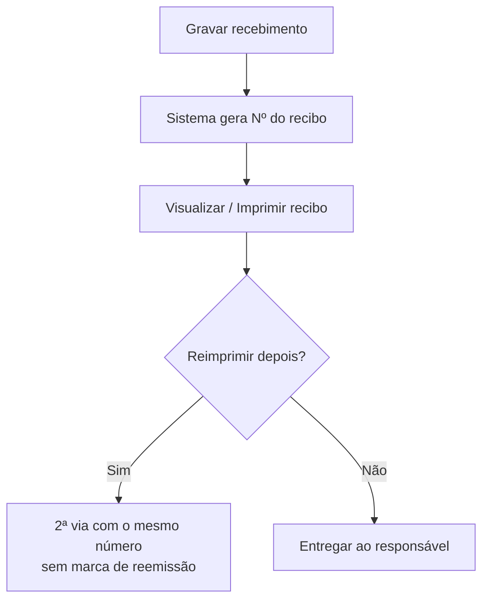

# Recibo de Recebimento

## Objetivo

Documentar o **recibo** emitido pelo Harpia ao registrar um recebimento — o comprovante entregue
ao responsável. O mesmo modelo de recibo é usado pelas telas de recebimento do módulo Financeiro,
por isso esta página concentra a explicação da sua **estrutura, numeração, reemissão e impressão**.

> Esta página descreve o recibo de **recebimento de mensalidade** e de **outros recebimentos**.
> A **sangria** possui um comprovante próprio — ver [Sangria](sangria.md).

:::note Atualização de 07/08/2026
O recibo deixou de exibir a marca **REEMISSÃO** nas 2ª vias. A reimpressão continua **mantendo o
mesmo número**, mas **sem nenhuma marcação visual** de reemissão. O recibo também passou a mostrar
a linha **Total**, a **máquina/tipo do cartão** na forma de pagamento e a **descrição da turma**.
:::

---

## Onde o recibo é gerado

O recibo é produzido a partir das telas que registram entradas de valores:

- [Recebimento de Mensalidade](recebimento-mensalidade.md) — ao gravar o pagamento das parcelas.
- [Outros Recebimentos](outros-recebimentos.md) — ao gravar o recebimento (campo **Nº Recibo**).
- [Ficha Financeira](ficha-financeira.md) — ao pagar uma parcela ou **reimprimir** o recibo de um
  pagamento já realizado, pelo botão de impressão na linha da parcela.

Em todas elas, use **Imprimir** / **Visualizar Recibo** para exibir o comprovante.

---

## Quando utilizar

- Sempre que for preciso **entregar o comprovante** de um pagamento ao responsável.
- Para **reimprimir** um recibo de um pagamento anterior (pela Ficha Financeira ou pela lista de
  Outros Recebimentos).

---

## Estrutura do recibo

O recibo é dividido em **canhoto** (resumo destacável) e **corpo** (declaração de quitação).

### Cabeçalho

| Item | Descrição |
|------|-----------|
| Dados da empresa | Nome, CNPJ e identificação da escola emissora |
| Nº do Recibo | Número sequencial do recibo, gerado pelo sistema |
| Selo **CORTESIA** | Aparece ao lado do número quando o recebimento foi marcado como **Pagamento sem valor recebido (Cortesia)** |

> A partir de 07/08/2026, o recibo **não exibe mais a marca REEMISSÃO** nas reimpressões.

:::note Recibo de cortesia
Quando o recebimento é lançado com a marcação **Pagamento sem valor recebido (Cortesia)** — uma
isenção, sem entrada de dinheiro —, o recibo sai com o selo **CORTESIA**, tanto no canhoto quanto
no corpo. Isso deixa claro para a família e para a conferência interna que não houve pagamento
em dinheiro.
:::

### Canhoto (detalhamento de valores)

| Linha | Descrição |
|-------|-----------|
| Val. Mens. | Valor da mensalidade/parcela |
| Desconto | Desconto concedido (exibido com sinal negativo) |
| Desconto Extra | Desconto adicional aplicado no recebimento (também no recibo de Outros Recebimentos) |
| Dedução | Valor deduzido, quando houver (com a descrição da dedução) |
| Acréscimos | Acréscimos aplicados, quando houver |
| Juros | Juros por atraso |
| **Total** | **Total apurado da parcela**: mensalidade + acréscimos + multas + juros − desconto − dedução − desconto extra |
| **Pago** | **Valor efetivamente recebido**, em destaque |
| Forma Pagto. | Quando o pagamento é por cartão, exibe a **máquina/tipo do cartão** (Crédito, Débito, Parcelado ou PIX). Cartões **RPU** aparecem com o sufixo **- RPU** |

> **Total x Pago:** o **Total** é o valor devido apurado da parcela; o **Pago** é o valor que
> entrou de fato. Em recebimentos comuns os dois coincidem.

### Corpo / dados do pagamento

| Item | Descrição |
|------|-----------|
| Aluno / Responsável Financeiro | Quem pagou (nome e CPF/CNPJ, quando informado) |
| Forma de Pagto. | Forma de pagamento; para **cartão**, exibe também o **tipo** (Crédito/Débito/Parcelado/PIX) da máquina e, no **parcelado**, o nº de parcelas, ex.: *Cartão de Crédito (3x)* |
| Matrícula / Turma | Matrícula do aluno e a **turma com a descrição**, ex.: *3ºA - 3ª Série A* |
| N° Doc. | Número do documento/comprovante do pagamento, quando informado |
| Fonte | Fonte financeira do lançamento (seguida da data do pagamento) |
| Data / Local | Data do pagamento e **cidade/UF da escola** (obtidos automaticamente do cadastro da empresa) |
| Declaração de quitação | Texto com o valor por extenso e a **referência** do pagamento (parcela ou descrição) |

---

## Numeração e reemissão

- Todo recebimento gera um **número de recibo sequencial** próprio, que **não repete** números já usados em Mensalidades ou Outros Recebimentos. Todas as parcelas de um mesmo Outros Recebimentos compartilham o **mesmo número**.
- Em **adiantamentos** o título do recibo é **Recibo de Adiantamento** (nos demais, *Recibo de Pagamento*).
- No recibo de **cortesia**, o valor pago aparece como **R$ 0,00**. Quando o aluno não tem matrícula (Outros Recebimentos avulsos), o recibo mostra só o **Nome**.
- Ao **reimprimir**, o recibo **preserva o mesmo número**. Desde 07/08/2026, a 2ª via **não recebe
  mais a marca REEMISSÃO** — ela é idêntica ao recibo original.
- O número do recibo também fica **registrado no estorno**, para rastreabilidade.

---

## Impressão

- Use **Imprimir** (ou **Visualizar Recibo**) na tela de origem para gerar o comprovante em PDF.
- Em **Outros Recebimentos**, a opção **Configurar Impressão do Recibo** ajusta o layout/opções.

---

## Regras importantes

- O recibo só existe **após a gravação** do recebimento.
- A reimpressão **não gera um novo número** — reaproveita o número original (sem marca de reemissão).
- Ao **estornar** um recebimento, o número do recibo é mantido no registro do estorno.

---

## Mensagens do sistema

**Erro**
- *"Erro ao gerar recibo!"*
- *"Recibo não encontrado!"*
- *"Erro ao buscar dados do recibo"*

---

## Fluxo da funcionalidade

---

## Exemplos práticos

**Exemplo — reimpressão pela Ficha Financeira:** o responsável pediu a 2ª via do recibo de uma
parcela já paga. Abra a [Ficha Financeira](ficha-financeira.md) do aluno, localize a parcela e
clique no botão de **imprimir recibo** daquele pagamento. A 2ª via sai com o **mesmo número** do
original, sem qualquer marca de reemissão.

---

## Dicas

- Confira a **Forma de Pagto.** e o **N° Doc.** antes de entregar — são os dados mais consultados
  pelo responsável.
- Para pagamentos com cartão parcelado, valide o número de parcelas exibido *(Nx)* no recibo.

---

## Erros comuns

- **"Recibo não encontrado!"** → o pagamento pode ter sido estornado; confira a movimentação.
- **Valores zerados no canhoto** → linhas sem valor aparecem como `-,--`; isso é normal quando
  não há desconto, dedução ou acréscimo.

---

## FAQ

**O número do recibo muda na reimpressão?**
Não. A 2ª via mantém o mesmo número. Desde 07/08/2026 **não há mais a marca REEMISSÃO** — a
2ª via é idêntica ao recibo original.

**Por que aparece uma linha "Total" além de "Pago"?**
O **Total** é o valor devido apurado da parcela (mensalidade + acréscimos + multas + juros, menos
desconto, dedução e desconto extra). O **Pago** é o que foi efetivamente recebido. Em recebimentos
comuns os dois valores são iguais.

**O recibo mostra qual máquina/cartão foi usado?**
Sim. Nos pagamentos por cartão, a **Forma de Pagto.** exibe o tipo da máquina (Crédito, Débito,
Parcelado ou PIX) e, no parcelado, o número de parcelas *(Nx)*.

**Como reimprimo um recibo antigo?**
Pela [Ficha Financeira](ficha-financeira.md) (botão de impressão na parcela) ou pela lista de
[Outros Recebimentos](outros-recebimentos.md) em **Visualizar Recibo** / **Opções**.

**O recibo de sangria é o mesmo?**
Não. A [Sangria](sangria.md) usa um comprovante próprio.

---

## Prints

- [ ] Recibo de recebimento de mensalidade (canhoto + corpo) — **recapturar**: agora com a linha **Total** e sem a marca REEMISSÃO.
- [ ] Recibo de outros recebimentos — **recapturar** com a linha **Total**.
- [ ] Detalhe do recibo com pagamento por **cartão** mostrando o tipo da máquina na Forma de Pagto.

> **Prints a substituir:** todas as capturas anteriores que exibiam a marca **REEMISSÃO** estão
> desatualizadas e devem ser refeitas.

---

## Histórico

| Data | Alteração |
|------|-----------|
| 31/07/2026 | Página criada. Centraliza a documentação do recibo (estrutura, numeração, reemissão e impressão), com forma de pagamento por parcelas (Nx), N° Doc. e Desconto Extra. |
| 07/08/2026 | Removida a marca **REEMISSÃO** das 2ª vias (mantido o mesmo número). Incluída a linha **Total** no detalhamento de valores. **Forma de Pagto.** passa a exibir a **máquina/tipo do cartão** (Crédito/Débito/Parcelado/PIX). **Turma** exibida com a descrição e **cidade/UF** obtidas do cadastro da empresa. |
| 21/08/2026 | Novo selo **CORTESIA** no recibo, exibido quando o recebimento é marcado como *Pagamento sem valor recebido (Cortesia)*. O **número do recibo** voltou a ser exibido também nos recibos de **estorno**. |
| 07/10/2026 | Sufixo **- RPU**, título de **Adiantamento**, **Desconto Extra**, cortesia com R$ 0,00 e número de recibo único. |
