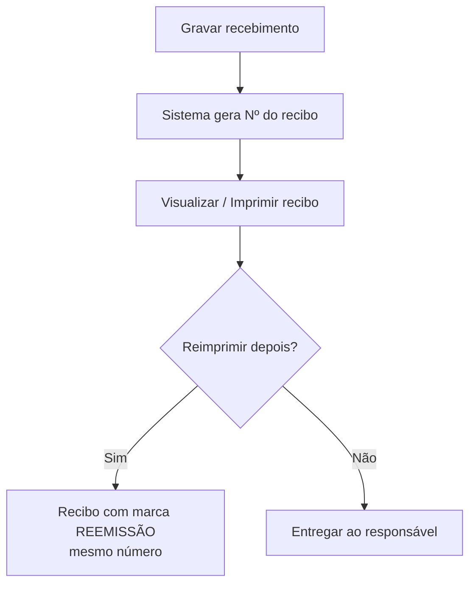

# Recibo de Recebimento

## Objetivo

Documentar o **recibo** emitido pelo Harpia ao registrar um recebimento — o comprovante entregue
ao responsável. O mesmo modelo de recibo é usado pelas telas de recebimento do módulo Financeiro,
por isso esta página concentra a explicação da sua **estrutura, numeração, reemissão e impressão**.

> Esta página descreve o recibo de **recebimento de mensalidade** e de **outros recebimentos**.
> A **sangria** possui um comprovante próprio — ver [Sangria](sangria.md).

---

## Onde o recibo é gerado

O recibo é produzido a partir das telas que registram entradas de valores:

- [Recebimento de Mensalidade](recebimento-mensalidade.md) — ao gravar o pagamento das parcelas.
- [Outros Recebimentos](outros-recebimentos.md) — ao gravar o recebimento (campo **Nº Recibo**).
- [Ficha Financeira](ficha-financeira.md) — ao pagar uma parcela ou **reimprimir** o recibo de um
  pagamento já realizado, pelo botão de impressão na linha da parcela.

Em todas elas, use **Imprimir** / **Visualizar Recibo** para exibir o comprovante.

---

## Quando utilizar

- Sempre que for preciso **entregar o comprovante** de um pagamento ao responsável.
- Para **reimprimir** um recibo de um pagamento anterior (pela Ficha Financeira ou pela lista de
  Outros Recebimentos).

---

## Estrutura do recibo

O recibo é dividido em **canhoto** (resumo destacável) e **corpo** (declaração de quitação).

### Cabeçalho

| Item | Descrição |
|------|-----------|
| Dados da empresa | Nome, CNPJ e identificação da escola emissora |
| Nº do Recibo | Número sequencial do recibo, gerado pelo sistema |
| REEMISSÃO | Marcação exibida quando o recibo é uma **reimpressão** |

### Canhoto (detalhamento de valores)

| Linha | Descrição |
|-------|-----------|
| Val. Mens. | Valor da mensalidade/parcela |
| Desconto | Desconto concedido (exibido com sinal negativo) |
| Desconto Extra | Desconto adicional aplicado no recebimento |
| Dedução | Valor deduzido, quando houver (com a descrição da dedução) |
| Acréscimos | Acréscimos aplicados, quando houver |
| Juros | Juros por atraso |
| **Pago** | **Valor efetivamente recebido**, em destaque |

### Corpo / dados do pagamento

| Item | Descrição |
|------|-----------|
| Aluno / Responsável Financeiro | Quem pagou (nome e CPF/CNPJ, quando informado) |
| Forma de Pagto. | Forma de pagamento; para **cartão parcelado** aparece o nº de parcelas, ex.: *Cartão de Crédito (3x)* |
| N° Doc. | Número do documento/comprovante do pagamento, quando informado |
| Fonte | Fonte financeira do lançamento |
| Data | Data do pagamento e local de emissão |
| Declaração de quitação | Texto com o valor por extenso e a **referência** do pagamento (parcela ou descrição) |

---

## Numeração e reemissão

- Todo recebimento gera um **número de recibo sequencial** próprio.
- Ao **reimprimir**, o recibo é marcado como **REEMISSÃO**, preservando o mesmo número.
- O número do recibo também fica **registrado no estorno**, para rastreabilidade.

---

## Impressão

- Use **Imprimir** (ou **Visualizar Recibo**) na tela de origem para gerar o comprovante em PDF.
- Em **Outros Recebimentos**, a opção **Configurar Impressão do Recibo** ajusta o layout/opções.

---

## Regras importantes

- O recibo só existe **após a gravação** do recebimento.
- A reimpressão **não gera um novo número** — reaproveita o número original e marca **REEMISSÃO**.
- Ao **estornar** um recebimento, o número do recibo é mantido no registro do estorno.

---

## Mensagens do sistema

**Erro**
- *"Erro ao gerar recibo!"*
- *"Recibo não encontrado!"*
- *"Erro ao buscar dados do recibo"*

---

## Fluxo da funcionalidade

---

## Exemplos práticos

**Exemplo — reimpressão pela Ficha Financeira:** o responsável pediu a 2ª via do recibo de uma
parcela já paga. Abra a [Ficha Financeira](ficha-financeira.md) do aluno, localize a parcela e
clique no botão de **imprimir recibo** daquele pagamento. O recibo sai marcado como **REEMISSÃO**.

---

## Dicas

- Confira a **Forma de Pagto.** e o **N° Doc.** antes de entregar — são os dados mais consultados
  pelo responsável.
- Para pagamentos com cartão parcelado, valide o número de parcelas exibido *(Nx)* no recibo.

---

## Erros comuns

- **"Recibo não encontrado!"** → o pagamento pode ter sido estornado; confira a movimentação.
- **Valores zerados no canhoto** → linhas sem valor aparecem como `-,--`; isso é normal quando
  não há desconto, dedução ou acréscimo.

---

## FAQ

**O número do recibo muda na reimpressão?**
Não. A 2ª via mantém o mesmo número e recebe a marca **REEMISSÃO**.

**Como reimprimo um recibo antigo?**
Pela [Ficha Financeira](ficha-financeira.md) (botão de impressão na parcela) ou pela lista de
[Outros Recebimentos](outros-recebimentos.md) em **Visualizar Recibo** / **Opções**.

**O recibo de sangria é o mesmo?**
Não. A [Sangria](sangria.md) usa um comprovante próprio.

---

## Prints

- [ ] Recibo de recebimento de mensalidade (canhoto + corpo).
- [ ] Recibo de outros recebimentos.
- [ ] Recibo marcado como **REEMISSÃO**.

---

## Histórico

| Data | Alteração |
|------|-----------|
| 31/07/2026 | Página criada. Centraliza a documentação do recibo (estrutura, numeração, reemissão e impressão), com forma de pagamento por parcelas (Nx), N° Doc. e Desconto Extra. |
