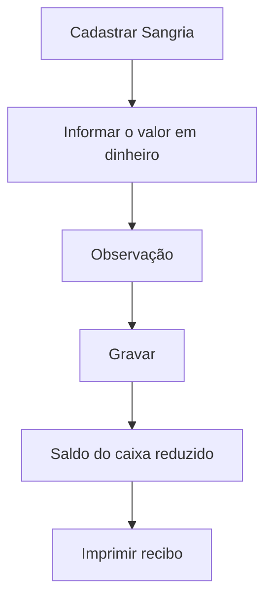

# Sangria

## Objetivo

Registrar a **sangria de caixa** — a retirada de valores **em dinheiro** do caixa durante
ou ao fim do expediente, por segurança ou para depósito. Gera um **recibo de sangria**.

---

## Como acessar

```
Financeiro
→ Sangria
```

---

## Quando utilizar

- Ao retirar dinheiro do caixa (redução de numerário, depósito).

---

## Como utilizar

1. Abra **Sangria**.
2. A tela já abre filtrada pelo **dia de hoje**. Para ver outros dias, ajuste o período em **Data Inicial/Final** (campo de período, com **Limpar**, **Hoje** e **Confirmar**), escolha o **Usuário** e clique em **Pesquisar**.
3. Clique em **Cadastrar Sangria**.
4. Confira o **Saldo Atual (R$)** do caixa (se aparecer erro de saldo, clique em **Atualiza Saldo**).
5. Informe o valor no campo **Total** (em R$) da seção **Sangria (R$)** e a **Observação**.
6. Clique em **Gravar** (o botão mostra carregamento — não clique duas vezes).
7. Depois de gravar, a tela volta com o filtro do **dia de hoje** e do **seu usuário**, mostrando a sangria feita.
8. Use **Imprimir** para emitir o **Recibo de Sangria**.

*(Print sugerido: filtros com período e lista de sangrias.)*
*(Print sugerido: formulário com Saldo Atual (R$) e Sangria (R$).)*

---

## Campos

| Campo | Descrição | Obrigatório |
|-------|-----------|-------------|
| Data Inicial/Final | Período da pesquisa | Sim (padrão: hoje) | Campo de período |
| Usuário | Operador da sangria | Não | Filtro da lista |
| Saldo Atual (R$) | Saldo em dinheiro do caixa do dia | — | Exibido pelo sistema |
| Total (Sangria R$) | Valor retirado, em dinheiro | Sim | Maior que zero e até o saldo |
| Observação | Motivo/observação | Não |
| Data / Hora / Usuário | Registro da sangria | — |

---

## Botões

| Botão | O que faz |
|-------|-----------|
| **Cadastrar Sangria** | Inicia uma nova sangria |
| **Pesquisar** | Busca sangrias por período/usuário |
| **Gravar** | Salva a sangria |
| **Imprimir** | Emite o recibo de sangria |
| **Opções** | Ações do registro |

---

## Resultados

- O saldo do caixa é reduzido pelo valor da sangria.
- É gerado um **recibo de sangria** para conferência.

---

## Regras importantes

- **A sangria deve ter valor maior que zero.**
- **O valor da sangria não pode ser maior que o saldo** do caixa.
- A sangria é **somente em dinheiro** (a opção cheque saiu da tela).
- Se houver **caixa aberto de data anterior** ou o **caixa de hoje já estiver encerrado**, o botão **Cadastrar Sangria** fica desabilitado (veja o aviso abaixo).

---

## Mensagens do sistema

- *"Sangria deve ter valor maior que zero."*
- *"Valor da sangria não pode ser maior que o saldo!"*
- *"Não foi possível verificar o saldo. Clique em Atualiza Saldo e tente novamente."*
- *"Erro ao buscar o saldo do dia!"*
- *"Erro ao gravar a sangria!"*
- *"Erro ao gerar recibo da sangria!"*

---

:::caution Aviso de caixa pendente
Ao abrir esta tela, o sistema confere o **seu caixa**. Se houver **caixa aberto de data anterior**
e/ou o **caixa de hoje já estiver encerrado**, aparece um **aviso amarelo** logo abaixo do título
(fecha no **X**), por exemplo: *"Existe caixa aberto de data(s) anterior(es) (dd/mm/aaaa). Verifique
as pendências no Encerramento de Caixa."* ou *"O caixa de hoje já está encerrado. Verifique o
Encerramento de Caixa antes de continuar."* Enquanto o aviso estiver ativo, o botão de gravar
(Cadastrar Sangria) fica **desabilitado**. Resolva a pendência em [Encerramento de Caixa](encerramento-caixa.md)
(a situação de cada dia pode ser consultada em [Consulta de Caixas](consulta-de-caixas.md)).
:::

---

## Fluxo da funcionalidade



---

## Exemplos práticos

**Exemplo:** ao fim do dia, retirar R$ 1.000,00 em dinheiro do caixa para depósito e imprimir o recibo.

---

## Dicas

- Faça sangrias durante o dia para reduzir o numerário em caixa por segurança.

---

## Erros comuns

- **"Valor da sangria não pode ser maior que o saldo!"** → confira o saldo disponível antes de sangrar.

---

## FAQ

**A sangria fecha o caixa?**
Não. Ela retira valores; o fechamento é feito no [Encerramento de Caixa](encerramento-caixa.md).

---

## Prints

- [ ] Lista de sangrias.
- [ ] Formulário de sangria.
- [ ] Recibo de sangria.

---

## Histórico

| Data | Alteração |
|------|-----------|
| 30/07/2026 | Página criada. |
| 07/10/2026 | Filtro de período único (já em hoje); **cheque removido** (sangria só em dinheiro); campo **Total**; aviso/bloqueio de caixa pendente; mensagens de saldo. |
