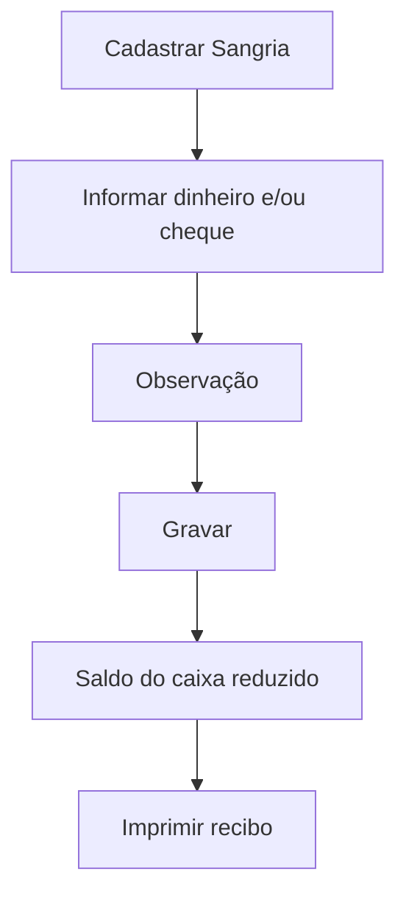

# Sangria

## Objetivo

Registrar a **sangria de caixa** — a retirada de valores (dinheiro e/ou cheque) do caixa durante
ou ao fim do expediente, por segurança ou para depósito. Gera um **recibo de sangria**.

---

## Quem pode utilizar

Financeiro e Administrador.

---

## Como acessar

```
Financeiro
→ Sangria
```

---

## Quando utilizar

- Ao retirar dinheiro/cheque do caixa (redução de numerário, depósito).

---

## Como utilizar

1. Abra **Sangria**.
2. Clique em **Cadastrar Sangria**.
3. Informe o valor em **Dinheiro** e/ou em **Cheque** e uma **Observação**.
4. Confira o **Total**.
5. Clique em **Gravar**.
6. Use **Imprimir** para emitir o **Recibo de Sangria**.

---

## Campos

| Campo | Descrição | Obrigatório |
|-------|-----------|-------------|
| Dinheiro | Valor retirado em dinheiro | Condicional |
| Cheque | Valor retirado em cheque | Condicional |
| Total | Soma da sangria | — |
| Observação | Motivo/observação | Não |
| Data / Hora / Usuário | Registro da sangria | — |

---

## Botões

| Botão | O que faz |
|-------|-----------|
| **Cadastrar Sangria** | Inicia uma nova sangria |
| **Pesquisar** | Busca sangrias por período/usuário |
| **Gravar** | Salva a sangria |
| **Imprimir** | Emite o recibo de sangria |
| **Opções** | Ações do registro |

---

## Resultados

- O saldo do caixa é reduzido pelo valor da sangria.
- É gerado um **recibo de sangria** para conferência.

---

## Regras importantes

- **A sangria deve ter valor maior que zero.**
- **O valor da sangria não pode ser maior que o saldo** do caixa.
- **Selecione ao menos um tipo de pagamento** (dinheiro ou cheque).

---

## Mensagens do sistema

- *"Sangria deve ter valor maior que zero."*
- *"Valor da sangria não pode ser maior que o saldo!"*
- *"Selecione ao menos um tipo de pagamento."*
- *"Erro ao gerar recibo da sangria!"*

---

## Fluxo da funcionalidade



---

## Exemplos práticos

**Exemplo:** ao fim do dia, retirar R$ 1.000,00 em dinheiro do caixa para depósito e imprimir o recibo.

---

## Dicas

- Faça sangrias durante o dia para reduzir o numerário em caixa por segurança.

---

## Erros comuns

- **"Valor da sangria não pode ser maior que o saldo!"** → confira o saldo disponível antes de sangrar.

---

## FAQ

**A sangria fecha o caixa?**
Não. Ela retira valores; o fechamento é feito no [Encerramento de Caixa](encerramento-caixa.md).

---

## Prints

- [ ] Lista de sangrias.
- [ ] Formulário de sangria.
- [ ] Recibo de sangria.

---

## Histórico

| Data | Alteração |
|------|-----------|
| 30/07/2026 | Página criada. |
