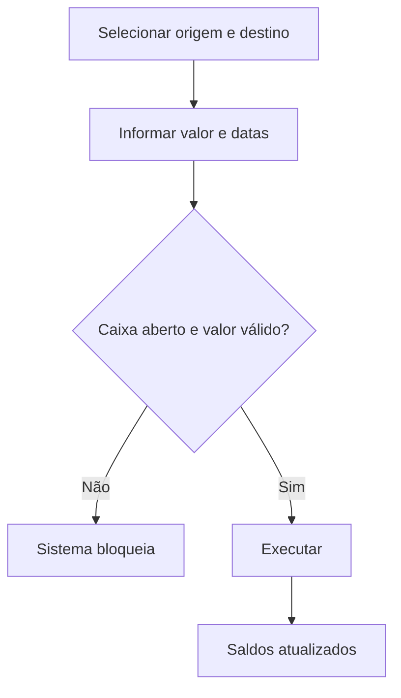

# Transferência de Fonte

## Objetivo

Transferir valores de uma **fonte financeira** (caixa, banco, conta) para outra — por exemplo,
mover o dinheiro do caixa para uma conta bancária. Registra origem, destino, valor e data de
crédito, mantendo os saldos das fontes corretos.

---

## Como acessar

```
Financeiro
→ Transferência de Fonte
```

---

## Quando utilizar

- Ao depositar o caixa no banco ou mover valores entre contas/fontes.

---

## Como utilizar

1. Abra **Transferência de Fonte**.
2. Selecione a **Fonte de Origem** e a **Fonte de Destino**.
3. Confira o **Saldo (R$)** da origem e informe o **Valor (R$)** a transferir.
4. Informe a **Data** e a **Data do Crédito** (quando o valor fica disponível no destino).
5. Preencha **Referente** e, para contas bancárias, **Agência/Conta**.
6. Clique em **Executar**.

---

## Campos

| Campo | Descrição | Obrigatório | Observações |
|-------|-----------|-------------|-------------|
| Fonte de Origem | De onde sai o valor | Sim | |
| Fonte de Destino | Para onde vai o valor | Sim | |
| Saldo R$ | Saldo da origem | — | Exibido pelo sistema |
| Valor R$ | Valor transferido | Sim | Não pode exceder o saldo |
| Data | Data da transferência | Sim | |
| Data do Crédito | Disponibilidade no destino | Sim | |
| Referente | Descrição | Não | |
| Agência / Conta | Dados bancários | Condicional | Para fontes bancárias |

---

## Botões

| Botão | O que faz |
|-------|-----------|
| **Executar** | Efetiva a transferência entre as fontes |

---

## Resultados

- O saldo da origem diminui e o do destino aumenta na data de crédito.

---

## Regras importantes

- O **caixa/fonte deve estar aberto** na data — se estiver encerrado, a transferência é bloqueada.
- O valor não pode exceder o **saldo** da origem.

---

## Mensagens do sistema

- *"Caixa Encerrado para a Data de Crédito!"* / *"Caixa Encerrado para a Data de Transferência!"*
- *"Valor Inválido!"* / *"Data Inválida!"*
- *"Registro gravado com sucesso!"*

---

## Fluxo da funcionalidade



---

## Exemplos práticos

**Exemplo:** transferir R$ 3.000,00 do "Caixa" para a fonte "Banco X", com data de crédito no dia útil seguinte.

---

## Dicas

- Confira a **Data do Crédito** — é ela que determina quando o valor entra no destino.

---

## Erros comuns

- **"Caixa Encerrado para a Data..."** → use uma data com caixa aberto ou reabra o período.

---

## FAQ

**Transferência gera receita/despesa?**
Não; é apenas movimentação entre fontes, sem afetar receita/despesa.

---

## Prints

- [ ] Seleção de origem/destino.
- [ ] Confirmação da transferência.

---

## Histórico

| Data | Alteração |
|------|-----------|
| 30/07/2026 | Página criada. |
