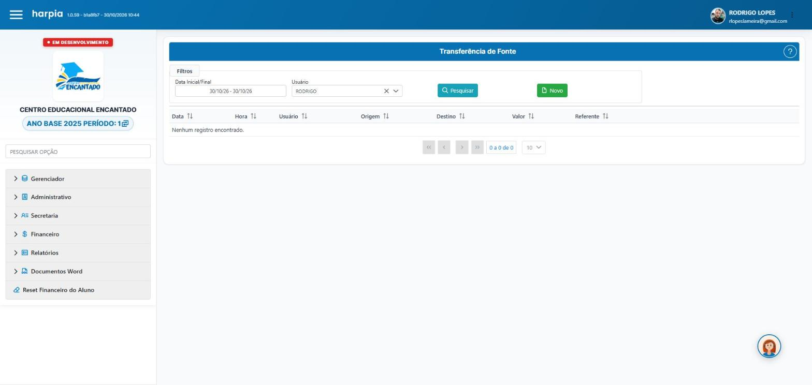
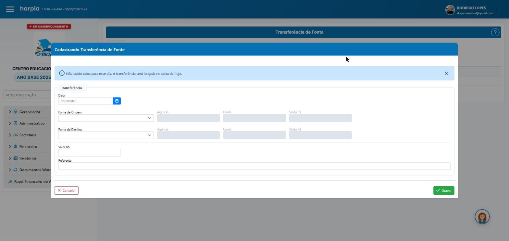
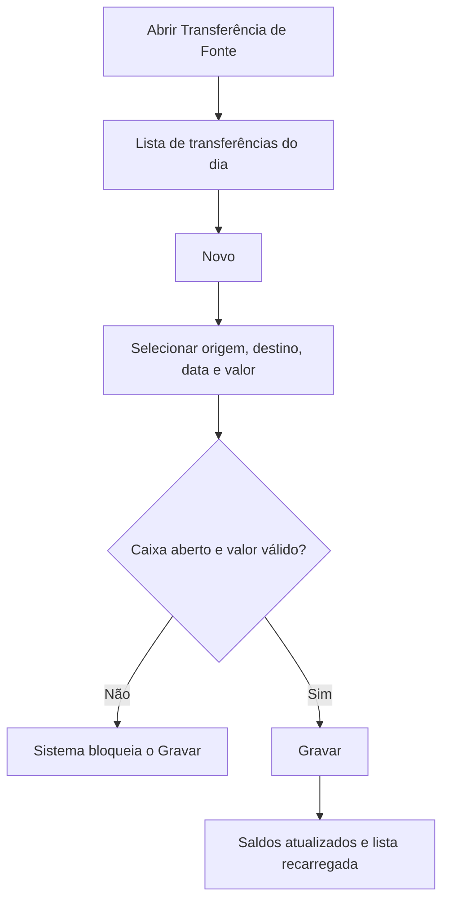

# Transferência de Fonte

## Objetivo

Transferir valores de uma **fonte financeira** (caixa, banco, conta) para outra — por exemplo,
mover o dinheiro do caixa para uma conta bancária. Registra origem, destino, valor e data,
mantendo os saldos das fontes corretos.

---

## Como acessar

```
Financeiro
→ Transferência de Fonte
```

---

## Quando utilizar

- Ao depositar o caixa no banco ou mover valores entre contas/fontes.

---

## Como utilizar

1. Abra **Transferência de Fonte**. A tela mostra primeiro a **lista das transferências já feitas** (consulta), já filtrada pelo dia de hoje.
2. Para ver outros dias, ajuste **Data Inicial/Final** e, se quiser, o **Usuário**, e clique em **Pesquisar**.
3. Para fazer uma nova transferência, clique em **Novo**. Abre a janela **Cadastrando Transferência de Fonte**.
4. Confira a **Data** da transferência (já vem com hoje). Ao escolher a data, o sistema avisa se o caixa daquele dia está encerrado.
5. Selecione a **Fonte de Origem** e a **Fonte de Destino**. O sistema mostra o **Saldo R$** de cada uma (e **Agência/Conta**, quando for conta bancária).
6. Informe o **Valor R$** a transferir e, se quiser, o **Referente**.
7. Clique em **Gravar**. A janela fecha e a transferência aparece na lista. Para desistir, clique em **Cancelar**.




---

## Campos

**Filtros da lista**

| Campo | Descrição | Obrigatório | Observações |
|-------|-----------|-------------|-------------|
| Data Inicial/Final | Período das transferências | Não | Campo de período; abre com o dia de hoje |
| Usuário | Quem lançou a transferência | Não | Abre com o usuário logado |

**Colunas da lista:** Data, Hora, Usuário, Origem, Destino, Valor e Referente (os valores aparecem em R$).

**Formulário (janela Novo)**

| Campo | Descrição | Obrigatório | Observações |
|-------|-----------|-------------|-------------|
| Data | Data da transferência | Sim | Padrão: hoje. Não existe mais o campo *Data do Crédito* |
| Fonte de Origem | De onde sai o valor | Sim | |
| Fonte de Destino | Para onde vai o valor | Sim | Não pode ser igual à origem |
| Saldo R$ | Saldo de cada fonte | — | Exibido pelo sistema |
| Agência / Conta | Dados bancários | — | Exibidos para fontes bancárias |
| Valor R$ | Valor transferido | Sim | Não pode exceder o saldo da origem |
| Referente | Descrição | Não | Ex.: "Depósito do caixa" |

---

## Botões

| Botão | Onde | O que faz |
|-------|------|-----------|
| **Pesquisar** | Lista | Mostra as transferências do período e usuário escolhidos |
| **Novo** | Lista | Abre a janela para cadastrar uma transferência |
| **Gravar** | Janela | Efetiva a transferência entre as fontes (substitui o antigo botão *Executar*) |
| **Cancelar** | Janela | Fecha a janela sem gravar |

---

## Resultados

- O saldo da origem diminui e o do destino aumenta **na data da transferência**.
- Débito e crédito são lançados juntos no Diário Financeiro (ou nenhum dos dois).

---

## Regras importantes

- O **caixa da data escolhida não pode estar encerrado**. Ao selecionar a **Data**, aparece um aviso fixo:
  - Caixa encerrado: *"O caixa referente à Data selecionada já está encerrado. Verifique o Encerramento de Caixa antes de continuar."* — o botão **Executar** fica desabilitado.
  - Dia sem caixa: *"Não existe caixa para esse dia. A transferência será lançada no caixa de hoje."* — não bloqueia.
- Além da data escolhida, o **caixa de hoje também não pode estar encerrado** (*"O caixa de hoje (dd/MM/aaaa) está encerrado! Não é permitido lançar valores."*), pois o lançamento entra no caixa do dia em que é feito.
- A transferência **não conta** no Total Geral do caixa.
- O valor não pode exceder o **saldo** da origem.

---

## Mensagens do sistema

- *"Caixa Encerrado para a Data de Transferência!"*
- *"Valor transferido não pode ser maior que o valor do saldo de origem!"*
- *"Erro ao salvar o registro!"*
- *"Transferência gravada no Diário Financeiro, mas o saldo das fontes não foi atualizado. Execute o Encerramento da Movimentação para esta data."*
- *"Valor Inválido!"* / *"Data Inválida!"*
- *"Registro salvo com sucesso!"*
- *"Fonte não tem saldo!"* / *"Fontes iguais!"*
- *"Erro ao carregar as transferências!"*

---

## Fluxo da funcionalidade



---

## Exemplos práticos

**Exemplo:** transferir R$ 3.000,00 do "Caixa" para a fonte "Banco X", na data de hoje.

---

## Dicas

- Confira a **Data** antes de executar: é ela que define o caixa verificado e o dia do saldo das fontes.

---

## Erros comuns

- **"Caixa Encerrado para a Data..."** → use uma data com caixa aberto ou reabra o período.

---

## FAQ

**Transferência gera receita/despesa?**
Não; é apenas movimentação entre fontes, sem afetar receita/despesa.

---

## Prints

- [x] **Novo:** lista de transferências com filtros (Data Inicial/Final e Usuário).
- [x] **Novo:** janela "Cadastrando Transferência de Fonte" (origem/destino/saldos).
- [x] Confirmação da transferência.
- [ ] Aviso amarelo de caixa encerrado na data escolhida.

---

## Histórico

| Data | Alteração |
|------|-----------|
| 30/07/2026 | Página criada. |
| 07/10/2026 | Campo **Data do Crédito** removido; aviso por data (caixa encerrado/inexistente), bloqueio do caixa de hoje e novas mensagens. |
| 30/10/2026 | A tela passou a abrir com a **lista (consulta)** de transferências, filtros **Data Inicial/Final** e **Usuário**; o cadastro agora é feito em janela aberta pelo botão **Novo**, e o botão **Executar** virou **Gravar** (com **Cancelar**). Valores em R$ nas colunas. |
