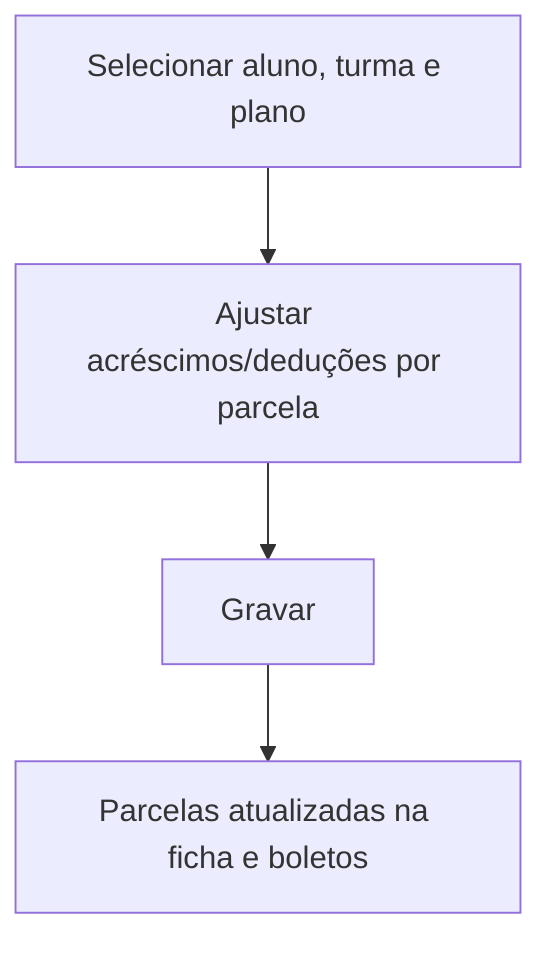

# Valores Complementares

## Objetivo

Gerenciar os **valores complementares** das mensalidades de um aluno — acréscimos, deduções e
ajustes que somam ou reduzem o valor das parcelas além da mensalidade base (por exemplo, material,
transporte, bolsas específicas). Permite abater/ajustar esses valores por parcela.

---

## Como acessar

```
Financeiro
→ Valores Complementares
```

Também acessível pela aba **Valores Complementares** do [Cadastro de Alunos](../cadastro/alunos.md).

---

## Quando utilizar

- Para incluir/ajustar acréscimos ou deduções nas parcelas de um aluno.

---

## Como utilizar

1. Abra **Valores Complementares**.
2. Selecione o aluno, a **Turma** e o **Plano de Pagamento**.
3. Ajuste os valores complementares por parcela (acréscimos/deduções).
4. Clique em **Gravar**.
5. Use **Voltar ao Cadastro do Aluno** para retornar ao cadastro, se veio de lá.

---

## Campos

| Campo | Descrição | Obrigatório |
|-------|-----------|-------------|
| Turma | Turma do aluno | Sim |
| Plano de Pagamento | Plano vinculado | Sim |
| Situação | Situação do aluno | — |
| Valores complementares por parcela | Acréscimos/deduções | Conforme o caso |

---

## Botões

| Botão | O que faz |
|-------|-----------|
| **Gravar** | Salva os valores complementares |
| **Voltar ao Cad. Aluno** | Retorna ao cadastro do aluno |

---

## Resultados

- Os valores das parcelas do aluno passam a refletir os acréscimos/deduções complementares.

---

## Regras importantes

- **O valor abatido não pode ser maior que o valor complementar** correspondente.
- Os ajustes impactam a [Ficha Financeira](ficha-financeira.md) e os boletos do aluno.

---

## Mensagens do sistema

- *"O valor abatido de [descrição] não pode ser maior que o valor complementar."*

---

## Fluxo da funcionalidade



---

## Exemplos práticos

**Exemplo:** incluir um acréscimo de material didático nas primeiras parcelas de um aluno.

---

## Dicas

- Confira o reflexo na [Ficha Financeira](ficha-financeira.md) após gravar.

---

## Erros comuns

- **"O valor abatido... não pode ser maior que o valor complementar."** → ajuste o valor abatido.

---

## FAQ

**Isso é o mesmo que desconto na matrícula?**
Não exatamente; complementares são acréscimos/deduções por parcela, além dos descontos definidos no plano.

---

## Prints

- [ ] Seleção de aluno/turma/plano.
- [ ] Valores complementares por parcela.

---

## Histórico

| Data | Alteração |
|------|-----------|
| 30/07/2026 | Página criada. |
