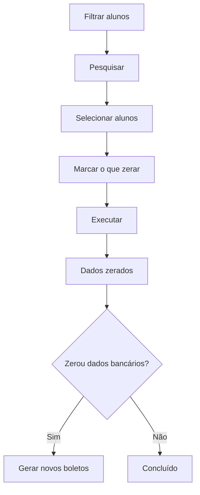

# Zerar Mensalidades

## Objetivo

Limpar, **em lote**, valores e/ou dados bancários das mensalidades de um conjunto de alunos.
É uma ferramenta de manutenção usada, por exemplo, no início de um novo período ou para
corrigir dados que foram gerados incorretamente.

> **Atenção:** esta é uma operação em massa e **irreversível**. Use com cuidado.

---

## Quem pode utilizar

Perfis com permissão financeira e administrativa (normalmente Administrador).

---

## Como acessar

```
Financeiro
→ Zerar Mensalidades
```

---

## Quando utilizar

- Ao reconfigurar valores de mensalidade de uma turma/curso.
- Para limpar dados bancários antigos (banco, linha digitável, código de barras) antes de gerar novos boletos.
- Para zerar acréscimos ou deduções aplicados por engano.

---

## Como utilizar

1. Abra **Zerar Mensalidades**.
2. Filtre os alunos por **Aluno**, **Turma**, **Curso** e/ou **Situação** (Matriculado,
   Registrado, Trancado, Transferido, Cancelado, Abandono, Convênio).
3. Clique em **Pesquisar** para listar os alunos.
4. Marque os alunos desejados (ou use **Selecionar Todos**).
5. Em **O que Fazer?**, marque exatamente **o que deve ser zerado** (ver seção Campos).
6. Confira a seleção.
7. Clique em **Executar**.
8. Aguarde a confirmação *"Mensalidades zeradas com Sucesso!"*.

*(Print sugerido: seleção de alunos e opções "O que Fazer?".)*

---

## Campos

**Filtros de seleção de alunos**

| Campo | Descrição |
|-------|-----------|
| Aluno | Filtra por aluno |
| Turma | Filtra por turma |
| Curso | Filtra por curso |
| Situação | Matriculado, Registrado, Trancado, Transferido, Cancelado, Abandono, Convênio |

**Opções "O que Fazer?" (o que será zerado)**

| Opção | O que limpa |
|-------|-------------|
| Zerar Valores de Mensalidade | Valores de mensalidade e desconto |
| Zerar Informações Bancárias | Banco, linha digitável, vencimento, código de barras, etc. |
| Zerar Valores da Dedução | Valores de dedução |
| Zerar Valores do Acréscimo 01 a 06 | Cada um dos seis acréscimos |

Colunas da lista: **Matrícula**, **Nome**, **Turma**, **Convênio**, **Situação**.

---

## Botões

| Botão | O que faz |
|-------|-----------|
| **Pesquisar** | Lista os alunos conforme os filtros |
| **Selecionar Todos** | Marca todos os alunos listados |
| **Página Anterior / Próxima Página** | Navega na lista |
| **Executar** | Aplica a limpeza selecionada aos alunos marcados |

---

## Resultados

- Os dados marcados são **zerados** para os alunos selecionados.
- Mensagem *"Mensalidades zeradas com Sucesso!"* ao concluir.

---

## Regras importantes

- **Operação em lote e irreversível** — confira a seleção antes de **Executar**.
- Só é aplicado **o que estiver marcado** em "O que Fazer?".
- Ao zerar informações bancárias, é necessário **gerar novos boletos** depois.

---

## Mensagens do sistema

**Sucesso**
- *"Mensalidades zeradas com Sucesso!"*

**Erro**
- *"Erro ao processar a operação"*

---

## Fluxo da funcionalidade



---

## Exemplos práticos

**Exemplo — troca de banco:** A escola mudou de banco. Filtre a turma, selecione todos, marque
**Zerar Informações Bancárias** e **Executar**. Depois, gere novos boletos com o banco correto.

---

## Dicas

- Antes de executar, confira duas vezes **quais opções** estão marcadas e **quais alunos** estão selecionados.
- Faça a operação por turma/curso para reduzir o risco de afetar alunos indevidos.

---

## Erros comuns

- **Zerou o que não queria** → como a operação é irreversível, refaça a configuração manualmente.
  Sempre revise antes de **Executar**.

---

## FAQ

**Dá para desfazer?**
Não. A operação é irreversível; por isso, revise a seleção antes de executar.

**Zerei os dados bancários. E agora?**
Gere novos boletos e, se for o caso, um novo [Arquivo de Remessa](arquivo-remessa.md).

---

## Prints

- [ ] Filtros e lista de alunos.
- [ ] Painel "O que Fazer?".

---

## Histórico

| Data | Alteração |
|------|-----------|
| 30/07/2026 | Página criada. |
