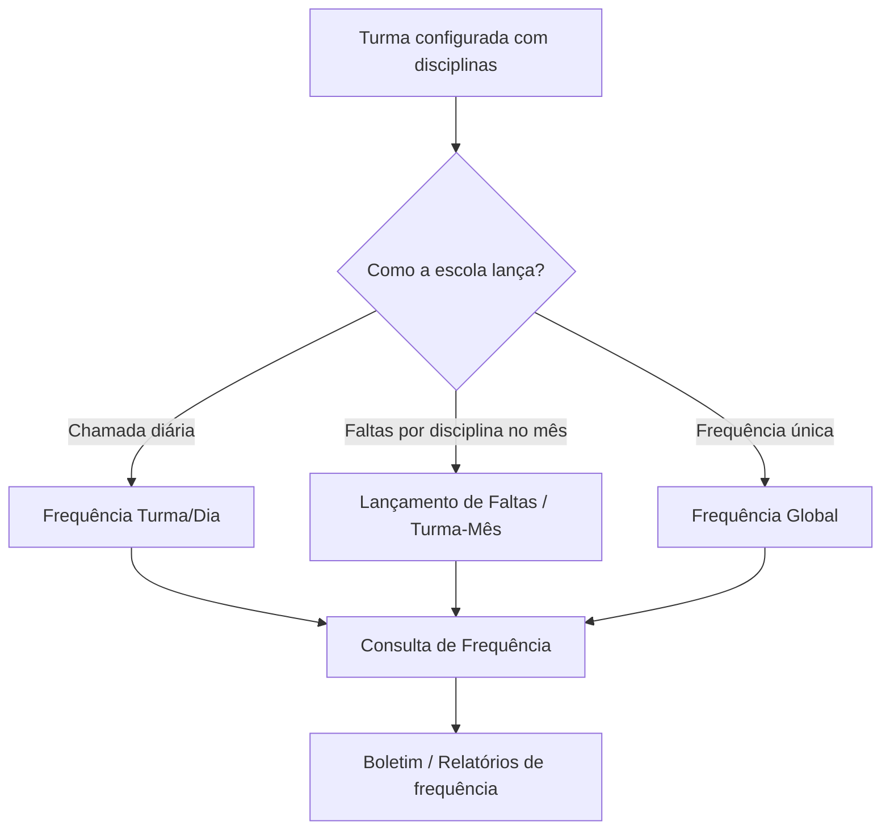

# Módulo Frequência

## Objetivo

O módulo **Frequência** registra e consulta as **faltas** dos alunos. Ele oferece várias formas
de lançar frequência conforme a rotina da escola: por **dia** (chamada do dia), por **mês**
(consolidado), por **disciplina/matéria**, de forma **global** (uma só frequência para a turma)
ou por **aluno**. Também permite **consultar** a frequência lançada.

## Como acessar

As telas ficam no grupo **Frequências** do menu lateral.

## Como escolher a tela certa

| Situação | Tela |
|----------|------|
| Fazer a chamada de um dia para a turma inteira | [Frequência Turma/Dia](turma-dia.md) |
| Lançar faltas do mês por disciplina/matéria | [Lançamento de Faltas](lancamento-faltas.md) |
| Consolidar faltas do mês por disciplina | [Frequência Turma/Mês](turma-mes.md) |
| Lançar frequência única para a turma (sem disciplina) | [Frequência Global](global.md) |
| Trabalhar a frequência de um aluno específico por dia | [Frequência Aluno/Dia](aluno-dia.md) |
| Apenas consultar a frequência lançada | [Consulta de Frequência](consulta.md) |

> A forma de lançar depende da configuração da turma: turmas com avaliação **Global** usam uma
> frequência única; turmas **Detalhado por Disciplina** lançam frequência por disciplina/matéria.
> Ver [Turmas](../academico/turmas.md).

## Fluxo geral

---

## Histórico

| Data | Alteração |
|------|-----------|
| 30/07/2026 | Página criada. |
