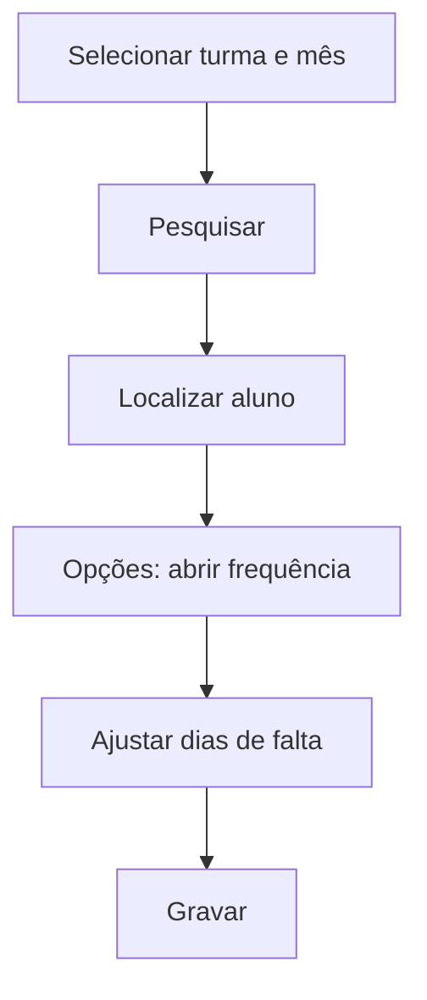

# Frequência Aluno/Dia

## Objetivo

Trabalhar a frequência de um **aluno específico**, dia a dia, dentro de um mês. Útil para
ajustar/consultar as faltas de um único aluno (por exemplo, para justificar ausências ou
corrigir um lançamento).

---

## Como acessar

```
Frequências
→ Frequência Aluno/Dia
```

---

## Quando utilizar

- Para revisar/ajustar as faltas de um aluno específico.

---

## Como utilizar

1. Abra **Frequência Aluno/Dia**.
2. Selecione a **Turma** e o **Mês**.
3. Clique em **Pesquisar** e localize o aluno (por **Nome**).
4. Use **Opções** para abrir a frequência do aluno.
5. Ajuste os **dias** de falta conforme necessário.
6. Clique em **Gravar**.

---

## Campos e colunas

| Campo/Coluna | Descrição |
|--------------|-----------|
| Selecione a Turma | Turma |
| Mês | Mês de referência |
| Ordem / Matrícula / Nome | Identificação do aluno |
| Situação | Situação do aluno |

---

## Botões

| Botão | O que faz |
|-------|-----------|
| **Pesquisar** | Lista os alunos da turma |
| **Opções** | Abre a frequência do aluno |
| **Gravar** | Salva os ajustes |
| **Cancelar** | Fecha sem salvar |

---

## Resultados

- A frequência do aluno é atualizada para o mês selecionado.

---

## Regras importantes

- É preciso selecionar **turma** e **mês** para consultar.

---

## Fluxo da funcionalidade



---

## Exemplos práticos

**Exemplo:** justificar as faltas de um aluno que apresentou atestado — abrir a frequência do
aluno no mês e ajustar os dias.

---

## Dicas

- Use esta tela para correções pontuais de um aluno; para a turma toda, use as telas por turma.

---

## FAQ

**Consigo ver a situação do aluno aqui?**
Sim, a lista mostra a **Situação** de cada aluno.

---

## Prints

- [ ] Seleção de turma e mês.
- [ ] Frequência do aluno por dia.

---

## Histórico

| Data | Alteração |
|------|-----------|
| 30/07/2026 | Página criada. |
