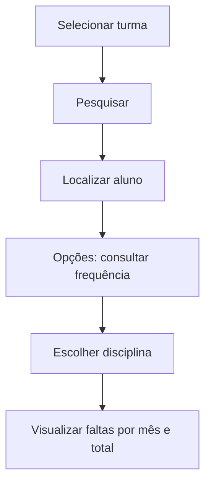

# Consulta de Frequência

## Objetivo

**Consultar** a frequência lançada de um aluno/turma, por **disciplina** e **mês**, exibindo os
totais de faltas ao longo do ano. É uma tela de conferência — não substitui as telas de
lançamento, mas serve para verificar o que já foi registrado.

---

## Quem pode utilizar

Secretaria, Coordenação, Professores e Administrador.

---

## Como acessar

```
Frequências
→ Consulta de Frequência
```

*(Em algumas escolas também aparece como "Frequências → Alunos".)*

---

## Quando utilizar

- Para conferir as faltas registradas antes do fechamento do boletim.
- Para atender dúvidas de responsáveis sobre a frequência do aluno.

---

## Como utilizar

1. Abra **Consulta de Frequência**.
2. Selecione a **Turma**.
3. Clique em **Pesquisar** e localize o aluno (por **Nome**).
4. Use **Opções** para abrir a consulta do aluno.
5. Escolha a **Disciplina** e visualize as faltas mês a mês (**JAN** a **DEZ**) e o **Total**.

---

## Campos e colunas

| Campo/Coluna | Descrição |
|--------------|-----------|
| Selecione a Turma | Turma |
| Ordem / Matrícula / Nome | Identificação do aluno |
| Situação | Situação do aluno |
| Disciplina | Disciplina consultada |
| JAN … DEZ | Faltas por mês |
| Total | Total de faltas |
| Tipo / Descrição | Detalhamento do registro |

---

## Botões

| Botão | O que faz |
|-------|-----------|
| **Pesquisar** | Lista os alunos da turma |
| **Opções** | Abre a consulta de frequência do aluno |
| **Cancelar** | Fecha a consulta |

---

## Resultados

- Exibe o panorama de faltas do aluno por disciplina e mês.

---

## Regras importantes

- É necessário escolher um **mês** para a consulta quando solicitado.
- Os dados exibidos refletem o que foi lançado nas telas de frequência.

---

## Mensagens do sistema

- *"Selecione um mês para consulta."*

---

## Fluxo da funcionalidade



---

## Exemplos práticos

**Exemplo:** verificar o total de faltas de um aluno em "Matemática" ao longo do ano antes de
fechar o boletim.

---

## Dicas

- Use esta tela como conferência final antes do [Boletim](../academico/README.md).

---

## Erros comuns

- **"Selecione um mês para consulta."** → escolha o mês antes de consultar.

---

## FAQ

**Aqui eu lanço faltas?**
Não — esta tela é de consulta. Para lançar, use as telas de lançamento por dia/mês.

---

## Prints

- [ ] Lista de alunos da turma.
- [ ] Consulta de faltas por mês/disciplina.

---

## Histórico

| Data | Alteração |
|------|-----------|
| 30/07/2026 | Página criada. |
