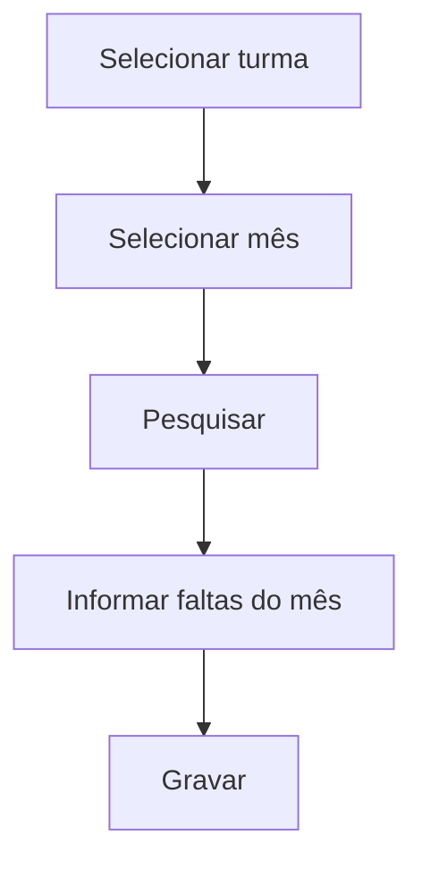

# Frequência Global

## Objetivo

Lançar a **frequência única da turma** no mês, sem separar por disciplina. É usada em turmas com
avaliação **Global** (por exemplo, Educação Infantil e séries iniciais), onde há uma única
frequência para o aluno em vez de uma por disciplina.

---

## Quem pode utilizar

Professores, Secretaria, Coordenação e Administrador.

---

## Como acessar

```
Frequências
→ Frequência Global
```

---

## Quando utilizar

- Em turmas configuradas como **Global** (uma frequência única, sem disciplina).

---

## Como utilizar

1. Abra **Frequência Global**.
2. Selecione a **Turma**.
3. Selecione o **Mês**.
4. Clique em **Pesquisar**.
5. Informe as **Faltas** de cada aluno no mês.
6. Clique em **Gravar**.

---

## Campos e colunas

| Campo/Coluna | Descrição |
|--------------|-----------|
| Selecione a Turma | Turma |
| Selecione o Mês | Mês de referência |
| Ordem / Matrícula / Nome | Identificação do aluno |
| Faltas | Total de faltas do aluno no mês |

---

## Botões

| Botão | O que faz |
|-------|-----------|
| **Pesquisar** | Lista os alunos da turma |
| **Gravar** | Salva a frequência do mês |

---

## Resultados

- A frequência global do mês fica registrada para a turma.

---

## Regras importantes

- Indicada para turmas com avaliação **Global** (ver [Turmas](../academico/turmas.md)).
- Não separa por disciplina — é uma única frequência por aluno.

---

## Fluxo da funcionalidade



---

## Exemplos práticos

**Exemplo:** turma de Educação Infantil, mês de agosto: informar as faltas de cada criança e gravar.

---

## Dicas

- Se a turma for **Detalhado por Disciplina**, use as telas por disciplina em vez desta.

---

## FAQ

**Quando usar Global e quando usar por disciplina?**
Depende da configuração da turma. **Global** = uma frequência; **Detalhado** = por disciplina.

---

## Prints

- [ ] Seleção de turma e mês.
- [ ] Coluna de faltas.

---

## Histórico

| Data | Alteração |
|------|-----------|
| 30/07/2026 | Página criada. |
