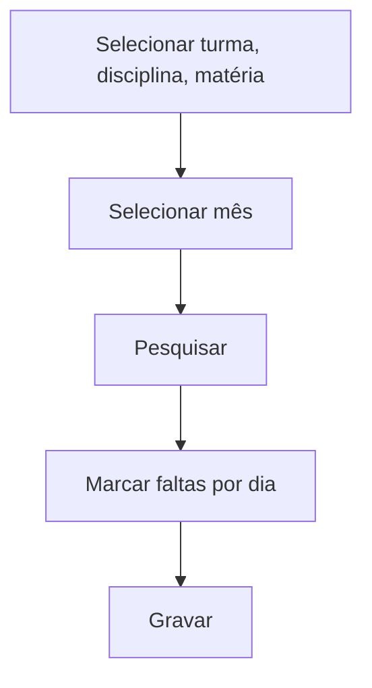

# Lançamento de Faltas

## Objetivo

Lançar as **faltas do mês** de uma turma **por disciplina** (e **matéria**, quando houver),
informando em quais **dias** cada aluno faltou. É a tela usada quando a escola controla
frequência de forma detalhada por disciplina.

---

## Como acessar

```
Frequências
→ Lançamento de Faltas
```

---

## Quando utilizar

- Para registrar as faltas do mês em uma disciplina específica da turma.

---

## Como utilizar

1. Abra **Lançamento de Faltas**.
2. Selecione a **Turma**, a **Disciplina** e, se houver, a **Matéria**.
3. Selecione o **Mês**.
4. Clique em **Pesquisar** para listar os alunos.
5. Informe as **Faltas** por **Dia** para cada aluno (marque **Faltou** nos dias correspondentes).
6. Clique em **Gravar**.

---

## Campos e colunas

| Campo/Coluna | Descrição |
|--------------|-----------|
| Selecione a Turma | Turma |
| Selecione a Disciplina | Disciplina da frequência |
| Selecione a Matéria | Matéria (quando a disciplina tem matérias) |
| Selecione o Mês | Mês de referência |
| Ordem / Matrícula / Nome | Identificação do aluno |
| Dia / Faltou / Faltas | Dias com falta e total de faltas |

---

## Botões

| Botão | O que faz |
|-------|-----------|
| **Pesquisar** | Lista os alunos da turma/disciplina/mês |
| **Gravar** | Salva as faltas lançadas |

---

## Resultados

- As faltas do mês por disciplina ficam registradas e compõem a frequência do aluno.

---

## Regras importantes

- **Se a disciplina tem matérias, é preciso selecionar uma matéria antes de continuar.**
- A disciplina precisa estar **ofertada** na turma e com **controle de frequência**.

---

## Mensagens do sistema

- *"A Disciplina selecionada contém Matérias. Selecione uma antes de continuar."*

---

## Fluxo da funcionalidade



---

## Exemplos práticos

**Exemplo:** turma "8º Ano B", disciplina "História", mês de agosto: marcar os dias em que cada
aluno faltou e gravar.

---

## Dicas

- Ao trabalhar disciplinas com matérias, selecione a matéria correta para não misturar registros.

---

## Erros comuns

- **"A Disciplina selecionada contém Matérias..."** → escolha a matéria antes de lançar.

---

## FAQ

**Qual a diferença para Turma/Mês?**
[Turma/Mês](turma-mes.md) trabalha o consolidado de faltas do mês; aqui o foco é o lançamento
detalhado por dia/disciplina.

---

## Prints

- [ ] Seleção de turma/disciplina/mês.
- [ ] Grade de faltas por dia.

---

## Histórico

| Data | Alteração |
|------|-----------|
| 30/07/2026 | Página criada. |
