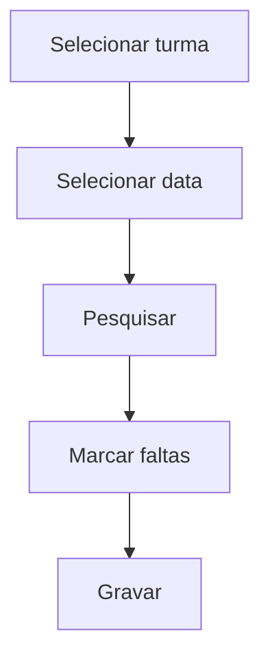

# Frequência Turma/Dia

## Objetivo

Fazer a **chamada de um dia** para uma turma inteira: marcar quais alunos **faltaram** em uma
data específica. É a forma mais direta de registrar presença/ausência no dia a dia.

---

## Como acessar

```
Frequências
→ Frequência Turma/Dia
```

---

## Quando utilizar

- Para registrar as faltas de um dia específico da turma.

---

## Como utilizar

1. Abra **Frequência Turma/Dia**.
2. Em **Selecione a Turma**, escolha a turma.
3. Em **Selecione a Data** (Data de Lançamento), escolha o dia.
4. Clique em **Pesquisar** para listar os alunos.
5. Marque **Falta** para os alunos ausentes.
6. Clique em **Gravar**.

---

## Campos e colunas

| Campo/Coluna | Descrição |
|--------------|-----------|
| Selecione a Turma | Turma da chamada |
| Selecione a Data / Data de Lançamento | Dia da frequência |
| Ordem | Ordem do aluno na turma |
| Matrícula | Matrícula do aluno |
| Nome | Nome do aluno |
| Falta | Marcação de ausência no dia |

---

## Botões

| Botão | O que faz |
|-------|-----------|
| **Pesquisar** | Lista os alunos da turma |
| **Gravar** | Salva as faltas do dia |

---

## Resultados

- As faltas do dia ficam registradas e passam a compor a frequência da turma.

---

## Regras importantes

- É preciso selecionar **turma** e **data** antes de pesquisar.
- Depende de a turma ter alunos matriculados e disciplinas com **controle de frequência**.

---

## Fluxo da funcionalidade



---

## Exemplos práticos

**Exemplo:** na turma "5º Ano A", data de hoje, marcar 2 alunos como **Falta** e gravar.

---

## Dicas

- Confira a **data** antes de gravar — a chamada é sempre por dia.

---

## FAQ

**E se a falta for por disciplina?**
Use [Lançamento de Faltas](lancamento-faltas.md) ou [Turma/Mês](turma-mes.md).

---

## Prints

- [ ] Seleção de turma e data.
- [ ] Lista com marcação de falta.

---

## Histórico

| Data | Alteração |
|------|-----------|
| 30/07/2026 | Página criada. |
