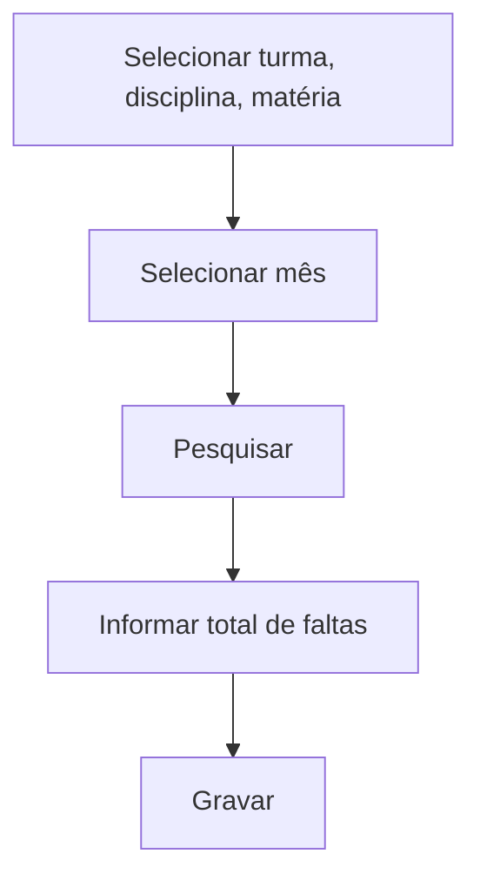

# Frequência Turma/Mês

## Objetivo

Trabalhar a frequência **consolidada do mês** de uma turma por **disciplina** (e **matéria**),
informando o total de **faltas** de cada aluno no período. Útil quando a escola registra o
total mensal em vez de dia a dia.

---

## Como acessar

```
Frequências
→ Frequência Turma/Mês
```

---

## Quando utilizar

- Para lançar/ajustar o total de faltas do mês por disciplina.

---

## Como utilizar

1. Abra **Frequência Turma/Mês**.
2. Selecione a **Turma**, a **Disciplina** e a **Matéria** (se houver).
3. Selecione o **Mês**.
4. Clique em **Pesquisar**.
5. Informe as **Faltas** de cada aluno no mês.
6. Clique em **Gravar**.

---

## Campos e colunas

| Campo/Coluna | Descrição |
|--------------|-----------|
| Selecione a Turma | Turma |
| Selecione a Disciplina | Disciplina |
| Selecione a Matéria | Matéria (quando aplicável) |
| Selecione o Mês | Mês de referência |
| Ordem / Matrícula / Nome | Identificação do aluno |
| Faltas | Total de faltas no mês |

---

## Botões

| Botão | O que faz |
|-------|-----------|
| **Pesquisar** | Lista os alunos |
| **Gravar** | Salva o total de faltas do mês |

---

## Resultados

- O total de faltas do mês por disciplina fica registrado.

---

## Regras importantes

- Disciplinas com **matérias** exigem a seleção da matéria.
- A disciplina precisa estar **ofertada** com **controle de frequência**.

---

## Fluxo da funcionalidade



---

## Exemplos práticos

**Exemplo:** turma "9º Ano A", disciplina "Ciências", agosto: informar 3 faltas para um aluno e gravar.

---

## Dicas

- Use esta tela quando só precisar do **total mensal**, sem detalhar por dia.

---

## FAQ

**Posso detalhar por dia depois?**
Sim, use [Lançamento de Faltas](lancamento-faltas.md) para o detalhamento diário.

---

## Prints

- [ ] Seleção de turma/disciplina/mês.
- [ ] Coluna de total de faltas.

---

## Histórico

| Data | Alteração |
|------|-----------|
| 30/07/2026 | Página criada. |
