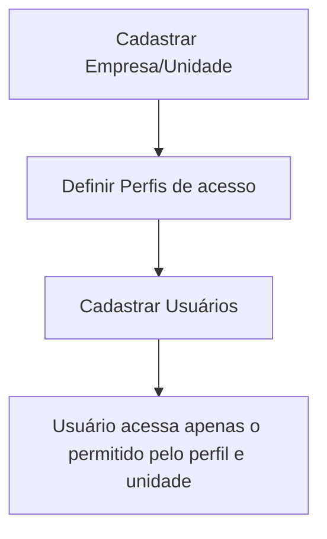

# Módulo Gerenciador (SaaS / Administração)

## Objetivo

O módulo **Gerenciador** controla a **administração da plataforma**: as **empresas/unidades**
(escolas atendidas — a base do modelo multi-tenant), os **perfis de acesso** (o que cada tipo de
usuário pode fazer) e os **usuários** do sistema (quem acessa e com qual perfil). É a área de
maior responsabilidade, normalmente restrita ao administrador.

## Como acessar

As telas ficam no grupo **Gerenciador** do menu lateral.

## Mapa do módulo

| Tela | Para que serve | Documentação |
|------|----------------|--------------|
| Empresas | Cadastrar as empresas/unidades (escolas) | [Abrir](empresas.md) |
| Perfil | Definir perfis de acesso e suas permissões | [Abrir](perfil.md) |
| Usuários | Cadastrar os usuários e vincular perfil | [Abrir](usuarios.md) |
| Reset Financeiro do Aluno | Zerar o financeiro de um aluno de teste (somente Master) | [Abrir](reset-financeiro-aluno.md) |

## Conceitos

- **Empresa/Unidade:** cada escola atendida pela plataforma. Os dados são isolados por unidade
  (multi-tenant) — um usuário só enxerga os dados da(s) sua(s) unidade(s).
- **Perfil:** um conjunto de permissões (quais **módulos** e **tarefas** o usuário pode acessar).
- **Usuário:** quem acessa o sistema, vinculado a um perfil e a uma unidade.

## Fluxo geral

---

## Histórico

| Data | Alteração |
|------|-----------|
| 30/07/2026 | Página criada. |
