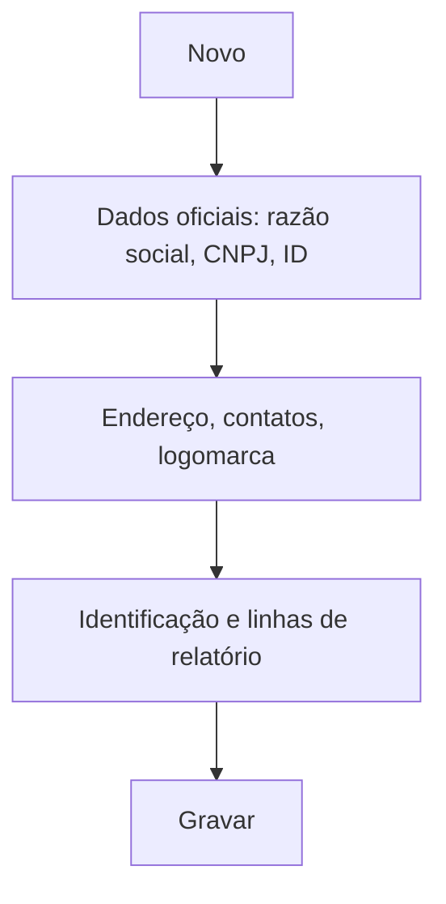

# Empresas / Unidades

## Objetivo

Cadastrar as **empresas/unidades** atendidas pela plataforma — cada **escola** é uma unidade, com
seus dados oficiais (razão social, CNPJ), identificação, logomarca e as mensagens/linhas que
saem nos relatórios e documentos. É a base do modelo **multi-tenant** do Harpia.

---

## Como acessar

```
Gerenciador
→ Empresas
```

---

## Quando utilizar

- Ao cadastrar uma nova escola/unidade na plataforma.
- Ao atualizar dados oficiais, logomarca ou textos de relatório de uma unidade.

---

## Como utilizar

1. Abra **Empresas**.
2. Clique em **Novo** (ou **Novo Com Base Nesse**).
3. Informe **Empresa**, **Razão Social**, **CNPJ**, **ID da Unidade** e o tipo (**Escola**,
   **IES**, **Curso Técnico**).
4. Preencha **Endereço**, contatos (**DDD**, **Celular/Fone**, **E-mail**) e o **Código Mobile**.
5. Defina a **Identificação no Relatório** e as **Linhas 01–04** (cabeçalho de documentos).
6. Use **ALTERAR IMAGEM** para a logomarca e a aba **Mensagens** para textos padrão.
7. Clique em **Gravar**.

---

## Campos (principais)

| Campo | Descrição | Obrigatório | Observações |
|-------|-----------|-------------|-------------|
| Empresa | Nome da unidade | Sim | |
| Razão Social | Razão social | Sim | |
| CNPJ | CNPJ da unidade | Sim | |
| ID da Unidade | Identificador da unidade | Sim | Isolamento multi-tenant |
| Escola / IES / Curso Técnico | Tipo da instituição | Não | |
| Endereço / Contatos | Dados de contato | Não | |
| Código Mobile | Código para o app | Não | |
| Identificação no Relatório | Nome nos relatórios | Não | |
| Linha 01–04 | Cabeçalho de documentos | Não | |
| Logomarca (ALTERAR IMAGEM) | Imagem da unidade | Não | |
| Mensagens | Textos padrão | Não | |

---

## Botões

| Botão | O que faz |
|-------|-----------|
| **Novo** | Cadastra uma nova unidade |
| **Novo Com Base Nesse** | Duplica uma unidade como base |
| **ALTERAR IMAGEM** | Define a logomarca |
| **Atualizar Dados** | Atualiza os dados da unidade |
| **Gravar** | Salva a unidade |
| **Opções** | Editar |

---

## Filtros e colunas

Colunas: **Empresa**, **Razão Social**, **CNPJ**, **ID da Unidade**.

---

## Resultados

- A unidade fica cadastrada e seus dados/logomarca passam a sair nos documentos e relatórios.

---

## Regras importantes

- **Razão Social**, **CNPJ** e **ID da Unidade** identificam a unidade — dados errados afetam
  documentos oficiais e boletos.
- Os dados de uma unidade são **isolados** das demais (multi-tenant).

---

## Fluxo da funcionalidade



---

## Exemplos práticos

**Exemplo:** cadastrar a unidade "Centro Educacional Encantado", com CNPJ, logomarca e as linhas
de cabeçalho que aparecem nos boletins e recibos.

---

## Dicas

- Configure as **Linhas 01–04** e a **logomarca** com cuidado — elas aparecem em todos os documentos.

---

## FAQ

**Uma instalação pode ter várias escolas?**
Sim — cada uma é uma **unidade**, com dados isolados.

---

## Prints

- [ ] Lista de empresas/unidades.
- [ ] Formulário (dados e logomarca).

---

## Histórico

| Data | Alteração |
|------|-----------|
| 30/07/2026 | Página criada. |
