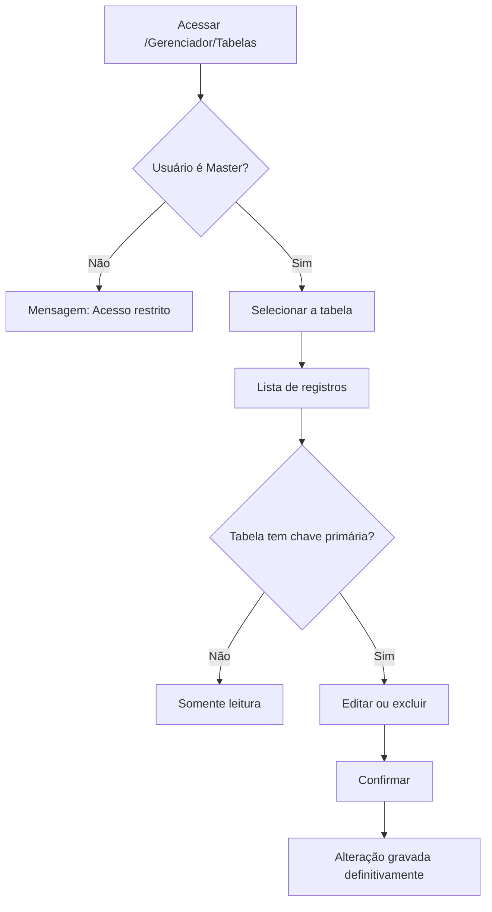

# Gerenciador de Tabelas

:::danger Área técnica de uso restrito
Esta tela permite alterar e excluir registros **diretamente nas tabelas do sistema**, sem passar
pelas validações das telas normais. Um registro alterado aqui pode inutilizar informações de
alunos, notas ou lançamentos financeiros — **sem possibilidade de desfazer**.

Use apenas sob orientação do suporte técnico e **somente** quando não houver caminho pela tela
correspondente.
:::

## Objetivo

Permitir que a equipe técnica **consulte, corrija ou remova registros** diretamente nas tabelas
do sistema, em situações de manutenção ou correção pontual que não podem ser resolvidas pelas
telas normais.

---

## Quem pode utilizar

Apenas usuários com marcação **Master**. Para os demais, a tela exibe a mensagem **"Acesso
restrito — Esta área é exclusiva para usuários Master."**

---

## Como acessar

A tela é aberta pelo endereço direto:

```
/Gerenciador/Tabelas
```

:::note Ainda não aparece no menu
O item de menu correspondente **está desativado** nesta versão. O acesso é feito apenas pelo
endereço direto, o que reforça o caráter técnico e excepcional da tela.
:::

---

## Quando utilizar

- Em atendimento do suporte, para corrigir um dado que ficou inconsistente.
- Para conferir rapidamente o conteúdo de uma tabela durante uma investigação.
- **Nunca** como substituto das telas de cadastro do dia a dia.

---

## Como utilizar

1. Acesse o endereço da tela.
2. Em **Tabela**, escolha a tabela que deseja abrir.
3. Os registros são carregados na lista, com paginação (10, 20, 50 ou 100 por página).
4. Use **Buscar nos campos de texto...** para localizar um registro.
5. Na coluna **Ações**, use o ícone de **lápis** para editar ou o de **lixeira** para excluir.
6. Na janela **Editar registro**, altere os campos necessários e clique em **Salvar**.

*(Print sugerido: tela com uma tabela selecionada e a lista de registros.)*

---

## Campos e colunas

| Elemento | Descrição |
|----------|-----------|
| Tabela | Dropdown com as tabelas disponíveis |
| Colunas | São as colunas reais da tabela escolhida. As que compõem a **chave primária** trazem um ícone de **chave** |
| Contador | Mostra o total de registros da tabela |
| Selo "Tabela sem PK — somente leitura" | Aparece quando a tabela não tem chave primária |

---

## Botões

| Botão | O que faz |
|-------|-----------|
| **Atualizar** | Recarrega os dados da tabela selecionada |
| **Editar** (lápis) | Abre a janela de edição do registro |
| **Excluir** (lixeira) | Exclui o registro, após confirmação |
| **Salvar** | Grava as alterações feitas na janela de edição |
| **Cancelar** | Fecha a janela sem gravar |

---

## Filtros

| Filtro | O que faz |
|--------|-----------|
| Tabela | Define qual tabela será exibida |
| Buscar nos campos de texto | Filtra os registros pelo texto digitado, nas colunas de texto |

---

## Resultados

- A alteração é gravada **imediatamente** na tabela.
- A exclusão remove o registro **definitivamente**.

---

## Regras importantes

- Apenas usuários **Master** acessam a tela.
- **Tabelas sem chave primária são somente leitura**: os botões de editar e excluir ficam
  desabilitados.
- Não há **desfazer**. Alterações e exclusões são definitivas.
- A tela **não valida regras de negócio** — é possível gravar um dado que as telas normais
  recusariam.
- Sempre faça (ou solicite) um **backup** antes de qualquer alteração.

---

## Mensagens do sistema

**Sucesso**
- *"Registro atualizado."*
- *"Registro excluído."*

**Informação**
- *"Nenhum campo foi alterado."*

**Alerta**
- *"Tabela sem chave primária: edição não permitida."*
- *"Tabela sem chave primária: exclusão não permitida."*

**Erro**
- *"Erro ao listar tabelas."*
- *"Erro ao carregar os dados."*
- *"Erro ao abrir a tabela."*
- *"Erro ao atualizar."*
- *"Erro ao excluir."*

**Confirmação**
- Confirmação antes de excluir o registro.

---

## Fluxo da funcionalidade



---

## Exemplos práticos

**Exemplo — correção orientada pelo suporte**

Durante um atendimento, o suporte identifica um registro com um campo gravado errado por uma
importação antiga. Com a supervisão do técnico, o usuário Master abre a tabela, localiza o
registro pela busca, corrige o campo e salva.

---

## Dicas

- Antes de alterar, **anote o valor original** — não existe desfazer.
- Prefira sempre a **tela de cadastro correspondente**; ela aplica as validações que protegem os
  dados.
- Use a busca para localizar o registro em vez de percorrer as páginas.

---

## Erros comuns

- **"Acesso restrito"** → o usuário não é Master.
- **Botões de editar e excluir desabilitados** → a tabela não tem chave primária e só permite
  leitura.
- **"Nenhum campo foi alterado."** → você abriu a edição e salvou sem mudar nada.

---

## FAQ

**Por que a tela não está no menu?**
O item de menu foi desativado propositalmente nesta versão. O acesso continua disponível pelo
endereço direto, para uso técnico.

**Dá para desfazer uma exclusão feita aqui?**
Não pelo sistema. Só com restauração de backup.

**Qualquer administrador da escola pode usar?**
Não. Somente usuários com marcação **Master**.

---

## Prints

- [ ] Mensagem de acesso restrito.
- [ ] Tela com uma tabela selecionada.
- [ ] Janela **Editar registro**.

---

## Páginas relacionadas

- [Visão geral do módulo Gerenciador](README.md)
- [Perfil (Permissões de Acesso)](perfil.md)
- [Usuários](usuarios.md)

---

## Histórico

| Data | Alteração |
|------|-----------|
| 21/08/2026 | Página criada — nova tela técnica **Gerenciador de Tabelas** (acesso Master, item de menu ainda desativado). |
