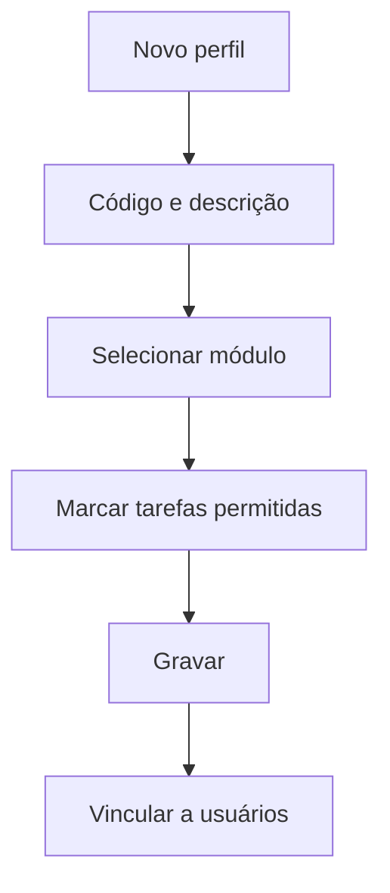

# Perfil (Permissões de Acesso)

## Objetivo

Definir os **perfis de acesso** — conjuntos de permissões que determinam **quais módulos e
tarefas** cada tipo de usuário pode acessar (ex.: Secretaria, Financeiro, Professor,
Coordenação). Cada usuário recebe um perfil, e é o perfil que controla o que ele vê e faz.

---

## Quem pode utilizar

Administrador / Usuário Master.

---

## Como acessar

```
Gerenciador
→ Perfil
```

---

## Quando utilizar

- Ao criar um novo tipo de acesso.
- Ao ajustar o que um perfil pode fazer (liberar/bloquear telas e tarefas).

---

## Como utilizar

1. Abra **Perfil**.
2. Clique em **Novo** (ou **Novo Com Base Nesse** para partir de um perfil existente).
3. Informe o **Código** e a **Descrição** do perfil.
4. Para cada **Módulo**, marque as **Tarefas** (telas/ações) que o perfil pode acessar.
5. Clique em **Gravar**.

---

## Campos

| Campo | Descrição | Obrigatório |
|-------|-----------|-------------|
| Código | Código do perfil | Sim |
| Descrição | Nome do perfil | Sim |
| Módulo | Módulo do sistema | Sim |
| Tarefa | Tela/ação liberada no módulo | Sim |

---

## Botões

| Botão | O que faz |
|-------|-----------|
| **Novo** | Cria um novo perfil |
| **Novo Com Base Nesse** | Duplica um perfil como base |
| **Pesquisar** | Busca perfis |
| **Gravar** | Salva o perfil e suas permissões |
| **Opções** | Editar/excluir |

---

## Resultados

- O perfil fica disponível para ser vinculado a [usuários](usuarios.md); as permissões definem o
  que aparece no menu e o que o usuário pode fazer.

---

## Regras importantes

- **Código** e **Descrição** são obrigatórios.
- As **tarefas** marcadas controlam o menu e o acesso — libere apenas o necessário (princípio do
  menor privilégio).
- Como o **menu é montado a partir das permissões**, o que o usuário vê depende diretamente do perfil.

---

## Fluxo da funcionalidade



---

## Exemplos práticos

**Exemplo:** criar o perfil "Secretaria" liberando os módulos de Cadastro, Acadêmico, Frequência,
Notas, Boletim e Histórico, sem acesso ao Financeiro.

---

## Dicas

- Use **Novo Com Base Nesse** para criar variações de um perfil já existente.
- Libere apenas as tarefas necessárias — facilita a segurança e o dia a dia do usuário.

---

## FAQ

**Por que um usuário não vê uma tela?**
Provavelmente o **perfil** dele não tem a tarefa liberada. Ajuste o perfil.

---

## Prints

- [ ] Lista de perfis.
- [ ] Seleção de módulos/tarefas.

---

## Histórico

| Data | Alteração |
|------|-----------|
| 30/07/2026 | Página criada. |
