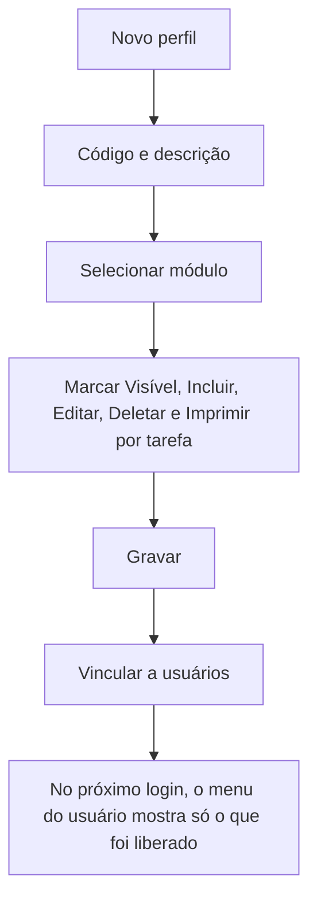

# Perfil (Permissões de Acesso)

## Objetivo

Definir os **perfis de acesso** — conjuntos de permissões que determinam **quais módulos e
tarefas** cada tipo de usuário pode acessar (ex.: Secretaria, Financeiro, Professor,
Coordenação). Cada usuário recebe um perfil, e é o perfil que controla o que ele vê e faz.

---

## Como acessar

```
Gerenciador
→ Perfil
```

---

## Quando utilizar

- Ao criar um novo tipo de acesso.
- Ao ajustar o que um perfil pode fazer (liberar/bloquear telas e tarefas).

---

## Como utilizar

1. Abra **Perfil**.
2. Clique em **Novo** (ou **Novo Com Base Nesse** para partir de um perfil existente).
3. Informe o **Código** e a **Descrição** do perfil.
4. Selecione o **Módulo**. A lista de **Tarefas** (telas) daquele módulo aparece abaixo.
5. Para cada tarefa, marque **o que o perfil pode fazer**: **Visível**, **Incluir**, **Editar**,
   **Deletar** e **Imprimir**.
6. Se quiser aplicar a mesma marcação a todas as tarefas do módulo, use a **caixa do cabeçalho**
   da coluna.
7. Clique em **Gravar**.

*(Print sugerido: lista de tarefas com as cinco colunas de permissão.)*

---

## Campos

| Campo | Descrição | Obrigatório |
|-------|-----------|-------------|
| Código | Código do perfil | Sim |
| Descrição | Nome do perfil | Sim |
| Módulo | Módulo do sistema cujas tarefas serão configuradas | Sim |
| Tarefa | Tela do módulo | Sim |

---

## Permissões por tarefa

Cada tarefa tem **cinco permissões independentes**:

| Permissão | O que libera |
|-----------|--------------|
| **Visível** | A tarefa aparece no menu e a tela pode ser aberta. Sem ela, o item **não é exibido** |
| **Incluir** | Criar novos registros na tela |
| **Editar** | Alterar registros existentes |
| **Deletar** | Excluir registros |
| **Imprimir** | Emitir relatórios e documentos da tela |

:::tip As marcações se ajustam sozinhas
Ao marcar **Visível**, o sistema marca também **Incluir**, **Editar** e **Deletar** — o caso mais
comum. Ao desmarcar **Visível**, todas são desmarcadas.

Ao marcar qualquer uma das outras permissões, o **Visível** é marcado automaticamente: não faz
sentido poder incluir em uma tela que não se pode abrir.
:::

Para deixar uma tela **apenas para consulta**, marque **Visível** e desmarque **Incluir**,
**Editar** e **Deletar**.

---

## Botões

| Botão | O que faz |
|-------|-----------|
| **Novo** | Cria um novo perfil |
| **Novo Com Base Nesse** | Duplica um perfil como base |
| **Pesquisar** | Busca perfis |
| **Gravar** | Salva o perfil e suas permissões |
| **Opções** | Editar/excluir |
| **Caixa do cabeçalho da coluna** | Marca ou desmarca aquela permissão em **todas** as tarefas do módulo |

---

## Resultados

- O perfil fica disponível para ser vinculado a [usuários](usuarios.md).
- **O menu lateral passa a exibir apenas as tarefas marcadas como Visível.** As demais
  simplesmente não aparecem para o usuário.
- Grupos de menu que ficarem **sem nenhuma tarefa liberada** também deixam de aparecer.

---

## Regras importantes

- **Código** e **Descrição** são obrigatórios.
- As **tarefas** marcadas controlam o menu e o acesso — libere apenas o necessário (princípio do
  menor privilégio).
- Como o **menu é montado a partir das permissões**, o que o usuário vê depende diretamente do perfil.
- O menu é **recarregado a cada login** e ao **trocar de empresa/unidade**. Uma permissão alterada
  enquanto o usuário está logado só aparece para ele no próximo acesso.
- Usuários com marcação **Master** não sofrem esse filtro: eles enxergam o menu completo.

---

## Fluxo da funcionalidade



---

## Exemplos práticos

**Exemplo 1 — perfil Secretaria:** criar o perfil "Secretaria" liberando os módulos de Cadastro,
Acadêmico, Frequência, Notas, Boletim e Histórico, sem acesso ao Financeiro. O menu desses
usuários não exibirá o grupo **Financeiro**.

**Exemplo 2 — perfil de consulta:** criar o perfil "Consulta Financeira" marcando, nas telas do
Financeiro, apenas **Visível** e **Imprimir**. O usuário abre as telas e emite relatórios, mas
não consegue lançar, alterar nem excluir nada.

---

## Dicas

- Use **Novo Com Base Nesse** para criar variações de um perfil já existente.
- Libere apenas as tarefas necessárias — facilita a segurança e o dia a dia do usuário.
- Use a **caixa do cabeçalho** para liberar um módulo inteiro rapidamente e depois retire as
  exceções.
- Para um perfil de consulta, marque **Visível** + **Imprimir** e deixe as demais desmarcadas.

---

## FAQ

**Por que um usuário não vê uma tela?**
Provavelmente o **perfil** dele não tem a tarefa marcada como **Visível**. Ajuste o perfil.

**Alterei o perfil e o usuário continua vendo o menu antigo. Por quê?**
O menu é montado no login. Peça para ele **sair e entrar novamente** no sistema.

**Um grupo inteiro do menu sumiu. É erro?**
Não. Quando **nenhuma** tarefa do grupo está liberada, o grupo deixa de aparecer.

**O usuário vê a tela, mas o botão de excluir não aparece. Por quê?**
A permissão **Deletar** daquela tarefa está desmarcada no perfil.

---

## Prints

- [ ] Lista de perfis.
- [ ] Seleção de módulo e lista de tarefas com as colunas Visível, Incluir, Editar, Deletar e Imprimir.
- [ ] Menu lateral de um usuário com perfil restrito.

---

## Páginas relacionadas

- [Usuários](usuarios.md)
- [Como navegar no sistema](../getting-started/navegacao.md)
- [Gerenciador de Tabelas](gerenciador-tabelas.md)

---

## Histórico

| Data | Alteração |
|------|-----------|
| 30/07/2026 | Página criada. |
| 21/08/2026 | Documentadas as **cinco permissões por tarefa** (Visível, Incluir, Editar, Deletar, Imprimir), a marcação automática entre elas e a marcação em massa pelo cabeçalho. O **menu lateral passou a ser filtrado pelas permissões do perfil**: tarefas sem *Visível* e grupos sem nenhuma tarefa liberada deixam de aparecer. |
