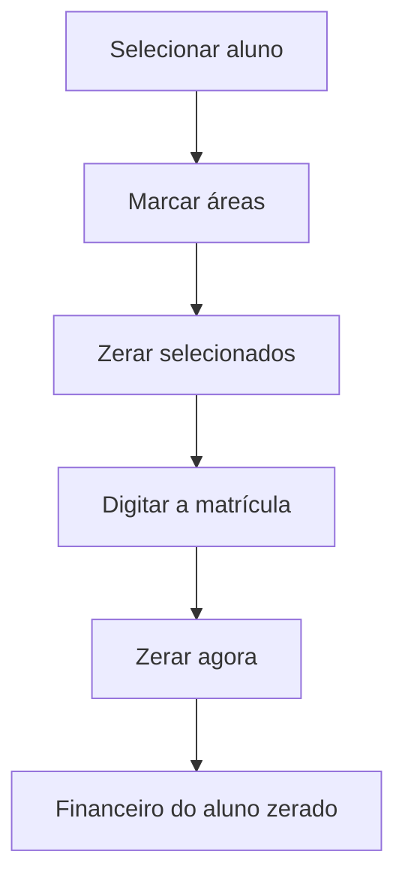

# Reset Financeiro do Aluno

## Objetivo

**Zerar as informações de pagamento de um aluno** no período letivo selecionado, para poder repetir
testes de recebimento sem precisar recriar o aluno. É uma ferramenta de **testes**.

:::danger Atenção
As exclusões são **definitivas e não têm estorno**. Use **apenas em base de testes**, nunca com dados reais de cobrança.
:::

---

## Como acessar

```
Reset Financeiro do Aluno
```

O item aparece **solto no fim do menu lateral** (ícone de borracha) e **somente para usuários
Master**. Se um usuário sem esse perfil abrir a tela, ela mostra *"Acesso restrito"* —
*"Esta área é exclusiva para usuários Master."*

---

## Quando utilizar

- Ao testar recebimentos, estornos e boletos de um aluno de teste e querer começar do zero.

---

## Como utilizar

1. Abra **Reset Financeiro do Aluno** (o período letivo usado é o selecionado no topo do sistema).
2. Em **Aluno**, pesquise e selecione o aluno. O sistema mostra a **matrícula** e a quantidade de registros em cada área.
3. Marque as áreas que deseja limpar (ou use **Marcar tudo**). Use **Atualizar** para recontar.
4. Clique em **Zerar selecionados**.
5. Na janela **Confirmar limpeza**, confira as áreas e as quantidades, **digite a matrícula** do aluno e clique em **Zerar agora**.

*(Print sugerido: tela com aluno selecionado e áreas marcadas.)*
*(Print sugerido: janela Confirmar limpeza pedindo a matrícula.)*

---

## Campos

| Campo | Descrição | Obrigatório |
|-------|-----------|-------------|
| Aluno | Aluno que terá o financeiro zerado | Sim |
| Áreas (caixas de seleção) | O que será limpo (tabela abaixo) | Ao menos uma |
| Matrícula (confirmação) | Digitada na janela de confirmação | Sim |

| Área | O que acontece |
|------|----------------|
| Mensalidades | Limpa os dados de pagamento das parcelas e apaga as parcelas extras criadas por adiantamento/recebimento |
| MensalidadesPagamento | Apaga os pagamentos das mensalidades do aluno |
| DiarioFinanceiro | Apaga os lançamentos do aluno no período |
| Apagar (contas a pagar) | Apaga só as contas a pagar geradas pelos recebimentos do aluno (taxa de cartão e parcelas ligadas). Contas avulsas da escola **não** são tocadas |
| OutrosRecebimentos | Apaga os outros recebimentos do aluno no período |

---

## Botões

| Botão | O que faz |
|-------|-----------|
| **Atualizar** | Recarrega a contagem de registros do aluno |
| **Marcar tudo / Desmarcar tudo** | Seleciona ou limpa todas as áreas |
| **Zerar selecionados** | Abre a confirmação |
| **Zerar agora** | Executa a limpeza (só habilita depois de digitar a matrícula correta) |
| **Cancelar** | Fecha sem alterar nada |

---

## Resultados

- As informações das áreas marcadas são zeradas para o aluno e período; o sistema mostra *"Pronto"* — *"Informações de pagamento zeradas."*

---

## Regras importantes

- **Somente usuário Master.**
- Vale só para o **aluno** e o **período letivo** selecionados.
- Se algo falhar, nada é alterado (*"Erro ao zerar. Nada foi alterado."*).
- Não há desfazer.

---

## Mensagens do sistema

- *"Selecione um aluno."*
- *"Marque ao menos uma tabela para limpar."*
- *"Pronto — Informações de pagamento zeradas."*
- *"Erro ao carregar o resumo do aluno."*
- *"Erro ao zerar as informações de pagamento."*
- *"Esta ação não pode ser desfeita."* (aviso na confirmação)

---

## Fluxo da funcionalidade



---

## Exemplos práticos

**Exemplo:** após testar um recebimento em cartão parcelado do aluno de teste, marque tudo, confirme com a matrícula e refaça o teste.

---

## Dicas

- Use sempre um **aluno de teste**.
- Marque também **Apagar** para remover as taxas de cartão geradas nos testes.

---

## Erros comuns

- **Botão "Zerar agora" desabilitado** → a matrícula digitada não confere com a do aluno.
- **"Acesso restrito"** → seu usuário não é Master.

---

## FAQ

**Dá para recuperar o que foi zerado?**
Não.

**Funciona em produção?**
A tela tem a marca **DEV** e o aviso de que é ferramenta de desenvolvimento. A restrição técnica ao ambiente de testes está hoje desativada; por isso, por segurança, use somente em base de testes.

---

## Prints

- [ ] Tela com aviso, aluno e áreas.
- [ ] Janela de confirmação.

---

## Histórico

| Data | Alteração |
|------|-----------|
| 07/10/2026 | Página criada (nova tela Reset Financeiro do Aluno). |
