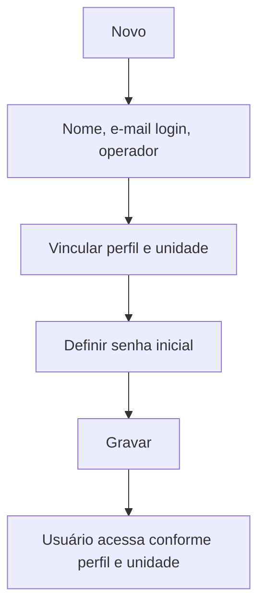

# Usuários

## Objetivo

Cadastrar os **usuários** que acessam o sistema — o login (e-mail), o nome, o **perfil** de
permissões e a **unidade** a que pertencem. É aqui que se concede e se controla o acesso das
pessoas ao Harpia.

---

## Como acessar

```
Gerenciador
→ Usuários
```

---

## Quando utilizar

- Ao dar acesso a um novo colaborador.
- Ao alterar o perfil, ativar/desativar ou redefinir o acesso de um usuário.

---

## Como utilizar

1. Abra **Usuários**.
2. Clique em **Novo**.
3. Informe o **Nome**, o **E-mail (Login)** e o **Operador**.
4. Vincule o **Perfil** (permissões) e a **Unidade**.
5. Defina a **Senha** inicial de acesso e, se for o caso, marque **Usuário Master**.
6. Clique em **Gravar**.

> **Segurança:** a senha é definida pelo administrador para o **primeiro acesso**. Oriente o
> usuário a trocá-la e nunca compartilhe senhas. Conceda **Usuário Master** apenas quando
> realmente necessário.

---

## Campos

| Campo | Descrição | Obrigatório | Observações |
|-------|-----------|-------------|-------------|
| Nome | Nome do usuário | Sim | |
| E-mail (Login) | E-mail usado para entrar | Sim | É o login |
| Operador | Identificação do operador | Não | Liga ao funcionário |
| Perfil | Perfil de permissões | Sim | Ver [Perfil](perfil.md) |
| Unidade | Unidade/empresa do usuário | Sim | Multi-tenant |
| Senha | Senha de acesso | Sim | Definida pelo administrador |
| Usuário Master | Acesso total de administração | Não | Conceder com critério |
| Ativado | Situação do acesso | Não | Desative em vez de excluir |

---

## Botões

| Botão | O que faz |
|-------|-----------|
| **Novo** | Cadastra um novo usuário |
| **Pesquisar** | Busca usuários |
| **Gravar** | Salva o usuário |
| **Opções** | Editar/ativar/desativar |

---

## Filtros e colunas

Colunas: **Nome**, **E-mail (Login)**, **Unidade**, **Ativado**.

---

## Resultados

- O usuário passa a acessar o sistema conforme o **perfil** e a **unidade** definidos.

---

## Regras importantes

- **Nome**, **E-mail (Login)**, **Perfil** e **Unidade** são obrigatórios.
- O que o usuário vê/faz é determinado pelo **perfil**; os dados que enxerga, pela **unidade**.
- Prefira **desativar** um usuário a excluí-lo, preservando o histórico de operações.
- **Usuário Master** tem acesso amplo — conceda apenas a administradores.

---

## Fluxo da funcionalidade



---

## Exemplos práticos

**Exemplo:** criar o usuário de uma secretária com o perfil "Secretaria", vinculado à unidade da
escola, com senha inicial para o primeiro acesso.

---

## Dicas

- Vincule o **Operador** ao funcionário para rastrear as operações no sistema.
- Revise periodicamente os usuários ativos e seus perfis.

---

## Erros comuns

- **Usuário não consegue ver uma tela** → ajuste o [Perfil](perfil.md) vinculado.
- **Usuário não enxerga os dados esperados** → verifique a **Unidade** vinculada.

---

## FAQ

**Usuário é o mesmo que funcionário?**
Não. O [Funcionário](../administrativo/funcionarios.md) é o cadastro de RH; o usuário é o **acesso**
ao sistema, que pode ser vinculado a um funcionário pelo **Operador**.

**Quem pode redefinir a senha?**
O administrador, por esta tela. Oriente a troca no primeiro acesso.

---

## Prints

- [ ] Lista de usuários.
- [ ] Formulário (perfil, unidade, senha).

---

## Histórico

| Data | Alteração |
|------|-----------|
| 30/07/2026 | Página criada. |
