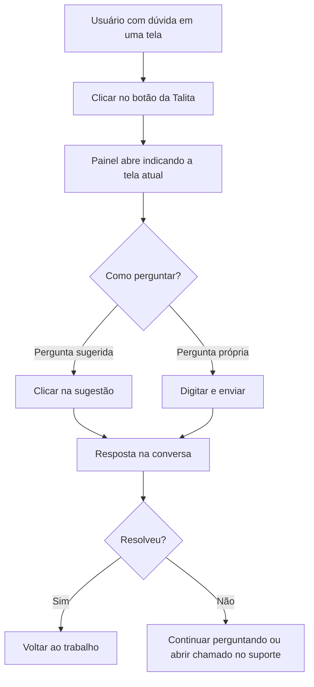

# Talita — Assistente Virtual

## Objetivo

A **Talita** é a assistente virtual do Harpia. Ela responde a dúvidas sobre **como usar o
sistema** — o que uma tela faz, para que serve um campo, qual é o passo seguinte de um processo —
sem que o usuário precise sair do que está fazendo para procurar na documentação ou ligar para o
suporte.

---

## Como acessar

A Talita fica em um **botão redondo flutuante**, sempre visível no canto da tela, em qualquer
parte do sistema. Basta clicar nele para abrir a conversa.

Ao passar o mouse pelo botão, aparece um balão com o convite *"Oi, sou a Talita! Em que posso
ajudar?"*.

*(Print sugerido: botão flutuante da Talita com o balão de convite.)*

---

## Quando utilizar

- Quando você não sabe **para que serve** um campo ou um botão da tela em que está.
- Quando não lembra **em que menu** fica uma funcionalidade.
- Quando precisa da **sequência correta** de um processo (por exemplo, o que fazer antes de gerar
  boletos).
- Como **primeiro socorro** antes de abrir um chamado no suporte.

---

## Como utilizar

1. Clique no **botão flutuante da Talita**.
2. O painel de conversa abre ao lado, com a saudação e, no topo, a indicação da tela em que você
   está (*"Você está em ..."*).
3. Clique em uma das **perguntas sugeridas** — elas mudam conforme a tela aberta — ou digite a
   sua própria pergunta no campo *"Como faço para..."*.
4. Pressione **Enter** ou clique no botão de **enviar**.
5. Leia a resposta e continue perguntando à vontade: a Talita mantém o fio da conversa.

*(Print sugerido: painel de conversa aberto com perguntas sugeridas.)*

### Mover o botão de lugar

O botão pode atrapalhar os botões da tela em que você está. Nesse caso:

- **Arraste** o botão para onde preferir. A posição fica **gravada** e vale para os próximos
  acessos.
- **Clique com o botão direito** sobre ele para devolvê-lo ao canto original.

---

## Botões

| Botão | O que faz |
|-------|-----------|
| **Botão flutuante da Talita** | Abre e fecha o painel de conversa |
| **Perguntas sugeridas** | Envia uma pergunta pronta relacionada à tela atual |
| **Enviar** | Envia a pergunta digitada |
| **Fechar** | Fecha o painel (a conversa continua guardada) |
| Arrastar o botão | Reposiciona o botão flutuante na tela |
| Clique com o botão direito no botão | Devolve o botão ao canto original |

---

## Resultados

- A resposta aparece na conversa, em linguagem simples.
- A conversa **sobrevive à troca de telas**: você pode navegar pelo sistema e voltar ao painel
  sem perder o histórico.
- A Talita **sabe em qual tela você está** — por isso perguntas como *"e esse campo aqui?"*
  fazem sentido para ela.

---

## Regras importantes

- A Talita **só orienta sobre o uso do sistema**. Ela **não acessa dados da escola** (alunos,
  notas, valores) e **não executa nenhuma operação** — não lança pagamento, não matricula, não
  altera cadastro.
- O botão **só aparece se a assistente estiver ativada** na instalação da sua escola. Se ele não
  estiver visível, o recurso não está habilitado — fale com o suporte.
- O histórico da conversa vale para a **sessão atual**. Ao sair e entrar de novo no sistema, a
  conversa recomeça.
- Como qualquer assistente, a Talita pode errar. Em decisões importantes — fechamento de caixa,
  encerramento de período, exclusão de registros — confirme na documentação ou com o suporte.

---

## Fluxo da funcionalidade

---

## Exemplos práticos

**Exemplo 1 — dúvida sobre um campo**

Na tela de Recebimento de Mensalidade, a atendente não sabe o que significa a marcação **RPU**
no cartão. Abre a Talita e pergunta *"o que é RPU no cartão?"*. A resposta explica o conceito
sem que ela precise sair da tela.

**Exemplo 2 — encontrar uma funcionalidade**

Um usuário novo pergunta *"onde eu gero os boletos?"*. A Talita indica o caminho no menu, e ele
segue direto para a tela.

---

## Dicas

- Comece pelas **perguntas sugeridas**: elas já são sobre a tela em que você está.
- Seja **específico**: *"como estorno um pagamento em cartão?"* rende uma resposta melhor do que
  *"como estorno?"*.
- Se o botão estiver cobrindo algum comando da tela, **arraste-o** — ele fica onde você deixar.

---

## Erros comuns

- **O botão da Talita não aparece** → a assistente não está ativada na instalação da sua escola.
- **A Talita não sabe um dado da escola** ("quanto o aluno X deve?") → isso é esperado: ela
  orienta sobre o **uso do sistema**, não consulta dados. Use a
  [Ficha Financeira](../financeiro/ficha-financeira.md) para esse tipo de informação.
- **O botão sumiu depois de arrastar** → clique com o botão direito sobre ele para devolvê-lo ao
  canto original. Se não conseguir localizá-lo, atualize a página.

---

## FAQ

**A Talita vê os dados dos meus alunos?**
Não. Ela não tem acesso aos dados da escola — só orienta sobre o funcionamento do sistema.

**Ela pode fazer alguma coisa por mim, como lançar um pagamento?**
Não. Ela apenas explica como fazer; a operação continua sendo sua.

**Minhas conversas ficam gravadas?**
O histórico vale para a sessão atual. Ao sair do sistema, a conversa é reiniciada.

**Posso usar a Talita em qualquer tela?**
Sim. O botão fica disponível em todo o sistema, e ela reconhece a tela em que você está.

---

## Prints

- [ ] Botão flutuante com o balão de convite.
- [ ] Painel de conversa aberto, com as perguntas sugeridas.
- [ ] Resposta da assistente na conversa.

---

## Páginas relacionadas

- [Como navegar no sistema](navegacao.md)
- [Introdução ao Harpia](introducao.md)

---

## Histórico

| Data | Alteração |
|------|-----------|
| 21/08/2026 | Página criada — nova **assistente virtual Talita**. |
