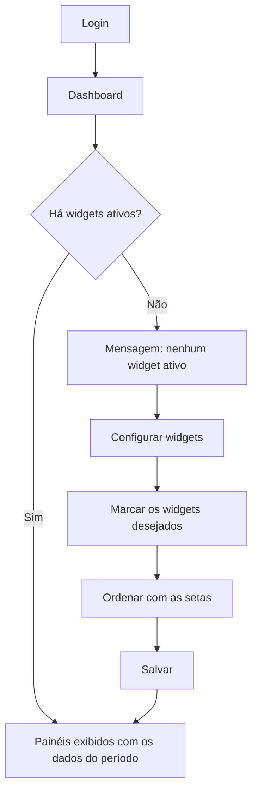

# Dashboard (Meus widgets)

## Objetivo

O **Dashboard** é a tela inicial do Harpia. Ele reúne, em **painéis visuais** chamados
**widgets**, os números que a escola acompanha no dia a dia: ocupação de vagas, faturamento e
inadimplência. Cada usuário escolhe **quais widgets quer ver** e **em que ordem** — a
configuração é pessoal.

---

## Como acessar

O Dashboard é a primeira tela apresentada após o login. Também é possível voltar a ele clicando
no item inicial do menu lateral.

---

## Quando utilizar

- No início do expediente, para uma visão rápida da situação da escola.
- Ao acompanhar o desempenho financeiro do mês.
- Ao conferir a ocupação das turmas durante o período de matrícula.

---

## Como utilizar

1. Abra o **Dashboard**.
2. Na primeira vez, se nenhum widget estiver ativo, aparece a mensagem *"Nenhum widget ativo.
   Clique em 'Configurar widgets' para ativar."*
3. Clique em **Configurar widgets**.
4. Na janela **Configurar widgets do Dashboard**, marque os painéis que deseja exibir.
5. Use as **setas para cima e para baixo** para definir a ordem em que eles aparecem.
6. Clique em **Salvar**.

*(Print sugerido: Dashboard com widgets ativos e o botão Configurar widgets.)*

*(Print sugerido: janela de configuração com a lista de widgets e as setas de ordenação.)*

---

## Widgets disponíveis

| Widget | O que mostra |
|--------|--------------|
| **Estatística de Vagas por Turma** | Quantas vagas de cada turma estão **ocupadas** e quantas estão **livres** |
| **Faturamento x Turma / Mês** | O faturamento de cada turma, com filtro por mês |
| **Faturamento x Inadimplência / Mês** | Comparativo mensal entre o que foi faturado e o que está inadimplente |
| **Inadimplência no Período** | Proporção entre alunos **adimplentes** e **inadimplentes** |
| **Sintético por Plano de Pagamento** | Resumo dos valores agrupados por plano de pagamento |

---

## Filtros

| Filtro | Onde aparece | O que faz |
|--------|--------------|-----------|
| Mês | Widget **Faturamento x Turma / Mês** | Mostra o faturamento de um mês específico ou de **Todos os meses** |

---

## Botões

| Botão | O que faz |
|-------|-----------|
| **Configurar widgets** | Abre a janela de escolha e ordenação dos painéis |
| **Seta para cima / para baixo** | Move o widget na ordem de exibição |
| **Salvar** | Grava a configuração escolhida |
| **Cancelar** | Fecha a janela sem alterar nada |

---

## Resultados

- Os widgets marcados passam a aparecer na tela inicial, na ordem definida.
- A configuração é **de cada usuário**: dois usuários da mesma escola podem ver dashboards
  diferentes.
- Os dados exibidos são sempre os da **empresa/unidade e do período letivo selecionados** no topo
  do sistema.

---

## Regras importantes

- Os widgets refletem os dados do **período letivo ativo**. Ao trocar de período, os números
  mudam.
- Um widget pode aparecer **vazio** quando ainda não há dados para o período — por exemplo,
  faturamento em um período que acabou de ser iniciado.
- A configuração de widgets **não altera permissões**: ela apenas escolhe o que exibir para você.

---

## Mensagens do sistema

**Alerta**
- *"Nenhum widget ativo. Clique em 'Configurar widgets' para ativar."*

**Erro**
- Cada widget exibe uma mensagem própria quando não consegue carregar os dados; os demais
  continuam funcionando normalmente.

---

## Fluxo da funcionalidade

---

## Exemplos práticos

**Exemplo — dashboard da direção**

A diretora ativa **Faturamento x Inadimplência / Mês** e **Inadimplência no Período**, nessa
ordem, e deixa os demais desligados. Ao entrar no sistema, ela vê imediatamente a evolução da
inadimplência do ano.

**Exemplo — dashboard da secretaria**

A secretária ativa apenas **Estatística de Vagas por Turma**, para acompanhar as vagas
disponíveis durante o período de matrículas.

---

## Dicas

- Ative **poucos widgets**: dois ou três bem escolhidos são mais úteis do que a tela cheia.
- Coloque no topo o painel que você consulta todos os dias — ele fica visível sem rolar a tela.
- No widget de faturamento por turma, use o filtro **Todos os meses** para ver o acumulado do
  período.

---

## Erros comuns

- **O widget aparece vazio** → não há dados para o período letivo selecionado. Confira o período
  no topo do sistema.
- **Os números não batem com o esperado** → verifique a **empresa/unidade** e o **período**
  selecionados; o Dashboard sempre segue essa seleção.

---

## FAQ

**Minha configuração vale para os outros usuários?**
Não. Cada usuário tem a sua.

**Posso voltar à configuração anterior?**
Basta abrir **Configurar widgets** novamente e refazer a seleção.

**Os widgets substituem os relatórios?**
Não. Eles dão a visão rápida; os números detalhados continuam nos
[Relatórios](../relatorios/README.md).

---

## Prints

- [ ] Dashboard com widgets ativos.
- [ ] Janela **Configurar widgets do Dashboard**.
- [ ] Estado vazio, com a mensagem de nenhum widget ativo.

---

## Páginas relacionadas

- [Como navegar no sistema](navegacao.md)
- [Talita — Assistente Virtual](assistente-virtual.md)
- [Relatórios Financeiros](../relatorios/financeiros.md)

---

## Histórico

| Data | Alteração |
|------|-----------|
| 21/08/2026 | Página criada — novo **Dashboard com widgets configuráveis**. |
