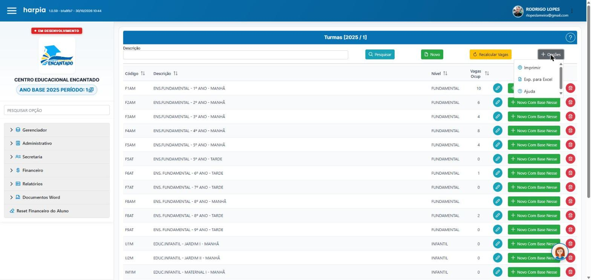
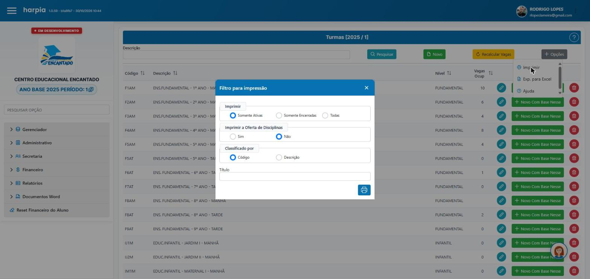
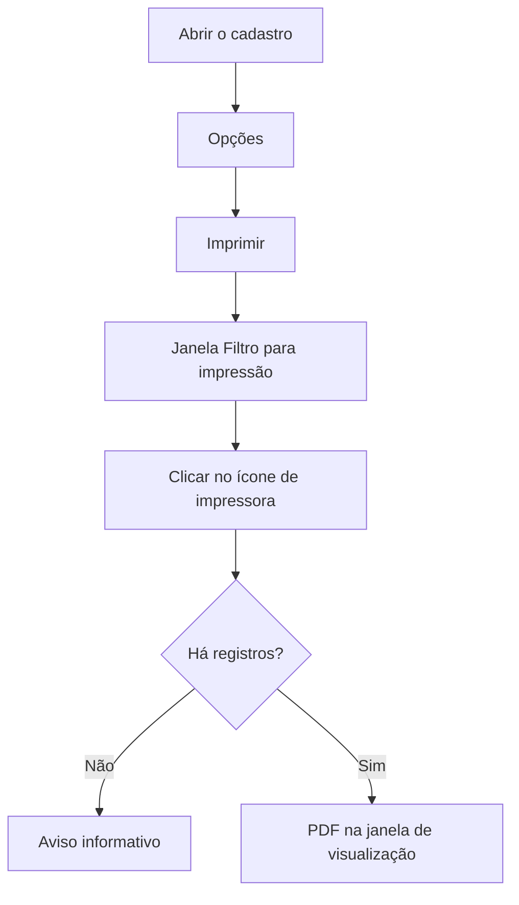

# Como imprimir relações nos cadastros

## Objetivo

Explicar o jeito padrão de **imprimir uma relação (lista em PDF)** a partir das telas de cadastro.
Cinco telas já funcionam da mesma forma, então basta aprender uma vez.

---

## Quem pode utilizar

Qualquer usuário com acesso à tela de cadastro desejada.

---

## Onde isso funciona

| Tela | Caminho | O que a relação mostra |
|------|---------|------------------------|
| [Turmas](../academico/turmas.md) | Acadêmico → Turmas | Turmas ativas, encerradas ou todas, com ou sem oferta de disciplinas |
| [Disciplinas](../academico/disciplinas.md) | Acadêmico → Disciplinas | Disciplinas por código ou descrição |
| [Plano de Pagamento](../tabelas-financeiras/plano-pagamento.md) | Tabelas Financeiras → Plano de Pagamento | Planos, com parcelas e contas opcionais |
| [Plano de Contas](../tabelas-financeiras/plano-contas.md) | Tabelas Financeiras → Plano de Contas | Contas cadastradas |
| [Alunos — Turmas Auxiliares](../cadastro/turmas-auxiliares.md) | Cadastro → Alunos — Turmas Auxiliares | Alunos por turma auxiliar |

---

## Como utilizar

1. Abra a tela de cadastro e, se quiser restringir a relação, preencha os filtros da própria tela (por exemplo, a **Descrição** ou a turma).
2. Clique em **Opções** e escolha **Imprimir**.
3. Na janela **Filtro para impressão**, escolha as opções específicas daquela tela (ex.: *Somente Ativas*, *Imprime Parcelas*, *Organizar por*).
4. Se desejar, digite um **Título** para aparecer no cabeçalho do relatório.
5. Clique no **ícone de impressora**. O sistema gera o PDF e mostra em uma janela de visualização, que pode ser maximizada.
6. Use os recursos do visualizador de PDF para imprimir ou salvar.

---

## Regras importantes

- Se não houver registros para o filtro escolhido, o sistema avisa com uma mensagem de informação (ex.: *"Nenhum registro encontrado para gerar o relatório."*) e não gera o PDF.
- Se a geração falhar, aparece *"Erro ao gerar relatório."*; tente novamente e, persistindo, acione o suporte.
- Em outras telas de cadastro o botão **Opções** do topo não existe mais; ali, editar e excluir são feitos pelos **ícones de lápis e lixeira** de cada linha.

---

## Fluxo da funcionalidade

---

## Exemplo prático

Para entregar à direção a lista de turmas em andamento: **Acadêmico → Turmas → Opções → Imprimir**, deixar **Somente Ativas**,
**Oferta de Disciplinas: Sim**, **Classificado por: Código**, título "Turmas 2026" e clicar na impressora.

---

## Dicas

- Preencha o filtro da tela antes de abrir o **Imprimir** para gerar uma relação menor.
- Use o **Título** para identificar o relatório quando for arquivá-lo.

---

## Prints

- [x] Menu Opções → Imprimir.
- [x] Janela "Filtro para impressão" (um exemplo por tela — ver cada página).
- [ ] Janela de visualização do PDF.

---

## Histórico

| Data | Alteração |
|------|-----------|
| 30/10/2026 | Página criada. |
