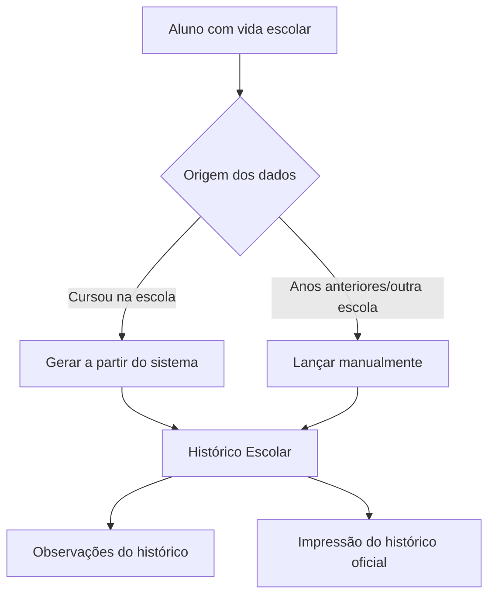

# Módulo Histórico

## Objetivo

O módulo **Histórico** cuida do **histórico escolar** do aluno — o registro oficial da sua vida
acadêmica ano a ano (disciplinas, cargas horárias, notas/médias, frequência e instituições) — e
das **observações** que acompanham esse histórico. É a base para emitir o documento oficial de
histórico escolar.

## Como acessar

As telas ficam no grupo **Histórico** (ou Secretaria) do menu lateral.

## Mapa do módulo

| Tela | Para que serve | Documentação |
|------|----------------|--------------|
| Histórico Escolar | Registrar/editar o histórico acadêmico do aluno | [Abrir](historico-escolar.md) |
| Histórico — Observações | Registrar observações que saem no histórico | [Abrir](historico-observacao.md) |

## Relação com outros módulos

O histórico pode ser **gerado a partir** dos dados já processados no sistema (notas, frequência,
níveis cursados) ou **lançado manualmente** para anos anteriores/escolas de origem. Os dados
oficiais do curso vêm do [Cadastro de Cursos](../academico/cursos.md) e dos
[Níveis/Sequência](../academico/nivel-sequencia.md).

## Fluxo geral

---

## Histórico

| Data | Alteração |
|------|-----------|
| 30/07/2026 | Página criada. |
