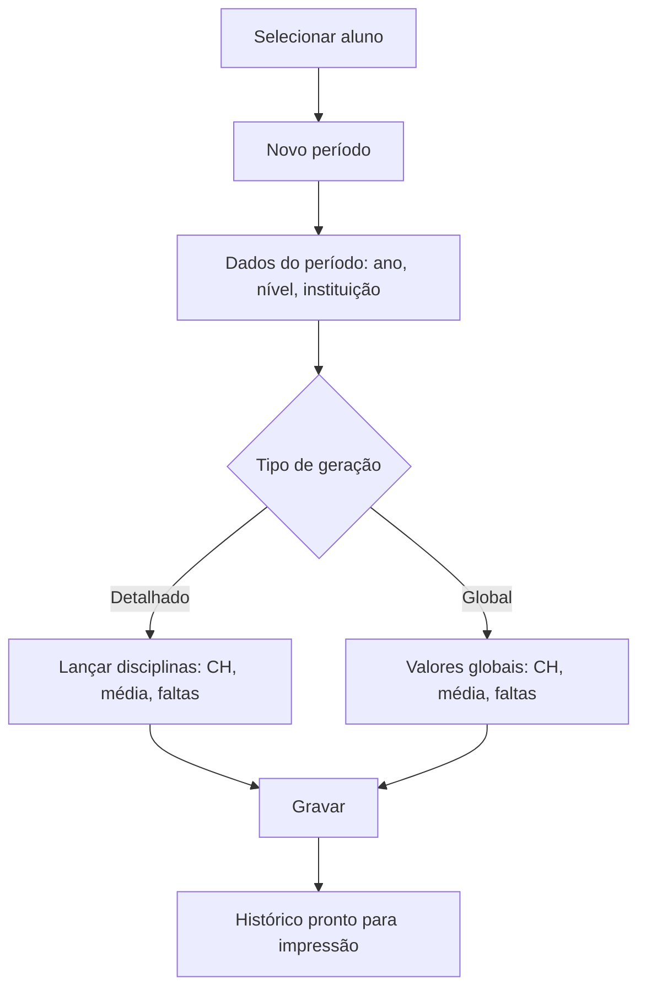

# Histórico Escolar

## Objetivo

Registrar e manter o **histórico escolar** do aluno: os anos/níveis cursados, com as
**disciplinas**, **cargas horárias**, **médias**, **faltas**, **frequência** e a **instituição**
de cada período. Serve para montar o documento oficial de histórico, inclusive com dados de anos
anteriores ou de outras escolas.

---

## Quem pode utilizar

Secretaria e Administrador.

---

## Como acessar

```
Histórico
→ Histórico Escolar
```

---

## Quando utilizar

- Para emitir o histórico oficial de um aluno.
- Para lançar anos cursados em **outra escola** ou anteriores ao uso do sistema.
- Para ajustar dados de um período específico.

---

## Como utilizar

1. Abra **Histórico Escolar**.
2. Pesquise e **Selecione o Aluno** (por **Nome do Aluno**).
3. A lista mostra os lançamentos por **Ano**, **Nível/Escolaridade**, **Sequência** e **Tipo de
   Lançamento**.
4. Clique em **Novo** para adicionar um período (ou **Opções** para editar).
5. Informe os dados do período: **Ano**, **Nível/Escolaridade**, **Série/Módulo/Período**,
   **Instituição**, **Local**, **Dias Letivos** e a **Frequência Anual**.
6. Escolha o **Tipo de Geração** (Detalhado ou Global) e informe as **Disciplinas** com
   **Carga Horária**, **Média** e **Faltas** (no modo Global, use os campos **Global**:
   Carga Horária Global, Média Global, Falta Global).
7. Ajuste a **Sequência/Ordem de Impressão** e clique em **Gravar**.

---

## Campos (principais)

| Campo | Descrição | Obrigatório | Observações |
|-------|-----------|-------------|-------------|
| Aluno | Aluno do histórico | Sim | |
| Ano | Ano letivo do período | Sim | |
| Nível/Escolaridade | Nível cursado | Sim | |
| Série / Módulo / Período | Referência do período | Não | |
| Instituição / Local | Escola e local | Não | Para períodos em outra escola |
| Dias Letivos | Dias letivos do período | Não | |
| Tipo de Geração | Detalhado ou Global | Sim | Define como as disciplinas são lançadas |
| Disciplina | Disciplina cursada | Condicional | Obrigatória no detalhado |
| Carga Horária | Carga horária da disciplina | Condicional | |
| Média | Média da disciplina | Condicional | |
| Faltas | Faltas na disciplina | Condicional | |
| Carga Horária / Média / Falta Global | Valores no modo Global | Condicional | |
| % Frequência / Frequência Anual | Frequência do período | Não | |
| NÃO imprimir o percentual de Frequência Anual | Oculta a frequência na impressão | Não | |
| Lei / Alínea / Isento | Amparos legais | Não | |
| Sequência / Ordem de Impressão | Ordem no documento | Não | |

---

## Botões

| Botão | O que faz |
|-------|-----------|
| **Novo** | Adiciona um período ao histórico |
| **Pesquisar** | Localiza o aluno |
| **Opções** | Editar/excluir um lançamento |
| **Gravar** | Salva o histórico |
| **Confirmar/Cancelar Exclusão** | Confirma ou cancela a exclusão |

---

## Filtros e colunas

Colunas: **Ano**, **Nível Escolaridade**, **Sequência**, **Tipo de Lançamento**, **Ordem de Impressão**.

---

## Resultados

- O histórico do aluno fica completo e pronto para impressão do documento oficial.

---

## Regras importantes

- No modo **Detalhado**, cada disciplina exige **Carga Horária**, **Média**, **Faltas** e **Tipo**.
- **Selecione uma disciplina** antes de gravar um lançamento detalhado.
- A **Ordem/Sequência de Impressão** define como o histórico aparece no documento.

---

## Mensagens do sistema

- *"Selecione uma Disciplina."*
- *"Preencha o campo Carga Horaria."* / *"Preencha o campo Media."* / *"Preencha o campo Faltas."* / *"Preencha o campo Tipo."*

---

## Fluxo da funcionalidade



---

## Exemplos práticos

**Exemplo:** lançar o ano de 2024 de um aluno transferido, informando a escola de origem, as
disciplinas cursadas com médias e faltas, e a frequência anual.

---

## Dicas

- Use o modo **Global** quando só houver a média/carga horária totais do período (sem detalhar por disciplina).
- Ajuste a **Ordem de Impressão** para os anos saírem na sequência correta.

---

## Erros comuns

- **"Selecione uma Disciplina." / "Preencha o campo..."** → complete os dados obrigatórios da disciplina antes de gravar.

---

## FAQ

**Posso lançar anos de outra escola?**
Sim — informe a **Instituição** e os dados do período manualmente.

**Como incluo observações no histórico?**
Use [Histórico — Observações](historico-observacao.md).

---

## Prints

- [ ] Lista de lançamentos do histórico.
- [ ] Formulário do período (detalhado e global).

---

## Histórico

| Data | Alteração |
|------|-----------|
| 30/07/2026 | Página criada. |
