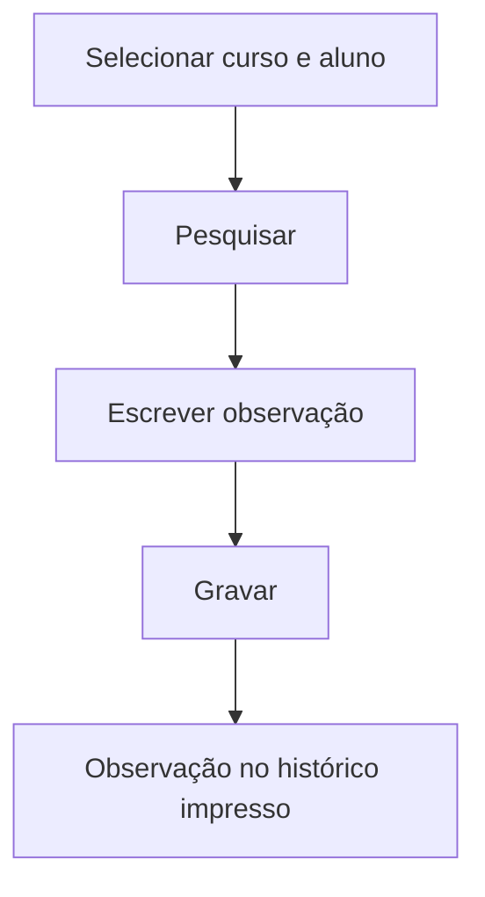

# Histórico — Observações

## Objetivo

Registrar **observações** que acompanham o histórico escolar do aluno — textos e anotações
oficiais que devem aparecer no documento (por exemplo, amparos legais, situações especiais,
notas de rodapé do histórico).

---

## Quem pode utilizar

Secretaria e Administrador.

---

## Como acessar

```
Histórico
→ Histórico — Observações
```

---

## Quando utilizar

- Para incluir anotações que devem constar no histórico impresso do aluno.

---

## Como utilizar

1. Abra **Histórico — Observações**.
2. **Selecione o Curso** e **Selecione o Aluno** (por **Nome do Aluno**).
3. Clique em **Pesquisar**.
4. Escreva o texto no campo **Observação**.
5. Clique em **Gravar**.

---

## Campos

| Campo | Descrição | Obrigatório |
|-------|-----------|-------------|
| Curso | Curso do aluno | Sim |
| Aluno / Nome | Aluno da observação | Sim |
| Observação | Texto da observação | Sim |

---

## Botões

| Botão | O que faz |
|-------|-----------|
| **Pesquisar** | Localiza o aluno |
| **Opções** | Editar a observação |
| **Gravar** | Salva a observação |
| **Cancelar** | Fecha sem salvar |

---

## Resultados

- A observação fica associada ao histórico do aluno e sai no documento impresso.

---

## Regras importantes

- **Curso** e **Aluno** precisam ser selecionados para localizar/registrar a observação.

---

## Mensagens do sistema

- *"Erro na pesquisa"*
- *"Erro ao salvar o registro"*

---

## Fluxo da funcionalidade



---

## Exemplos práticos

**Exemplo:** registrar no histórico a observação de que o aluno foi amparado por uma legislação
específica em determinado ano.

---

## Dicas

- Mantenha o texto objetivo e formal — ele compõe um documento oficial.

---

## FAQ

**Onde essa observação aparece?**
No **histórico escolar impresso** do aluno.

---

## Prints

- [ ] Seleção de curso/aluno.
- [ ] Campo de observação preenchido.

---

## Histórico

| Data | Alteração |
|------|-----------|
| 30/07/2026 | Página criada. |
