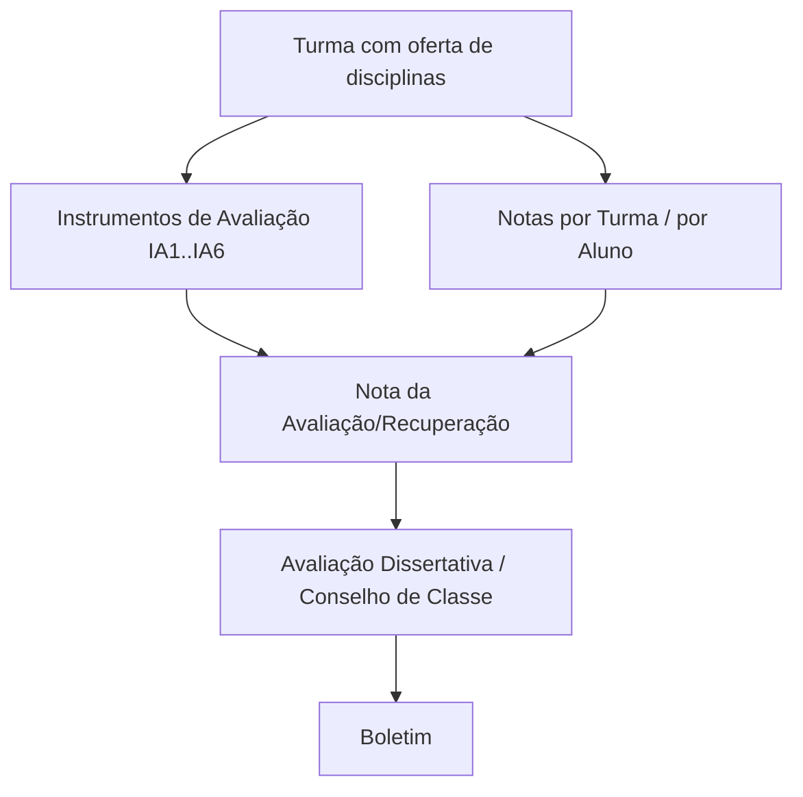

# Módulo Notas

## Objetivo

O módulo **Notas** cobre todo o registro do **desempenho dos alunos**: o lançamento de notas por
turma ou por aluno, os **instrumentos de avaliação** que compõem cada nota, a **avaliação
dissertativa** (parecer descritivo) e o **conselho de classe** com a situação final. É a base do
[Boletim](../academico/README.md).

## Como acessar

As telas ficam no grupo **Notas** do menu lateral.

## Como escolher a tela certa

| Situação | Tela |
|----------|------|
| Lançar as notas da turma inteira em uma avaliação | [Notas por Turma](notas-por-turma.md) |
| Lançar/ajustar as notas de um aluno específico | [Notas por Aluno](notas-por-aluno.md) |
| Compor a nota a partir de vários instrumentos (IA1…IA6) | [Instrumentos de Avaliação](instrumentos-avaliacao.md) |
| Registrar parecer descritivo por bimestre | [Avaliação Dissertativa](avaliacao-dissertativa.md) |
| Definir situação final e frequência (Ed. Infantil/Conselho) | [Conselho de Classe](conselho-classe.md) |

> A forma de avaliação depende da configuração da turma e das **Configurações de Avaliações**.
> A **nota máxima** padrão é **10,00**.

## Fluxo geral

---

## Histórico

| Data | Alteração |
|------|-----------|
| 30/07/2026 | Página criada. |
