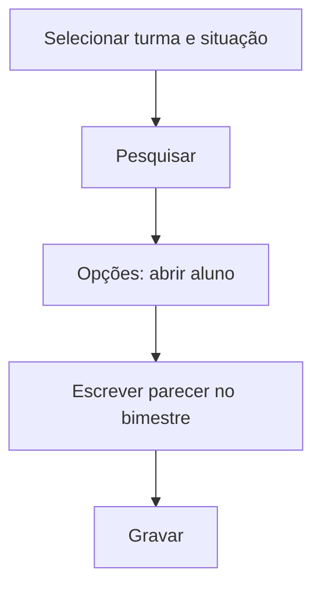

# Avaliação Dissertativa (Parecer Descritivo)

## Objetivo

Registrar a **avaliação dissertativa** — o parecer descritivo do aluno por **bimestre**. É usada
principalmente na Educação Infantil e em séries que avaliam por texto/parecer em vez de nota
numérica.

---

## Quem pode utilizar

Professores, Coordenação, Secretaria e Administrador.

---

## Como acessar

```
Notas
→ Avaliação Dissertativa
```

---

## Quando utilizar

- Para escrever o parecer descritivo de cada aluno por bimestre.

---

## Como utilizar

1. Abra **Avaliação Dissertativa**.
2. Selecione a **Turma** e a **Situação** (filtro).
3. Clique em **Pesquisar**.
4. Use **Opções** para abrir o aluno.
5. Escreva o parecer no bimestre correspondente (**Bimestral 1** a **Bimestral 5**).
6. Clique em **Gravar**.

---

## Campos e colunas

| Campo/Coluna | Descrição |
|--------------|-----------|
| Selecione a Turma | Turma |
| Selecione a Situação | Filtro por situação do aluno |
| Matrícula / Nome | Identificação do aluno |
| Bimestral 1 … Bimestral 5 | Texto do parecer por bimestre |

---

## Botões

| Botão | O que faz |
|-------|-----------|
| **Pesquisar** | Lista os alunos da turma |
| **Opções** | Abre o parecer do aluno |
| **Gravar** | Salva o parecer |
| **Cancelar** | Fecha sem salvar |

---

## Resultados

- O parecer descritivo fica registrado por bimestre e sai no boletim descritivo.

---

## Regras importantes

- **A seleção de um bimestre é obrigatória** para gravar o registro.
- **Turma** é obrigatória.

---

## Mensagens do sistema

- *"Seleção de Turma é obrigatória."*
- *"Seleção de um Bimestre é obrigatória para gravação do registro."*

---

## Fluxo da funcionalidade



---

## Exemplos práticos

**Exemplo:** turma de Educação Infantil, 2º Bimestre: escrever o parecer descritivo de cada criança.

---

## Dicas

- Confira o **bimestre** antes de escrever, para não gravar o parecer na etapa errada.

---

## Erros comuns

- **"Seleção de um Bimestre é obrigatória..."** → escolha o bimestre antes de gravar.

---

## FAQ

**Isso substitui a nota numérica?**
Depende da série. Turmas com parecer descritivo usam esta tela em vez das notas numéricas.

---

## Prints

- [ ] Lista de alunos.
- [ ] Editor do parecer por bimestre.

---

## Histórico

| Data | Alteração |
|------|-----------|
| 30/07/2026 | Página criada. |
