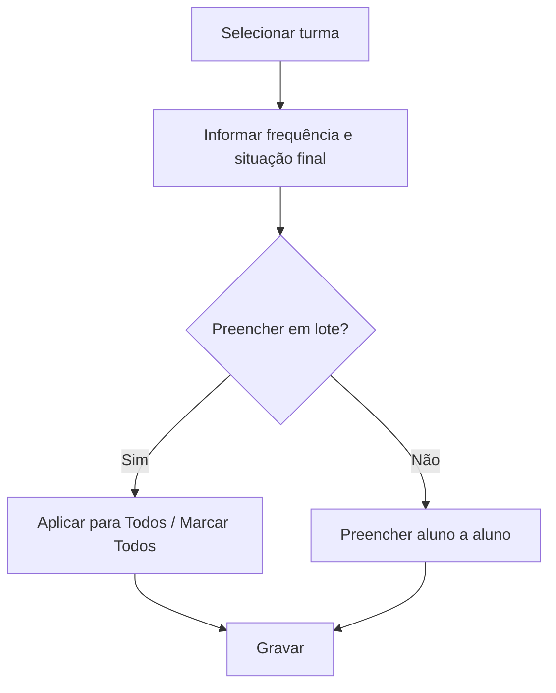

# Conselho de Classe

## Objetivo

Registrar, no fechamento do período, a **situação final** e a **frequência (%)** de cada aluno
da turma — a decisão do conselho de classe. Permite aplicar valores em lote para agilizar o
fechamento (especialmente em Educação Infantil).

---

## Quem pode utilizar

Coordenação, Secretaria e Administrador.

---

## Como acessar

```
Notas
→ Conselho de Classe
```

---

## Quando utilizar

- No encerramento do período letivo, para consolidar a situação final dos alunos.

---

## Como utilizar

1. Abra **Conselho de Classe**.
2. Selecione a **Turma**.
3. A lista de alunos aparece com **Frequência (%)** e **Situação Final**.
4. Informe a frequência e a situação final de cada aluno, ou use **Aplicar para Todos** /
   **Marcar Todos** para preencher em lote.
5. Se precisar recomeçar, use **Limpar Lançamentos**.
6. Clique em **Gravar**.

---

## Campos e colunas

| Campo/Coluna | Descrição |
|--------------|-----------|
| Selecione a Turma | Turma |
| Nº Ordem / Matrícula / Nome | Identificação do aluno |
| Frequência (%) | Percentual de frequência do aluno |
| Situação Final | Resultado final (aprovado/reprovado/etc.) |

---

## Botões

| Botão | O que faz |
|-------|-----------|
| **Aplicar para Todos** | Aplica o mesmo valor a todos os alunos |
| **Marcar Todos** | Marca todos os alunos |
| **Limpar Lançamentos** | Limpa os valores informados |
| **Gravar** | Salva a situação final e a frequência |

---

## Resultados

- A situação final e a frequência ficam registradas, alimentando o boletim e o resultado do período.

---

## Regras importantes

- **Frequência** e **Situação Final** são obrigatórias **para todos os alunos** antes de gravar.
- **Turma** é obrigatória.

---

## Mensagens do sistema

- *"Campo FREQUÊNCIA é obrigatório para todos os alunos!"*
- *"Campo SITUAÇÃO FINAL é obrigatório para todos os alunos!"*

---

## Fluxo da funcionalidade



---

## Exemplos práticos

**Exemplo:** turma de Educação Infantil ao fim do ano — aplicar "Aprovado" e 100% de frequência
para todos e ajustar exceções, depois gravar.

---

## Dicas

- Use **Aplicar para Todos** e depois ajuste apenas as exceções — mais rápido que preencher um a um.

---

## Erros comuns

- **"Campo FREQUÊNCIA / SITUAÇÃO FINAL é obrigatório para todos..."** → preencha todos os alunos antes de gravar.

---

## FAQ

**Serve para todas as séries?**
O fluxo é típico de Educação Infantil/conselho; outras séries podem consolidar pelo processamento do boletim.

---

## Prints

- [ ] Lista da turma com Frequência e Situação Final.
- [ ] Uso do "Aplicar para Todos".

---

## Histórico

| Data | Alteração |
|------|-----------|
| 30/07/2026 | Página criada. |
