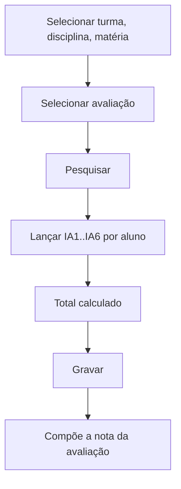

# Instrumentos de Avaliação

## Objetivo

Registrar as notas de vários **instrumentos avaliativos** (IA1 a IA6) que, somados/combinados,
compõem a nota de uma **avaliação** em uma disciplina. Permite trabalhar com provas, trabalhos,
participação etc. de forma separada antes de consolidar a nota da etapa.

---

## Como acessar

```
Notas
→ Instrumentos de Avaliação
```

---

## Quando utilizar

- Quando a nota de uma etapa é composta por mais de um instrumento (prova + trabalho, etc.).

---

## Como utilizar

1. Abra **Instrumentos de Avaliação**.
2. Selecione a **Turma**, a **Disciplina** e a **Matéria** (se houver).
3. Selecione a **Avaliação** (etapa).
4. Clique em **Pesquisar**.
5. Para cada aluno, informe as notas dos instrumentos **IA1, IA2, ... IA6** e marque
   **Fez Avaliação** quando aplicável. O **Total** é calculado.
6. Clique em **Gravar**.

---

## Campos e colunas

| Campo/Coluna | Descrição |
|--------------|-----------|
| Selecione a Turma | Turma |
| Selecione a Disciplina | Disciplina |
| Selecione a Matéria | Matéria (quando aplicável) |
| Selecione a Avaliação | Etapa avaliativa |
| Ordem / Matrícula / Nome | Identificação do aluno |
| IA1 … IA6 | Notas dos instrumentos de avaliação |
| Total | Soma/composição dos instrumentos |
| Fez Avaliação | Indica se o aluno realizou a avaliação |

---

## Botões

| Botão | O que faz |
|-------|-----------|
| **Pesquisar** | Lista os alunos |
| **Gravar** | Salva as notas dos instrumentos |

---

## Resultados

- As notas dos instrumentos são registradas e compõem a **nota da avaliação** da etapa.

---

## Regras importantes

- **Turma**, **Disciplina** e **Avaliação** são obrigatórias; matéria é obrigatória se houver.
- A forma como IA1..IA6 compõem o total depende das **Configurações de Avaliações/Fórmulas**.
- Nota máxima por instrumento conforme a configuração (padrão até 10,00).

---

## Mensagens do sistema

- *"Selecione Turma!"* / *"Selecione Disciplina!"* / *"Selecione Materia!"* / *"Selecione Avaliação!"*
- *"Erro ao salvar o registro"*

---

## Fluxo da funcionalidade



---

## Exemplos práticos

**Exemplo:** na disciplina "Matemática", 1º Bimestre: IA1 = prova (7,0), IA2 = trabalho (8,0),
IA3 = participação (9,0); o total compõe a nota da etapa.

---

## Dicas

- Defina antes, nas configurações, **como** os instrumentos formam a nota (média, soma, pesos).

---

## FAQ

**Preciso usar todos os IA1..IA6?**
Não. Use apenas os instrumentos que a disciplina realmente utiliza.

---

## Prints

- [ ] Seleção de turma/disciplina/avaliação.
- [ ] Grade com IA1..IA6 e Total.

---

## Histórico

| Data | Alteração |
|------|-----------|
| 30/07/2026 | Página criada. |
